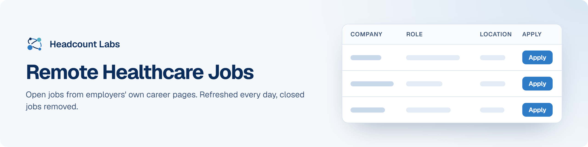

# Remote Healthcare Jobs

Remote nursing, clinical, medical coding and healthcare jobs at US employers.

**239 open jobs** · 194 new since the last update · 355 removed because they closed or left the employer's board · updated November 7, 2026 at 4:42 AM EST

This list is built and refreshed every day by [Headcount Labs](https://headcountlabs.com/?utm_source=github&utm_medium=job-list&utm_campaign=remote-healthcare-jobs), which reads jobs straight from employers' own career pages and job boards. Every job here was still listed on its source board when we last read that board, within the past 3 days, and was posted in the past 30 days. Copies of the same job are merged into one row, and jobs that close are removed at the next update.

Want this data in your own app or agent? Use the [Headcount Labs jobs API](https://headcountlabs.com/docs/?utm_source=github&utm_medium=job-list&utm_campaign=remote-healthcare-jobs) (free tier), the [MCP server](https://headcountlabs.com/mcp/?utm_source=github&utm_medium=job-list&utm_campaign=remote-healthcare-jobs) for Claude, ChatGPT and other AI assistants, or the [public dataset subsets](https://huggingface.co/HeadcountLabs) on Hugging Face (the full dataset is coming soon).

**Full dataset.** A bigger, one-off snapshot dated 2026-10-19 (all matching jobs, not only the open jobs below) is on Hugging Face: [Remote jobs](https://huggingface.co/datasets/HeadcountLabs/remote-jobs) · [Healthcare jobs](https://huggingface.co/datasets/HeadcountLabs/healthcare-jobs). It loads with `datasets.load_dataset` and is under the Open Database License (ODbL) 1.0.

**Jump to:** [Posted in the last 7 days (167)](#posted-in-the-last-7-days) · [Posted 8 to 30 days ago (72)](#posted-8-to-30-days-ago)

**Columns.** *Apply* opens the original posting on the employer's site. *Details* opens the job on Headcount Labs, with every posting we found for it. *Remote* shows what the employer states; a dash means the posting doesn't say. *Pay* is the range the employer published.

## Posted in the last 7 days

| Company | Role | Location | Remote | Pay | Posted | Apply | Details |
| --- | --- | --- | --- | --- | --- | :---: | :---: |
| **Sonova Group** | Senior Clinical Research Associate &#124; REMOTE | 

2 locations
United States city
 | Remote | $91k–$114k/yr | Nov 7 |  | <a href="https://headcountlabs.com/catalog/jobs/64a441bc-c1ad-418b-a7b7-1e3e4000819e?utm_source=github&utm_medium=job-list&utm_campaign=remote-healthcare-jobs">via Headcount Labs</a> |
| **Sonova Group** | Clinical Specialist Western Canada | 

2 locations
United States city
 | Remote | — | Nov 7 |  | <a href="https://headcountlabs.com/catalog/jobs/c1e0dbec-3a1d-4834-beeb-51d1a42264e4?utm_source=github&utm_medium=job-list&utm_campaign=remote-healthcare-jobs">via Headcount Labs</a> |
| **Sonova Group** | Director Commercial Execution USA - Digital Health (Silent Cloud) | 

2 locations
United States city
 | Remote | $163k–$203k/yr | Nov 7 |  | <a href="https://headcountlabs.com/catalog/jobs/9339c7a7-f0b5-4774-a4e0-3ef68222ad5b?utm_source=github&utm_medium=job-list&utm_campaign=remote-healthcare-jobs">via Headcount Labs</a> |
| **Worldwide Clinical Trials Holdings, Inc.** | Senior Clinical Research Associate - CNS | Research Triangle Park, NC | Remote | — | Nov 6 |  | <a href="https://headcountlabs.com/catalog/jobs/2f1c3b47-51e7-46a0-aed3-54d2b61f960e?utm_source=github&utm_medium=job-list&utm_campaign=remote-healthcare-jobs">via Headcount Labs</a> |
| **Worldwide Clinical Trials Holdings, Inc.** | Senior Clinical Research Associate - Oncology (Southeast/MidAtlantic) | United States | Remote | — | Nov 6 |  | <a href="https://headcountlabs.com/catalog/jobs/f16e83b6-7d2c-456f-8f4c-043508ba3a1b?utm_source=github&utm_medium=job-list&utm_campaign=remote-healthcare-jobs">via Headcount Labs</a> |
| **Worldwide Clinical Trials Holdings, Inc.** | Senior Clinical Trial Manager - Internal Medicine (U.S.) | Durham, NC | Remote | — | Nov 6 |  | <a href="https://headcountlabs.com/catalog/jobs/1284cd50-ff3d-4c7d-8d99-8c2960892acd?utm_source=github&utm_medium=job-list&utm_campaign=remote-healthcare-jobs">via Headcount Labs</a> |
| **Sutter Health** | Project Manager IV, Virtual Health | 

2 locations
Sacramento Emeryville
 | Remote | $117k–$176k/yr | Nov 6 |  | <a href="https://headcountlabs.com/catalog/jobs/484486fa-837d-46f3-9b16-b995f54dc2e0?utm_source=github&utm_medium=job-list&utm_campaign=remote-healthcare-jobs">via Headcount Labs</a> |
| **Sutter Bay Medical Foundation** | Ambulatory Clinical Pharmacist IV | San Francisco | Remote | $91.61–$128.25/hr | Nov 6 |  | <a href="https://headcountlabs.com/catalog/jobs/afe115fa-4dc9-439d-8a00-30ad7c2cb2b1?utm_source=github&utm_medium=job-list&utm_campaign=remote-healthcare-jobs">via Headcount Labs</a> |
| **Palmetto GBA** | RN Medical Reviewer II - Palmetto GBA-13 | United States | Remote | — | Nov 6 |  | <a href="https://headcountlabs.com/catalog/jobs/53ae37fd-3eec-4384-a686-a99f607f1bc0?utm_source=github&utm_medium=job-list&utm_campaign=remote-healthcare-jobs">via Headcount Labs</a> |
| **Lifted, an Upwork Company™** | Clinical Pharmacist | Atlanta, GA | Remote | — | Nov 6 |  | <a href="https://headcountlabs.com/catalog/jobs/60c09f44-4296-4613-a59b-e66c9a21ea63?utm_source=github&utm_medium=job-list&utm_campaign=remote-healthcare-jobs">via Headcount Labs</a> |
| **LE12 MVP Service Corp.** | Temporary HEDIS Abstractor Nurse | New York | Remote | — | Nov 6 |  | <a href="https://headcountlabs.com/catalog/jobs/12a3e10e-c76d-4482-a559-10e93bcdabe2?utm_source=github&utm_medium=job-list&utm_campaign=remote-healthcare-jobs">via Headcount Labs</a> |
| **Intuitive** | Clinical Sales Representative | Chicago, IL | Remote | — | Nov 6 |  | <a href="https://headcountlabs.com/catalog/jobs/5466e39a-8f9b-4445-ad68-6fd3e58728e7?utm_source=github&utm_medium=job-list&utm_campaign=remote-healthcare-jobs">via Headcount Labs</a> |
| **Intuitive** | Clinical Sales Manager - Ion Endoluminal | 

2 locations
Syracuse, NY Albany, NY
 | Remote | — | Nov 6 |  | <a href="https://headcountlabs.com/catalog/jobs/e0f03028-b6a4-4e71-9477-3868f716ceef?utm_source=github&utm_medium=job-list&utm_campaign=remote-healthcare-jobs">via Headcount Labs</a> |
| **ICR United States USA** | Clinical Research Associate | 

2 locations
Blue Bell United States
 | Remote | — | Nov 6 |  | <a href="https://headcountlabs.com/catalog/jobs/6b167f71-d831-4c61-bf80-8a86650768e4?utm_source=github&utm_medium=job-list&utm_campaign=remote-healthcare-jobs">via Headcount Labs</a> |
| **Humana** | Utilization Management Registered Nurse - Home Health | Kentucky | Remote | $71k–$98k/yr | Nov 6 |  | <a href="https://headcountlabs.com/catalog/jobs/6d1429d3-5ab1-4140-a9f0-a3c2f96f9021?utm_source=github&utm_medium=job-list&utm_campaign=remote-healthcare-jobs">via Headcount Labs</a> |
| **Humana** | Community Health Worker (CHW) | 

2 locations
Michigan United States
 | Remote | $42k–$57k/yr | Nov 6 |  | <a href="https://headcountlabs.com/catalog/jobs/932c7e13-a567-4f30-a38b-7292d9bb6700?utm_source=github&utm_medium=job-list&utm_campaign=remote-healthcare-jobs">via Headcount Labs</a> |
| **Humana** | Medical Director - OneHome | United States | Remote | $224k–$313k/yr | Nov 6 |  | <a href="https://headcountlabs.com/catalog/jobs/4fd0a949-60e0-411c-9603-8f275e3cddc1?utm_source=github&utm_medium=job-list&utm_campaign=remote-healthcare-jobs">via Headcount Labs</a> |
| **Health Care Service Corp.** | Clinical Account Consultant - Work from Home | 

2 locations
Houston Richardson, TX
 | Remote | $84k–$152k/yr | Nov 6 |  | <a href="https://headcountlabs.com/catalog/jobs/6e04a0c9-3695-4b41-8936-1373a144aa53?utm_source=github&utm_medium=job-list&utm_campaign=remote-healthcare-jobs">via Headcount Labs</a> |
| **Eli Lilly and Company** | Senior Director, Counsel, Diagnostics &amp; Medical Devices (USA Remote Role) | 

2 locations
United States Indianapolis IN
 | Remote | $166k–$244k/yr | Nov 6 |  | <a href="https://headcountlabs.com/catalog/jobs/61b1ca8f-5009-4177-b3fe-aa6573c29ef3?utm_source=github&utm_medium=job-list&utm_campaign=remote-healthcare-jobs">via Headcount Labs</a> |
| **Dexcom** | Sr Clinical Research Associate | Colorado | Remote | $101k–$168k/yr | Nov 6 |  | <a href="https://headcountlabs.com/catalog/jobs/b7b3badd-8805-4a44-8d94-c274d5135ed2?utm_source=github&utm_medium=job-list&utm_campaign=remote-healthcare-jobs">via Headcount Labs</a> |
| **Dexcom** | Sr. Federal Clinical Educator - East | United States | Remote | $91k–$152k/yr | Nov 6 |  | <a href="https://headcountlabs.com/catalog/jobs/28346a45-c585-4577-8823-b5357b6bb2b4?utm_source=github&utm_medium=job-list&utm_campaign=remote-healthcare-jobs">via Headcount Labs</a> |
| **CareSource Management Services LLC** | Clinical Care Reviewer II- Post Acute - RN with Compact License | United States | Remote | $63k–$100k/yr | Nov 6 |  | <a href="https://headcountlabs.com/catalog/jobs/8c883a81-59b1-474a-8dbc-9e8ebf0d43c6?utm_source=github&utm_medium=job-list&utm_campaign=remote-healthcare-jobs">via Headcount Labs</a> |
| **Banner Health** | Profee Medical Coder Complex Surgical Pediatric | Arizona | Remote | $26.05–$39.07/hr | Nov 6 |  | <a href="https://headcountlabs.com/catalog/jobs/2894cf1b-dbab-4b83-afa8-08535c3ffdc1?utm_source=github&utm_medium=job-list&utm_campaign=remote-healthcare-jobs">via Headcount Labs</a> |
| **AHS Allina Health System** | Regional Coverage Provider - Family Nurse Practitioner or Physician Assistant | Champlin, MN | Remote | $143k–$163k/yr | Nov 6 |  | <a href="https://headcountlabs.com/catalog/jobs/9accf25c-1f75-4345-aa7a-e39cffb230cd?utm_source=github&utm_medium=job-list&utm_campaign=remote-healthcare-jobs">via Headcount Labs</a> |
| **AHS Allina Health System** | Medical Weight Management NP - Remote (Must live in MN) | Allina Commons | Remote | $138k–$162k/yr | Nov 6 |  | <a href="https://headcountlabs.com/catalog/jobs/bb1fd5e5-e9f0-4d96-97ef-c10aced051bf?utm_source=github&utm_medium=job-list&utm_campaign=remote-healthcare-jobs">via Headcount Labs</a> |
| **004 Humana Insurance Company** | Utilization Management Behavioral Health Professional | United States | Remote | $65k–$89k/yr | Nov 6 |  | <a href="https://headcountlabs.com/catalog/jobs/c0e49e88-8e0b-434b-a75e-f6e1693bf7e3?utm_source=github&utm_medium=job-list&utm_campaign=remote-healthcare-jobs">via Headcount Labs</a> |
| **004 Humana Insurance Company** | Utilization Management Administration Coordinator -- Home Health | United States | Remote | $40k–$52k/yr | Nov 6 |  | <a href="https://headcountlabs.com/catalog/jobs/18d4ad1f-d8a2-4900-a12f-fd08e581690d?utm_source=github&utm_medium=job-list&utm_campaign=remote-healthcare-jobs">via Headcount Labs</a> |
| **Worldwide Clinical Trials Holdings, Inc.** | Senior Clinical Research Associate | Lansing, MI | Remote | — | Nov 5 |  | <a href="https://headcountlabs.com/catalog/jobs/4940da0d-bc08-438a-af73-124ebfebdd50?utm_source=github&utm_medium=job-list&utm_campaign=remote-healthcare-jobs">via Headcount Labs</a> |
| **WNS Global Services** | Nurse, Concurrent Review | Houston, TX | Remote | $75k/yr | Nov 5 |  | <a href="https://headcountlabs.com/catalog/jobs/f4479b84-d059-4465-b6f4-5212f0278cb9?utm_source=github&utm_medium=job-list&utm_campaign=remote-healthcare-jobs">via Headcount Labs</a> |
| **WellSky Corporation** | Clinical Quality Program Manager | United States | Remote | — | Nov 5 |  | <a href="https://headcountlabs.com/catalog/jobs/e9ec4bf6-c945-4e44-99f0-343b305838ef?utm_source=github&utm_medium=job-list&utm_campaign=remote-healthcare-jobs">via Headcount Labs</a> |
| **WellSky Administrative Services Corporation** | Authorization Management Clinical Reviewer - Appeals and Denials | United States | Remote | — | Nov 5 |  | <a href="https://headcountlabs.com/catalog/jobs/95967a1a-6522-4c9d-80ef-5d9937a879d6?utm_source=github&utm_medium=job-list&utm_campaign=remote-healthcare-jobs">via Headcount Labs</a> |
| **Vynca** | Behavioral Health Case Manager | United States | Remote | $30–$35/hr | Nov 5 |  | <a href="https://headcountlabs.com/catalog/jobs/ebb82504-abcc-4110-a714-bc4bda11d8f7?utm_source=github&utm_medium=job-list&utm_campaign=remote-healthcare-jobs">via Headcount Labs</a> |
| **US012 Marsh Agency LLC** | National Compliance Consultant - Employee Health &amp; Benefits | United States | Remote | $90k–$167k/yr | Nov 5 |  | <a href="https://headcountlabs.com/catalog/jobs/d6eec36a-b88c-4381-b22e-75253f145c74?utm_source=github&utm_medium=job-list&utm_campaign=remote-healthcare-jobs">via Headcount Labs</a> |
| **UNAVAILABLE** | Denials Coder | OMAHA, NE | Remote | $19.87–$28.06/hr | Nov 5 |  | <a href="https://headcountlabs.com/catalog/jobs/25fce390-782a-4832-9eca-6bb15aab4271?utm_source=github&utm_medium=job-list&utm_campaign=remote-healthcare-jobs">via Headcount Labs</a> |
| **SynergenX Health Holdings LLC** | Telehealth Family Nurse Practitioner | Indianapolis, IN | Remote | $120k/yr | Nov 5 |  | <a href="https://headcountlabs.com/catalog/jobs/e85b4401-0472-4121-a87a-26bd946f2401?utm_source=github&utm_medium=job-list&utm_campaign=remote-healthcare-jobs">via Headcount Labs</a> |
| **Syneos Health, LLC** | Clinical Data Reviewer | Washington | Remote | $81k–$145k/yr | Nov 5 |  | <a href="https://headcountlabs.com/catalog/jobs/c313a9f4-a7aa-4702-a138-5550e10d9756?utm_source=github&utm_medium=job-list&utm_campaign=remote-healthcare-jobs">via Headcount Labs</a> |
| **Sutter Health** | Advice Nurse, Mental Health Work From Home | 

4 locations
Salt Lake City, UT Phoenix, AZ Boise, ID Missoula, MT
 | Remote | $38.87–$54.42/hr | Nov 5 |  | <a href="https://headcountlabs.com/catalog/jobs/087a3341-c584-4498-a106-1add8937559b?utm_source=github&utm_medium=job-list&utm_campaign=remote-healthcare-jobs">via Headcount Labs</a> |
| **Senior Lifestyle** | Licensed Practical Nurse (LPN) - Assisted Living-PM SHIFTS &amp; Overnight- Full &amp; Part Time | Chicago Heights, IL | Remote | $36/hr | Nov 5 |  | <a href="https://headcountlabs.com/catalog/jobs/af89b750-ecc7-4ad9-869f-f26de1df8db5?utm_source=github&utm_medium=job-list&utm_campaign=remote-healthcare-jobs">via Headcount Labs</a> |
| **Regeneron Pharmaceuticals, Inc (USA)** | Associate Director, Clinical Imaging (Oncology) | 

3 locations
TARRYTOWN Boston Warren
 | Remote | $176k–$287k/yr | Nov 5 |  | <a href="https://headcountlabs.com/catalog/jobs/f155b9b5-3aaf-4277-9fe3-acf0a7b1e71c?utm_source=github&utm_medium=job-list&utm_campaign=remote-healthcare-jobs">via Headcount Labs</a> |
| **Princeton10** | Freelance Medical Editor (West Coast) | Seattle, WA | Remote | $60–$70/hr | Nov 5 |  | <a href="https://headcountlabs.com/catalog/jobs/bdc7c621-3451-4182-9599-d4244f84536a?utm_source=github&utm_medium=job-list&utm_campaign=remote-healthcare-jobs">via Headcount Labs</a> |
| **Pinch Med Spa** | Aesthetic Nurse Practitioner | Washington | Remote | — | Nov 5 |  | <a href="https://headcountlabs.com/catalog/jobs/3b91ddae-ec8c-4940-a1b8-95f1b0a107bd?utm_source=github&utm_medium=job-list&utm_campaign=remote-healthcare-jobs">via Headcount Labs</a> |
| **Orthopaedic Management Services** | Medical Coder Clinic | Omaha, NE | Remote | — | Nov 5 |  | <a href="https://headcountlabs.com/catalog/jobs/8b2b6884-69e2-48c3-8654-f91a47a2f316?utm_source=github&utm_medium=job-list&utm_campaign=remote-healthcare-jobs">via Headcount Labs</a> |
| **Navitus Health Solutions, LLC** | Pharmacist I, Clinical Prior Authorization | United States | Remote | $101k–$127k/yr | Nov 5 |  | <a href="https://headcountlabs.com/catalog/jobs/86f99548-929c-4e66-8a81-42768b7344d1?utm_source=github&utm_medium=job-list&utm_campaign=remote-healthcare-jobs">via Headcount Labs</a> |
| **MDU Medtronic USA Inc** | Clinical Specialist, Peripheral Nerve Stimulation (PNS) - Milwaukee, WI | Milwaukee, WI | Remote | — | Nov 5 |  | <a href="https://headcountlabs.com/catalog/jobs/bedea7ac-e5c2-4afd-a892-a218c0a70d5a?utm_source=github&utm_medium=job-list&utm_campaign=remote-healthcare-jobs">via Headcount Labs</a> |
| **MDU Medtronic USA Inc** | Principal Aortic Clinical Specialist - Syracuse, NY | 

2 locations
Syracuse, NY State of Pennsylvania
 | Remote | $100k–$105k/yr | Nov 5 |  | <a href="https://headcountlabs.com/catalog/jobs/bcadd2d8-a36b-4e07-b126-731a840ed0e6?utm_source=github&utm_medium=job-list&utm_campaign=remote-healthcare-jobs">via Headcount Labs</a> |
| **MDU Medtronic USA Inc** | Clinical Specialist, Peripheral Nerve Stimulation (PNS) - Northern Manhattan, NY | Manhattan, NY | Remote | — | Nov 5 |  | <a href="https://headcountlabs.com/catalog/jobs/bb51b4f4-98e1-434d-a727-4cd21ca18cf0?utm_source=github&utm_medium=job-list&utm_campaign=remote-healthcare-jobs">via Headcount Labs</a> |
| **MDU Medtronic USA Inc** | Clinical Specialist, Peripheral Nerve Stimulation (PNS) - San Diego, CA | San Diego, CA | Remote | — | Nov 5 |  | <a href="https://headcountlabs.com/catalog/jobs/78997215-ce6f-4c20-bea2-688b2a20f909?utm_source=github&utm_medium=job-list&utm_campaign=remote-healthcare-jobs">via Headcount Labs</a> |
| **MDU Medtronic USA Inc** | Clinical Specialist, Peripheral Nerve Stimulation (PNS) - Springfield, MO | Springfield, MO | Remote | — | Nov 5 |  | <a href="https://headcountlabs.com/catalog/jobs/6ccb4ae4-8495-4eb6-ab41-73d1f5f46175?utm_source=github&utm_medium=job-list&utm_campaign=remote-healthcare-jobs">via Headcount Labs</a> |
| **MDU Medtronic USA Inc** | Clinical Specialist, Pain Interventions - Dallas, TX | Dallas, TX | Remote | $76k–$114k/yr | Nov 5 |  | <a href="https://headcountlabs.com/catalog/jobs/bcdb6fd4-f3ef-43a5-b610-8d6c83909ce8?utm_source=github&utm_medium=job-list&utm_campaign=remote-healthcare-jobs">via Headcount Labs</a> |
| **MDU Medtronic USA Inc** | Cardiac Rhythm Management Clinical Specialist - Bridgeport/Poughkeepsie | 

2 locations
Bridgeport, CT Poughkeepsie, NY
 | Remote | $72k–$90k/yr | Nov 5 |  | <a href="https://headcountlabs.com/catalog/jobs/9dd00947-145e-4136-bece-b3501762f973?utm_source=github&utm_medium=job-list&utm_campaign=remote-healthcare-jobs">via Headcount Labs</a> |
| **MDU Medtronic USA Inc** | Clinical Specialist CRM - Corpus Christi / McAllen | 

2 locations
McAllen, TX Corpus Christi, TX
 | Remote | $72k–$90k/yr | Nov 5 |  | <a href="https://headcountlabs.com/catalog/jobs/c025a1bc-0189-48f8-9ecf-dea692a6594f?utm_source=github&utm_medium=job-list&utm_campaign=remote-healthcare-jobs">via Headcount Labs</a> |
| **Linical** | Clinical Research Associate II - North-East Coast or Central USA | Stuart | Remote | $95k–$120k/yr | Nov 5 |  | <a href="https://headcountlabs.com/catalog/jobs/a7f319f8-3c31-45ee-8e02-6b360370ebda?utm_source=github&utm_medium=job-list&utm_campaign=remote-healthcare-jobs">via Headcount Labs</a> |
| **LifeStance Health** | Licensed Independent Clinical Social Worker (LICSW) | Riverside, RI | Remote | $72k–$115k/yr | Nov 5 |  | <a href="https://headcountlabs.com/catalog/jobs/46f31258-1c45-4a33-be8b-6b741e674291?utm_source=github&utm_medium=job-list&utm_campaign=remote-healthcare-jobs">via Headcount Labs</a> |
| **LifeStance Health** | Licensed Marriage and Family Therapist (LMFT) | 

2 locations
Cranston, RI Riverside, RI
 | Remote | $72k–$115k/yr | Nov 5 |  | <a href="https://headcountlabs.com/catalog/jobs/36ab57b9-f9c6-415f-9bf2-6e8522398aea?utm_source=github&utm_medium=job-list&utm_campaign=remote-healthcare-jobs">via Headcount Labs</a> |
| **LifeStance Health** | Licensed Mental Health Counselor (LMHC) | Riverside, RI | Remote | $72k–$115k/yr | Nov 5 |  | <a href="https://headcountlabs.com/catalog/jobs/9f22601a-2747-4f8b-9fa5-1c39d4c85eac?utm_source=github&utm_medium=job-list&utm_campaign=remote-healthcare-jobs">via Headcount Labs</a> |
| **Jobgether** | Lead Behavioral Health Integration Clinician (BHIC) &amp; Supervisor | United States | Remote | — | Nov 5 |  | <a href="https://headcountlabs.com/catalog/jobs/c838eb4d-1bed-455e-b1d1-f2022a0c0aa6?utm_source=github&utm_medium=job-list&utm_campaign=remote-healthcare-jobs">via Headcount Labs</a> |
| **Jobgether** | VP of Business Development, Health Plans | United States | Remote | $150k–$170k/yr | Nov 5 |  | <a href="https://headcountlabs.com/catalog/jobs/bebf903a-423d-4706-a4ca-856e38de41c9?utm_source=github&utm_medium=job-list&utm_campaign=remote-healthcare-jobs">via Headcount Labs</a> |
| **Jobgether** | Clinical Trials Associate | United States | Remote | — | Nov 5 |  | <a href="https://headcountlabs.com/catalog/jobs/412135c8-346d-4eaa-b2c8-93fda5c571b2?utm_source=github&utm_medium=job-list&utm_campaign=remote-healthcare-jobs">via Headcount Labs</a> |
| **Jobgether** | Manager Clinical Affairs | United States | Remote | — | Nov 5 |  | <a href="https://headcountlabs.com/catalog/jobs/e2152e52-0d4f-4ba6-8b13-0eef2d2b73dc?utm_source=github&utm_medium=job-list&utm_campaign=remote-healthcare-jobs">via Headcount Labs</a> |
| **Jobgether** | Nurse Advisor (RN) | United States | Remote | $85k–$100k/yr | Nov 5 |  | <a href="https://headcountlabs.com/catalog/jobs/9d4eaabe-7a7a-4e19-b43e-15e2faca8158?utm_source=github&utm_medium=job-list&utm_campaign=remote-healthcare-jobs">via Headcount Labs</a> |
| **Jobgether** | Clinical Site Partnerships &amp; Enablement Manager | United States | Remote | $100k–$125k/yr | Nov 5 |  | <a href="https://headcountlabs.com/catalog/jobs/36f4f421-e3b2-4849-b0c1-1ca2ee333ef9?utm_source=github&utm_medium=job-list&utm_campaign=remote-healthcare-jobs">via Headcount Labs</a> |
| **Jobgether** | Telephonic Nurse Care Manager | United States | Remote | — | Nov 5 |  | <a href="https://headcountlabs.com/catalog/jobs/b314deb9-9bae-423d-81ac-598e8a280c85?utm_source=github&utm_medium=job-list&utm_campaign=remote-healthcare-jobs">via Headcount Labs</a> |
| **Jobgether** | Sr. Clinical Project Manager | United States | Remote | $150k–$170k/yr | Nov 5 |  | <a href="https://headcountlabs.com/catalog/jobs/8468eaef-fc06-40db-9da2-2407136e296b?utm_source=github&utm_medium=job-list&utm_campaign=remote-healthcare-jobs">via Headcount Labs</a> |
| **ICR United States USA** | Senior Clinical Python Programmer | Blue Bell | Remote | — | Nov 5 |  | <a href="https://headcountlabs.com/catalog/jobs/ea65a315-9a24-411e-9db7-746d7633c507?utm_source=github&utm_medium=job-list&utm_campaign=remote-healthcare-jobs">via Headcount Labs</a> |
| **Humana** | Clinical Innovation Performance Management Lead | United States | Remote | $115k–$158k/yr | Nov 5 |  | <a href="https://headcountlabs.com/catalog/jobs/9ee4cae6-b29a-41dd-81e4-7a7536214b21?utm_source=github&utm_medium=job-list&utm_campaign=remote-healthcare-jobs">via Headcount Labs</a> |
| **FTINC Fortrea Inc.** | In House Clinical Research Associate II - FSP | Durham | Remote | $65k–$72k/yr | Nov 5 |  | <a href="https://headcountlabs.com/catalog/jobs/94cf123a-43a3-49be-ae13-c26482ae18e8?utm_source=github&utm_medium=job-list&utm_campaign=remote-healthcare-jobs">via Headcount Labs</a> |
| **EXL Health** | Clinical Validation Audit (CVA) Trainer | United States | Remote | $75k–$107k/yr | Nov 5 |  | <a href="https://headcountlabs.com/catalog/jobs/67aa2e8d-65b3-43cf-b074-cfc569182365?utm_source=github&utm_medium=job-list&utm_campaign=remote-healthcare-jobs">via Headcount Labs</a> |
| **EXL Health** | Quality Analyst - Clinical Validation Auditor (CVA), Healthcare | United States | Remote | $60k–$99k/yr | Nov 5 |  | <a href="https://headcountlabs.com/catalog/jobs/359d3407-f284-4f8b-8901-ab364b1189ad?utm_source=github&utm_medium=job-list&utm_campaign=remote-healthcare-jobs">via Headcount Labs</a> |
| **EXL** | Clinical Validation Audit Quality Manager | United States | Remote | $75k–$123k/yr | Nov 5 |  | <a href="https://headcountlabs.com/catalog/jobs/812feb8b-2dac-4589-b3e0-39fc6433788f?utm_source=github&utm_medium=job-list&utm_campaign=remote-healthcare-jobs">via Headcount Labs</a> |
| **EVERSANA** | Medical Information Representative | Overland Park, KS | Remote | $80k/yr | Nov 5 |  | <a href="https://headcountlabs.com/catalog/jobs/01ba4b60-d3a3-40ea-b4cf-f08419d30b39?utm_source=github&utm_medium=job-list&utm_campaign=remote-healthcare-jobs">via Headcount Labs</a> |
| **Eminence Home Care** | Field Registered Nurse | 

6 locations
Berlin, MD Cambridge, MD Easton, MD Ocean City, MD Princess Anne, MD Salisbury, MD
 | Remote | — | Nov 5 |  | <a href="https://headcountlabs.com/catalog/jobs/83afb03d-5bc8-4e20-ad54-fe880593cfa9?utm_source=github&utm_medium=job-list&utm_campaign=remote-healthcare-jobs">via Headcount Labs</a> |
| **Eli Lilly and Company** | Senior Advisor, Clinical Pharmacology (remote) | 

2 locations
United States Boston MA
 | Remote | $168k–$268k/yr | Nov 5 |  | <a href="https://headcountlabs.com/catalog/jobs/4c4bb9e2-545a-4bb6-8e0e-362c54bd0a58?utm_source=github&utm_medium=job-list&utm_campaign=remote-healthcare-jobs">via Headcount Labs</a> |
| **CareSource Management Services LLC** | Health &amp; Social Partnerships Strategy Lead-HOUSING EXPERIENCE STRONGLY PREFERRED!! MUST RESIDE IN OHIO! | United States | Remote | $83k–$133k/yr | Nov 5 |  | <a href="https://headcountlabs.com/catalog/jobs/45be6da9-c1fb-432e-b137-6961281b35e3?utm_source=github&utm_medium=job-list&utm_campaign=remote-healthcare-jobs">via Headcount Labs</a> |
| **Brave Health** | Licensed Clinical Social Worker (LCSW) - Remote | 

4 locations
United States Tulsa, OK Oklahoma City, OK New York State
 | Remote | $68k–$74k/yr | Nov 5 |  | <a href="https://headcountlabs.com/catalog/jobs/11919628-d362-4d86-b2a6-82064a4268af?utm_source=github&utm_medium=job-list&utm_campaign=remote-healthcare-jobs">via Headcount Labs</a> |
| **Brave Health** | Registered Mental Health Counselor Intern (RMHCI) - Remote | United States | Remote | $55k–$57k/yr | Nov 5 |  | <a href="https://headcountlabs.com/catalog/jobs/9cce2246-1006-4e4d-98bd-aae3eb67924a?utm_source=github&utm_medium=job-list&utm_campaign=remote-healthcare-jobs">via Headcount Labs</a> |
| **Brave Health** | Licensed Clinical Social Worker (LCSW) - Remote - Spanish Speaking | United States | Remote | $68k–$74k/yr | Nov 5 |  | <a href="https://headcountlabs.com/catalog/jobs/7cd75049-07f3-4cd6-b2a4-553aa549cf7b?utm_source=github&utm_medium=job-list&utm_campaign=remote-healthcare-jobs">via Headcount Labs</a> |
| **Brave Health** | Registered Clinical Social Work Intern (RCSWI) - Remote - Spanish Speaking | United States | Remote | $55k–$57k/yr | Nov 5 |  | <a href="https://headcountlabs.com/catalog/jobs/7150b353-68dd-4520-956a-920d5226569e?utm_source=github&utm_medium=job-list&utm_campaign=remote-healthcare-jobs">via Headcount Labs</a> |
| **Brave Health** | Registered Clinical Social Work Intern (RCSWI) - Remote | United States | Remote | $55k–$57k/yr | Nov 5 |  | <a href="https://headcountlabs.com/catalog/jobs/654834bb-2dce-4a8a-ad78-f49d448bf818?utm_source=github&utm_medium=job-list&utm_campaign=remote-healthcare-jobs">via Headcount Labs</a> |
| **Brave Health** | Licensed Mental Health Counselor/Marriage &amp; Family Therapist (LMHC &amp; LMFT) - Remote | United States | Remote | $68k–$74k/yr | Nov 5 |  | <a href="https://headcountlabs.com/catalog/jobs/c446a6af-5035-473f-ab5a-e9f2919f0af9?utm_source=github&utm_medium=job-list&utm_campaign=remote-healthcare-jobs">via Headcount Labs</a> |
| **Brave Health** | Registered Mental Health Counselor Intern (RMHCI) - Remote - Spanish Speaking | United States | Remote | $55k–$57k/yr | Nov 5 |  | <a href="https://headcountlabs.com/catalog/jobs/11968986-717b-4dc5-b58c-0d2bc3e348e0?utm_source=github&utm_medium=job-list&utm_campaign=remote-healthcare-jobs">via Headcount Labs</a> |
| **Brave Health** | Licensed Mental Health Counselor/Marriage &amp; Family Therapist (LMHC &amp; LMFT) - Remote - Spanish Speaking | United States | Remote | $68k–$74k/yr | Nov 5 |  | <a href="https://headcountlabs.com/catalog/jobs/0306dbb1-e5b0-497b-a1a2-caaa7501a951?utm_source=github&utm_medium=job-list&utm_campaign=remote-healthcare-jobs">via Headcount Labs</a> |
| **BlueCross and BlueShield of South Carolina** | RN Concierge Care Manager - Medical Case Management | United States | Remote | — | Nov 5 |  | <a href="https://headcountlabs.com/catalog/jobs/ddd9e579-8ec5-4c4d-993d-9ab1cfeaf2ef?utm_source=github&utm_medium=job-list&utm_campaign=remote-healthcare-jobs">via Headcount Labs</a> |
| **BEHAVIORAL HEALTH PRACTICE SERVICES LLC.** | Behavioral Health Sales Representative | 

2 locations
GREENVILLE United States
 | Remote | $70k–$80k/yr | Nov 5 |  | <a href="https://headcountlabs.com/catalog/jobs/7771abf6-af76-4d02-91f5-19881e68eb5c?utm_source=github&utm_medium=job-list&utm_campaign=remote-healthcare-jobs">via Headcount Labs</a> |
| **Banner Health** | Profee Coder Academic General Med | Arizona | Remote | $23.62–$35.44/hr | Nov 5 |  | <a href="https://headcountlabs.com/catalog/jobs/fff280d3-661d-4502-a449-cbb83a73a478?utm_source=github&utm_medium=job-list&utm_campaign=remote-healthcare-jobs">via Headcount Labs</a> |
| **Ascension** | Registered Nurse Utilization Review | Austin, TX | Remote | $76k–$142k/yr | Nov 5 |  | <a href="https://headcountlabs.com/catalog/jobs/2c00f1b4-b6e9-4f93-b892-4282703fda12?utm_source=github&utm_medium=job-list&utm_campaign=remote-healthcare-jobs">via Headcount Labs</a> |
| **Ascension** | Medical Coder | Nashville, TN | Remote | $20.73–$37.39/hr | Nov 5 |  | <a href="https://headcountlabs.com/catalog/jobs/042f5f1c-50f7-4fce-88cf-9e0fd05a9457?utm_source=github&utm_medium=job-list&utm_campaign=remote-healthcare-jobs">via Headcount Labs</a> |
| **Ascend Healthcare** | Independent Mental Health Therapist - Washington, Remote | Massachusetts | Remote | $88k–$98k/yr | Nov 5 |  | <a href="https://headcountlabs.com/catalog/jobs/a55af873-0de0-4e19-9270-0eec6db1893f?utm_source=github&utm_medium=job-list&utm_campaign=remote-healthcare-jobs">via Headcount Labs</a> |
| **AnsibleHealth Inc.** | Registered Nurse | United States | Remote | $75k–$85k/yr | Nov 5 |  | <a href="https://headcountlabs.com/catalog/jobs/6a718544-6189-4db7-ab80-ee071a700c83?utm_source=github&utm_medium=job-list&utm_campaign=remote-healthcare-jobs">via Headcount Labs</a> |
| **AnsibleHealth Inc.** | Registered Nurse (Part-time) | United States | Remote | $36–$40/hr | Nov 5 |  | <a href="https://headcountlabs.com/catalog/jobs/16505488-bfc6-44db-9799-cd6c8d79aa16?utm_source=github&utm_medium=job-list&utm_campaign=remote-healthcare-jobs">via Headcount Labs</a> |
| **041 Humana Benefit Plan of South Carolina, Inc.** | Field Care Manager Behavioral Health | South Carolina | Remote | $65k–$89k/yr | Nov 5 |  | <a href="https://headcountlabs.com/catalog/jobs/a61fdaea-4d58-4e4a-84ea-47aee6c2cb28?utm_source=github&utm_medium=job-list&utm_campaign=remote-healthcare-jobs">via Headcount Labs</a> |
| **Vida Health** | Client Success Manager (Health Plans/PBM) | United States | Remote | $140k/yr | Nov 4 |  | <a href="https://headcountlabs.com/catalog/jobs/232835a7-82c0-4a33-8015-8dfaa3c32534?utm_source=github&utm_medium=job-list&utm_campaign=remote-healthcare-jobs">via Headcount Labs</a> |
| **Vatica Health** | Clinical Nurse Consultant I (Remote) | United States | Remote | — | Nov 4 |  | <a href="https://headcountlabs.com/catalog/jobs/7fcd88be-2731-4733-ad6b-19457667318f?utm_source=github&utm_medium=job-list&utm_campaign=remote-healthcare-jobs">via Headcount Labs</a> |
| **UW1861 University of Washington** | RN - Clinical Documentation Specialist - Oncology (Remote) | Seattle, WA | Remote | — | Nov 4 |  | <a href="https://headcountlabs.com/catalog/jobs/aeeaa032-fae0-43e4-b243-821b98966044?utm_source=github&utm_medium=job-list&utm_campaign=remote-healthcare-jobs">via Headcount Labs</a> |
| **UNAVAILABLE** | Clinical Pharmacist Telepharmacy | 

7 locations
CHICAGO, IL ENGLEWOOD, CO Houston, TX Omaha, NE Fargo, ND Bryan, TX Englewood, CO
 | Remote | $63.25–$104.36/hr | Nov 4 |  | <a href="https://headcountlabs.com/catalog/jobs/c8def78e-dd73-4372-9500-c0a8fd307511?utm_source=github&utm_medium=job-list&utm_campaign=remote-healthcare-jobs">via Headcount Labs</a> |
| **UNAVAILABLE** | Patient Health Benefits Counselor | Centennial, CO | Remote | $20.46–$31.71/hr | Nov 4 |  | <a href="https://headcountlabs.com/catalog/jobs/5d14f687-128e-42f1-b008-aa0bcd75591a?utm_source=github&utm_medium=job-list&utm_campaign=remote-healthcare-jobs">via Headcount Labs</a> |
| **Two Chairs** | Mental Health Therapist (Part-Time, W-2) | Massachusetts | Remote | $58.50–$85/hr | Nov 4 |  | <a href="https://headcountlabs.com/catalog/jobs/da88ffbd-5aed-4178-a630-246c2e4679a0?utm_source=github&utm_medium=job-list&utm_campaign=remote-healthcare-jobs">via Headcount Labs</a> |
| **Third Space** | Supervising Therapist, LCSW, MO | United States | Remote | — | Nov 4 |  | <a href="https://headcountlabs.com/catalog/jobs/4c5d9ef5-dfaa-4383-940c-2e28ee37f369?utm_source=github&utm_medium=job-list&utm_campaign=remote-healthcare-jobs">via Headcount Labs</a> |
| **STMD Merger Company, LLC** | Medical Director - Clinical Implementations | United States | Remote | $130k–$140k/yr | Nov 4 |  | <a href="https://headcountlabs.com/catalog/jobs/3b110064-1ef9-4220-b44c-5fbb07d7eaf7?utm_source=github&utm_medium=job-list&utm_campaign=remote-healthcare-jobs">via Headcount Labs</a> |
| **Seven Starling** | Fully Licensed Mental Health Therapist - Women's Health | United States | Remote | $70–$75/hr | Nov 4 |  | <a href="https://headcountlabs.com/catalog/jobs/0a6a8e13-4d89-4c5e-ae49-44007d501d2c?utm_source=github&utm_medium=job-list&utm_campaign=remote-healthcare-jobs">via Headcount Labs</a> |
| **Parexel** | Clinical Research Associate/Sr. Clinical Research Associate - Western US - FSP | 

2 locations
Any Region New York
 | Remote | — | Nov 4 |  | <a href="https://headcountlabs.com/catalog/jobs/c1af754f-bcef-49a7-9c0c-5fd7bbb13454?utm_source=github&utm_medium=job-list&utm_campaign=remote-healthcare-jobs">via Headcount Labs</a> |
| **OpenLoop Health** | Pharmacy &amp; Clinical Systems Engineer | United States | Remote | — | Nov 4 |  | <a href="https://headcountlabs.com/catalog/jobs/b3d08ba0-8ff2-40c2-980e-e1046e2b1c6c?utm_source=github&utm_medium=job-list&utm_campaign=remote-healthcare-jobs">via Headcount Labs</a> |
| **Navitus Health Solutions, LLC** | Clinical Account Executive (RPh) - Archimedes | United States | Remote | — | Nov 4 |  | <a href="https://headcountlabs.com/catalog/jobs/9efd9e13-beec-4f50-a539-81986ab66989?utm_source=github&utm_medium=job-list&utm_campaign=remote-healthcare-jobs">via Headcount Labs</a> |
| **MRO Corporation** | Clinical Data Specialist - GWTG Stroke | United States | Remote | $23–$27/hr | Nov 4 |  | <a href="https://headcountlabs.com/catalog/jobs/7f0f24fb-a79e-40f3-8d69-f1278db242c6?utm_source=github&utm_medium=job-list&utm_campaign=remote-healthcare-jobs">via Headcount Labs</a> |
| **Monogram Health** | POD Pharmacist | Texas, TX | Remote | $120k–$145k/yr | Nov 4 |  | <a href="https://headcountlabs.com/catalog/jobs/5b042888-46eb-4e46-9471-d4452fdd5c06?utm_source=github&utm_medium=job-list&utm_campaign=remote-healthcare-jobs">via Headcount Labs</a> |
| **Merck Sharp &amp; Dohme LLC** | Clinical Director, Clinical Research, Hematology | 

3 locations
Rahway, NJ Boston, MA Upper Gwynedd, PA
 | Remote | $256k–$403k/yr | Nov 4 |  | <a href="https://headcountlabs.com/catalog/jobs/9b8e9c8f-4665-416b-9a0f-e9e5b60112fd?utm_source=github&utm_medium=job-list&utm_campaign=remote-healthcare-jobs">via Headcount Labs</a> |
| **Merck Sharp &amp; Dohme LLC** | Payer &amp; Health Systems Oncology, Medical Affairs Director (PHSO MAD) (PA, MD, Upstate NY) | 

5 locations
North Wales, PA Baltimore, MD Buffalo, NY Syracuse, NY Philadelphia, PA
 | Remote | $210k–$331k/yr | Nov 4 |  | <a href="https://headcountlabs.com/catalog/jobs/2c69c8b0-dbca-402e-be5c-6ac87881a3c3?utm_source=github&utm_medium=job-list&utm_campaign=remote-healthcare-jobs">via Headcount Labs</a> |
| **Merck Sharp &amp; Dohme LLC** | 2027 Future Talent Program - Global Medical Affairs - Intern | North Wales, PA | Remote | $40k–$111k/yr | Nov 4 |  | <a href="https://headcountlabs.com/catalog/jobs/0ef7d126-8de8-4357-93b2-344e8dc4ac5c?utm_source=github&utm_medium=job-list&utm_campaign=remote-healthcare-jobs">via Headcount Labs</a> |
| **Medical Mutual** | Clinical Auditor | Cleveland, OH | Remote | — | Nov 4 |  | <a href="https://headcountlabs.com/catalog/jobs/8c9d80bb-8be0-46f9-8e1c-b0c45cb90f77?utm_source=github&utm_medium=job-list&utm_campaign=remote-healthcare-jobs">via Headcount Labs</a> |
| **Madrona Hospice Care Inc.** | Licensed Practical/ Vocational Nurse | 

5 locations
Cotati, CA Petaluma, CA Santa Rosa, CA Sebastopol, CA Sonoma, CA
 | Remote | — | Nov 4 |  | <a href="https://headcountlabs.com/catalog/jobs/17969e3e-92a4-46d7-ba84-26a50b5fd364?utm_source=github&utm_medium=job-list&utm_campaign=remote-healthcare-jobs">via Headcount Labs</a> |
| **Linical** | Clinical Research Associate II - West Coast USA | Stuart | Remote | $95k–$135k/yr | Nov 4 |  | <a href="https://headcountlabs.com/catalog/jobs/b4697df2-c870-49b4-a69c-dd7663620e12?utm_source=github&utm_medium=job-list&utm_campaign=remote-healthcare-jobs">via Headcount Labs</a> |
| **Lifepoint Health** | Resource Clinical Liaison | 

2 locations
United States Chesterfield, MO
 | Remote | — | Nov 4 |  | <a href="https://headcountlabs.com/catalog/jobs/f4358819-5675-43bb-b3b4-70a721c86fa7?utm_source=github&utm_medium=job-list&utm_campaign=remote-healthcare-jobs">via Headcount Labs</a> |
| **LifeNet Health** | Clinical Referral Specialist | Richmond, VA | Remote | $24.64–$41.07/hr | Nov 4 |  | <a href="https://headcountlabs.com/catalog/jobs/3a2133f8-a767-4f44-a067-b6512e37827a?utm_source=github&utm_medium=job-list&utm_campaign=remote-healthcare-jobs">via Headcount Labs</a> |
| **Lavender** | Psychiatric Nurse Practitioner - New York | New York, NY | Remote | — | Nov 4 |  | <a href="https://headcountlabs.com/catalog/jobs/8633b8b1-5be6-4f50-9611-766d2a8ccd20?utm_source=github&utm_medium=job-list&utm_campaign=remote-healthcare-jobs">via Headcount Labs</a> |
| **Labcorp** | Medical Technologist - Remote Data Review | 

2 locations
Saint Paul, MN United States
 | Remote | $23–$28/hr | Nov 4 |  | <a href="https://headcountlabs.com/catalog/jobs/843577ac-d8fc-454a-8968-85c097292c05?utm_source=github&utm_medium=job-list&utm_campaign=remote-healthcare-jobs">via Headcount Labs</a> |
| **INTEGRIS** | Sr. Certified Coder - HB Inpatient | United States | Remote | — | Nov 4 |  | <a href="https://headcountlabs.com/catalog/jobs/a04a7ef8-f3cc-44dd-b158-3657004ad6ae?utm_source=github&utm_medium=job-list&utm_campaign=remote-healthcare-jobs">via Headcount Labs</a> |
| **Humana** | Care Manager Telephonic Behavioral Health | 

2 locations
United States South Carolina
 | Remote | $59k–$81k/yr | Nov 4 |  | <a href="https://headcountlabs.com/catalog/jobs/e57c6885-5eb5-458f-8ab6-d570036123a1?utm_source=github&utm_medium=job-list&utm_campaign=remote-healthcare-jobs">via Headcount Labs</a> |
| **Humana** | Home Health Strategy Advancement Advisor | United States | Remote | $104k–$143k/yr | Nov 4 |  | <a href="https://headcountlabs.com/catalog/jobs/d6672b1c-047a-4084-acee-947d66d6c00d?utm_source=github&utm_medium=job-list&utm_campaign=remote-healthcare-jobs">via Headcount Labs</a> |
| **Humana** | Care Manager, Telephonic Nurse | Oklahoma | Remote | $71k–$98k/yr | Nov 4 |  | <a href="https://headcountlabs.com/catalog/jobs/c8b2ec0e-c5b0-4acd-92ab-f5f99bd02ac3?utm_source=github&utm_medium=job-list&utm_campaign=remote-healthcare-jobs">via Headcount Labs</a> |
| **Humana** | Licensed Behavioral Health UM (RN, SW, Counseling, Psychology) | Oklahoma | Remote | $65k–$89k/yr | Nov 4 |  | <a href="https://headcountlabs.com/catalog/jobs/42c4b06b-1bcb-4d85-a771-6781578ba0e5?utm_source=github&utm_medium=job-list&utm_campaign=remote-healthcare-jobs">via Headcount Labs</a> |
| **Herndon Surgery Center** | VP, Health System Development | United States | Remote | — | Nov 4 |  | <a href="https://headcountlabs.com/catalog/jobs/13468250-a11b-433f-bcb4-27b6983c1652?utm_source=github&utm_medium=job-list&utm_campaign=remote-healthcare-jobs">via Headcount Labs</a> |
| **Heed Health** | Copy of Emergency Medical Technician | Rock hill, SC | Remote | $24/hr | Nov 4 |  | <a href="https://headcountlabs.com/catalog/jobs/5857447d-b182-4110-b2b7-7f255376dc47?utm_source=github&utm_medium=job-list&utm_campaign=remote-healthcare-jobs">via Headcount Labs</a> |
| **Hawthorne Health** | Clinical Site Partnerships &amp; Enablement Manager | United States | Remote | $100k–$125k/yr | Nov 4 |  | <a href="https://headcountlabs.com/catalog/jobs/656bc94c-7e39-4cc8-bf0d-e2838951df56?utm_source=github&utm_medium=job-list&utm_campaign=remote-healthcare-jobs">via Headcount Labs</a> |
| **Global Health Action** | 2027 Spring Health Policy, Research, and Advocacy Internship (Globally Remote, Unpaid) | United States | Remote | — | Nov 4 |  | <a href="https://headcountlabs.com/catalog/jobs/e7fad403-7d0d-4c90-b65e-99f4749a69d9?utm_source=github&utm_medium=job-list&utm_campaign=remote-healthcare-jobs">via Headcount Labs</a> |
| **Fitchburg Comprehensive Treatment Center** | Medical Director - Addiction Medicine Physician | Fitchburg, MA | Remote | $165–$175/hr | Nov 4 |  | <a href="https://headcountlabs.com/catalog/jobs/162cab1c-60f3-4235-851b-fc53c3a25301?utm_source=github&utm_medium=job-list&utm_campaign=remote-healthcare-jobs">via Headcount Labs</a> |
| **Everlywell** | VP of Business Development, Health Plans | United States | Remote | $150k–$170k/yr | Nov 4 |  | <a href="https://headcountlabs.com/catalog/jobs/e37818fd-e642-460d-a938-290cc172d5a1?utm_source=github&utm_medium=job-list&utm_campaign=remote-healthcare-jobs">via Headcount Labs</a> |
| **CVS Covidien Sales LLC** | Endoscopy Clinical Specialist | 

4 locations
Baltimore, MD State of New Jersey State of Pennsylvania Washington, DC
 | Remote | $95k/yr | Nov 4 |  | <a href="https://headcountlabs.com/catalog/jobs/202ed656-081d-4787-b4ea-da84a4fa7bec?utm_source=github&utm_medium=job-list&utm_campaign=remote-healthcare-jobs">via Headcount Labs</a> |
| **Crawford Job Listings - Global** | Medical Case Manager- Palm Desert / Coachella Valley, CA | United States | Remote | $25.65–$46.91/hr | Nov 4 |  | <a href="https://headcountlabs.com/catalog/jobs/634440f3-8534-4649-ab03-02997077306f?utm_source=github&utm_medium=job-list&utm_campaign=remote-healthcare-jobs">via Headcount Labs</a> |
| **Council Capital** | Medical Director – Utilization Management &amp; Worker's Compensation | United States | Remote | — | Nov 4 |  | <a href="https://headcountlabs.com/catalog/jobs/dd94cb3f-1906-4503-bc4b-50fae16b15d3?utm_source=github&utm_medium=job-list&utm_campaign=remote-healthcare-jobs">via Headcount Labs</a> |
| **Conifer Health Solutions** | RN Clinical Scheduler Representative - Remote | United States | Remote | $24.82–$37.23/hr | Nov 4 |  | <a href="https://headcountlabs.com/catalog/jobs/775d7ce1-528b-4460-8698-de93bf25e555?utm_source=github&utm_medium=job-list&utm_campaign=remote-healthcare-jobs">via Headcount Labs</a> |
| **CommUnityCare Health Centers** | Community Health Worker - CUC | 

2 locations
Round Rock, TX Austin, TX
 | Remote | — | Nov 4 |  | <a href="https://headcountlabs.com/catalog/jobs/0759f83c-da37-4094-b752-63e6b8868b56?utm_source=github&utm_medium=job-list&utm_campaign=remote-healthcare-jobs">via Headcount Labs</a> |
| **Centauri Health Solutions** | Coder Quality Specialist - Remote, United States | United States | Remote | — | Nov 4 |  | <a href="https://headcountlabs.com/catalog/jobs/4466e38c-9ef3-483d-abf6-c48c3f663f90?utm_source=github&utm_medium=job-list&utm_campaign=remote-healthcare-jobs">via Headcount Labs</a> |
| **Cedars-Sinai** | Principal Data Intelligence Analyst (Clinical Operations) - Hybrid | 

2 locations
United States Los Angeles, CA
 | Remote | $144k–$208k/yr | Nov 4 |  | <a href="https://headcountlabs.com/catalog/jobs/3826e7c4-3823-475b-907c-3a0cdcc39024?utm_source=github&utm_medium=job-list&utm_campaign=remote-healthcare-jobs">via Headcount Labs</a> |
| **Carenet Health** | We are hiring!! &#124; Registered Nurse (RN) &#124; Remote | United States | Remote | $34/hr | Nov 4 |  | <a href="https://headcountlabs.com/catalog/jobs/9a2d188c-00c5-43e1-868c-8805b3014322?utm_source=github&utm_medium=job-list&utm_campaign=remote-healthcare-jobs">via Headcount Labs</a> |
| **CallTek** | Registered Nurse, Remote Patient Monitoring | United States | Remote | — | Nov 4 |  | <a href="https://headcountlabs.com/catalog/jobs/dfc14aa3-e6d3-426a-8db8-a9b8674dffcf?utm_source=github&utm_medium=job-list&utm_campaign=remote-healthcare-jobs">via Headcount Labs</a> |
| **Bayfront Health** | RN, Remote Telecare Nurse Triage | Orlando, FL | Remote | — | Nov 4 |  | <a href="https://headcountlabs.com/catalog/jobs/b4ac9383-b7f6-4364-bfca-899504545a63?utm_source=github&utm_medium=job-list&utm_campaign=remote-healthcare-jobs">via Headcount Labs</a> |
| **Alcanza Clinical Research** | Senior Revenue &amp; Project Specialist - Clinical Research | Lake Mary, FL | Remote | — | Nov 4 |  | <a href="https://headcountlabs.com/catalog/jobs/93577840-457d-495f-9a50-ee908c5e4537?utm_source=github&utm_medium=job-list&utm_campaign=remote-healthcare-jobs">via Headcount Labs</a> |
| **Air Methods Clinical** | Flight Nurse | Pensacola, FL | Remote | $31.15–$34.61/hr | Nov 4 |  | <a href="https://headcountlabs.com/catalog/jobs/b83c1e33-cb93-42e1-a45b-9b514e966b67?utm_source=github&utm_medium=job-list&utm_campaign=remote-healthcare-jobs">via Headcount Labs</a> |
| **Air Methods** | Flight Nurse | Pensacola, FL | Remote | $31.15–$34.61/hr | Nov 4 |  | <a href="https://headcountlabs.com/catalog/jobs/e13329a8-1ba2-4b84-89ac-d13363a9370f?utm_source=github&utm_medium=job-list&utm_campaign=remote-healthcare-jobs">via Headcount Labs</a> |
| **591x Varian Medical Systems, Inc.** | Clinical Training Specialist - Boston, MA / Albany, NY | 

2 locations
United States Washington
 | Remote | $121k–$167k/yr | Nov 4 |  | <a href="https://headcountlabs.com/catalog/jobs/0a2ccd31-7021-4bfa-b2a3-3d76789e3153?utm_source=github&utm_medium=job-list&utm_campaign=remote-healthcare-jobs">via Headcount Labs</a> |
| **423 Conviva Care Solutions, LLC** | Senior Integrated Clinic Pharmacist | Lauderdale Lakes, FL | Remote | $126k–$174k/yr | Nov 4 |  | <a href="https://headcountlabs.com/catalog/jobs/ea9a1d26-8507-49b7-9233-1f75cea4bd10?utm_source=github&utm_medium=job-list&utm_campaign=remote-healthcare-jobs">via Headcount Labs</a> |
| **Vynca** | Nurse Practitioner - Telehealth | United States | Remote | $130k–$160k/yr | Nov 3 |  | <a href="https://headcountlabs.com/catalog/jobs/330c23eb-4bb1-4ee1-bd88-75d8b01d8ee6?utm_source=github&utm_medium=job-list&utm_campaign=remote-healthcare-jobs">via Headcount Labs</a> |
| **System One** | Clinical Contracts Associate | Riverdale, NJ | Remote | $30–$35/hr | Nov 3 |  | <a href="https://headcountlabs.com/catalog/jobs/41815d6b-d384-4e62-a4aa-43312d7f26bf?utm_source=github&utm_medium=job-list&utm_campaign=remote-healthcare-jobs">via Headcount Labs</a> |
| **ResPro Health** | Registered Nurse (Remote Patient Monitoring and Chronic Care Management) | 

6 locations
Atlanta, GA Dallas, TX Houston, TX Savannah, GA Tallahassee, FL Tampa, FL
 | Remote | — | Nov 3 |  | <a href="https://headcountlabs.com/catalog/jobs/90565e23-3170-455b-bff4-81409dd52691?utm_source=github&utm_medium=job-list&utm_campaign=remote-healthcare-jobs">via Headcount Labs</a> |
| **ResPro Health** | Respiratory Therapist | 

6 locations
Alabama Florida Georgia Mississippi South Carolina Texas
 | Remote | — | Nov 3 |  | <a href="https://headcountlabs.com/catalog/jobs/fdf3848f-ebd0-4ba2-b1a8-91c0e090c77a?utm_source=github&utm_medium=job-list&utm_campaign=remote-healthcare-jobs">via Headcount Labs</a> |
| **ProMedica Health System** | ITS Epic Willow Inpatient Pharmacist Analyst II - Remote | Toledo, OH | Remote | $104k–$190k/yr | Nov 3 |  | <a href="https://headcountlabs.com/catalog/jobs/78092af5-63f2-4091-8c0b-ab9a630ddae3?utm_source=github&utm_medium=job-list&utm_campaign=remote-healthcare-jobs">via Headcount Labs</a> |
| **Perspective Therapeutics** | Medical Director | United States | Remote | — | Nov 3 |  | <a href="https://headcountlabs.com/catalog/jobs/0ac5a9c3-70c4-471c-b0ee-8122c15f6e5d?utm_source=github&utm_medium=job-list&utm_campaign=remote-healthcare-jobs">via Headcount Labs</a> |
| **Merck Sharp &amp; Dohme LLC** | Senior Clinical Trial Coordinator (Sr. CTC) - Remote | Rahway, NJ | Remote | $74k–$118k/yr | Nov 3 |  | <a href="https://headcountlabs.com/catalog/jobs/e236c1c0-daec-4f5a-891d-fe303bbc0be8?utm_source=github&utm_medium=job-list&utm_campaign=remote-healthcare-jobs">via Headcount Labs</a> |
| **Merck Sharp &amp; Dohme LLC** | Regional Medical Scientific Director (US Medical Affairs) Immunology - Gastrointestinal (Southern Midwest) | 

5 locations
North Wales, PA Des Moines, IA Kansas City, KS Saint Louis, MO Omaha, NE
 | Remote | $191k–$300k/yr | Nov 3 |  | <a href="https://headcountlabs.com/catalog/jobs/62a3bdf3-0ec8-47a3-a6f4-e6d2d17d0639?utm_source=github&utm_medium=job-list&utm_campaign=remote-healthcare-jobs">via Headcount Labs</a> |
| **Merck Sharp &amp; Dohme LLC** | Clinical Trial Coordinator - Monitoring (Remote) | 

2 locations
Rahway, NJ United States
 | Remote | $68k–$107k/yr | Nov 3 |  | <a href="https://headcountlabs.com/catalog/jobs/59532681-ae5d-4610-8244-dbe36915b11b?utm_source=github&utm_medium=job-list&utm_campaign=remote-healthcare-jobs">via Headcount Labs</a> |
| **Merck Sharp &amp; Dohme LLC** | Clinical Trial Coordinator (CTC) - Remote | Rahway, NJ | Remote | $68k–$107k/yr | Nov 3 |  | <a href="https://headcountlabs.com/catalog/jobs/4760a4a3-3561-4379-bdb2-781e23c11565?utm_source=github&utm_medium=job-list&utm_campaign=remote-healthcare-jobs">via Headcount Labs</a> |
| **MDB Health Services** | Licensed Clinical Social Worker | 

2 locations
Pocahontas, AR Fort Worth, TX
 | Remote | — | Nov 3 |  | <a href="https://headcountlabs.com/catalog/jobs/80d84ab0-06bb-4ea6-a329-b0026a0e5e7d?utm_source=github&utm_medium=job-list&utm_campaign=remote-healthcare-jobs">via Headcount Labs</a> |
| **Lavender** | Psychiatric Nurse Practitioner - West Virginia | West Virginia | Remote | — | Nov 3 |  | <a href="https://headcountlabs.com/catalog/jobs/70742530-cb30-4dfb-8b1b-4d38e058247c?utm_source=github&utm_medium=job-list&utm_campaign=remote-healthcare-jobs">via Headcount Labs</a> |
| **Heed Health** | Emergency Medical Technician | 

4 locations
Buffalo, NY New York Lake Placid, NY Syracuse, NY
 | Remote | $24/hr | Nov 3 |  | <a href="https://headcountlabs.com/catalog/jobs/98adf1ae-8605-41c0-8747-5937be3c9b61?utm_source=github&utm_medium=job-list&utm_campaign=remote-healthcare-jobs">via Headcount Labs</a> |
| **Cross Country Healthcare** | Travel Nurse Recruiter | 

5 locations
Chicago, IL United States Charlotte, NC Boca Raton, FL Omaha, NE
 | Remote | — | Nov 3 |  | <a href="https://headcountlabs.com/catalog/jobs/8bf8bf5d-f574-4345-9747-c49e4084d825?utm_source=github&utm_medium=job-list&utm_campaign=remote-healthcare-jobs">via Headcount Labs</a> |
| **CooperCompanies** | Stem Cell Clinical Specialist | 

2 locations
United States Tucson, AZ
 | Remote | $70k–$75k/yr | Nov 3 |  | <a href="https://headcountlabs.com/catalog/jobs/0ae894d7-fddb-48ca-bfaf-a4093c590286?utm_source=github&utm_medium=job-list&utm_campaign=remote-healthcare-jobs">via Headcount Labs</a> |
| **Bristol Myers Squibb** | Senior Director, Clinical Development - Prostate Cancer | Lawrence Township, NJ | Remote | $242k–$293k/yr | Nov 3 |  | <a href="https://headcountlabs.com/catalog/jobs/e29090e5-59dc-4400-9ad4-adf3c04ad00c?utm_source=github&utm_medium=job-list&utm_campaign=remote-healthcare-jobs">via Headcount Labs</a> |
| **Bristol Myers Squibb** | Clinical Theranostic Specialist | Lawrence Township, NJ | Remote | $135k–$163k/yr | Nov 3 |  | <a href="https://headcountlabs.com/catalog/jobs/d0bb9a38-c422-457a-ba11-9f659c847170?utm_source=github&utm_medium=job-list&utm_campaign=remote-healthcare-jobs">via Headcount Labs</a> |
| **AF Group Careers Section** | Senior Nurse Case Manager- Brighton, Michigan | 

2 locations
Brighton, MI Lansing, MI
 | Remote | $74k–$123k/yr | Nov 3 |  | <a href="https://headcountlabs.com/catalog/jobs/b6098bb4-aeca-45c2-9709-41312a2eb014?utm_source=github&utm_medium=job-list&utm_campaign=remote-healthcare-jobs">via Headcount Labs</a> |
| **UNAVAILABLE** | Patient Services Representative - Medical Assistant | LEXINGTON, KY | Remote | $18.06–$25.51/hr | Nov 2 |  | <a href="https://headcountlabs.com/catalog/jobs/9e430a62-718a-44b2-81ba-8c378c5362bb?utm_source=github&utm_medium=job-list&utm_campaign=remote-healthcare-jobs">via Headcount Labs</a> |
| **Revolution Medicines** | Director, US Medical Affairs, NSCLC | United States | Remote | $201k–$251k/yr | Nov 2 |  | <a href="https://headcountlabs.com/catalog/jobs/99ab88bd-5afc-484f-813e-d48b9157225b?utm_source=github&utm_medium=job-list&utm_campaign=remote-healthcare-jobs">via Headcount Labs</a> |
| **Revolution Medicines** | Director, US Medical Affairs, PDAC | United States | Remote | $201k–$251k/yr | Nov 2 |  | <a href="https://headcountlabs.com/catalog/jobs/1cfc20f4-5f89-4cd8-aca2-d0da84c4c400?utm_source=github&utm_medium=job-list&utm_campaign=remote-healthcare-jobs">via Headcount Labs</a> |
| **Providence** | Supervisor Medical Staff Services - Admin | Centralia, WA | Remote | $35.66–$55.37/hr | Nov 2 |  | <a href="https://headcountlabs.com/catalog/jobs/df6464b1-ad6d-43ab-a5a2-069b1a397008?utm_source=github&utm_medium=job-list&utm_campaign=remote-healthcare-jobs">via Headcount Labs</a> |
| **Davies** | Workers’ Compensation Medical Only Claims Adjuster (Remote) | Home, AL | Remote | $48k–$55k/yr | Nov 2 |  | <a href="https://headcountlabs.com/catalog/jobs/9ac18c98-416f-4ab3-8958-1a49dd7a4dec?utm_source=github&utm_medium=job-list&utm_campaign=remote-healthcare-jobs">via Headcount Labs</a> |
| **Cano Health LLC** | Risk Adjustment Coder | Jupiter, FL | Remote | — | Nov 2 |  | <a href="https://headcountlabs.com/catalog/jobs/f6ad963a-6e96-4d84-a3fc-60cec2a9e377?utm_source=github&utm_medium=job-list&utm_campaign=remote-healthcare-jobs">via Headcount Labs</a> |
| **Providence** | IS Program Manager-Enterprise Medical Device Strategy - Remote | 

7 locations
Portland, TX Portland, OR Portland, CA Portland, AK Portland, MT Portland, NM Portland, WA
 | Remote | $56.40–$89.04/hr | Oct 31 |  | <a href="https://headcountlabs.com/catalog/jobs/584c0ba5-dc33-4bdb-9a4a-89d0bd420dce?utm_source=github&utm_medium=job-list&utm_campaign=remote-healthcare-jobs">via Headcount Labs</a> |
| **Lycia Therapeutics** | Clinical Research Associate | South San Francisco | Remote | $125k–$150k/yr | Oct 31 |  | <a href="https://headcountlabs.com/catalog/jobs/53a67080-a60d-4f35-b139-c802fa6ac1a2?utm_source=github&utm_medium=job-list&utm_campaign=remote-healthcare-jobs">via Headcount Labs</a> |
| **Bristol Myers Squibb** | Medical Science Liaison - Rheumatology (N Florida and Alabama) | Lawrence Township, NJ | Remote | $166k–$201k/yr | Oct 31 |  | <a href="https://headcountlabs.com/catalog/jobs/77362c97-a92b-4f94-9bce-6e472b0af627?utm_source=github&utm_medium=job-list&utm_campaign=remote-healthcare-jobs">via Headcount Labs</a> |

## Posted 8 to 30 days ago

| Company | Role | Location | Remote | Pay | Posted | Apply | Details |
| --- | --- | --- | --- | --- | --- | :---: | :---: |
| **RTI International** | Medical Writer | 

2 locations
United States Raleigh, NC
 | Remote | $70k–$87k/yr | Oct 30 |  | <a href="https://headcountlabs.com/catalog/jobs/58dcea4b-bdb6-42b9-9be5-c809aa97c53e?utm_source=github&utm_medium=job-list&utm_campaign=remote-healthcare-jobs">via Headcount Labs</a> |
| **Merck Sharp &amp; Dohme LLC** | US Executive Director of Medical Affairs, Payer &amp; Health Systems (PHS EDMA) Oncology | 

2 locations
North Wales, PA Rahway, NJ
 | Remote | $256k–$403k/yr | Oct 30 |  | <a href="https://headcountlabs.com/catalog/jobs/a5b986f2-6f72-4fde-802e-518b23cb80d6?utm_source=github&utm_medium=job-list&utm_campaign=remote-healthcare-jobs">via Headcount Labs</a> |
| **Local Infusion** | Part Time Nurse Practitioner (NP) - Wilmington, DE | Wilmington, DE | Remote | $65–$70/hr | Oct 30 |  | <a href="https://headcountlabs.com/catalog/jobs/0e2289dc-ff35-4d5c-8884-60613bf1c25d?utm_source=github&utm_medium=job-list&utm_campaign=remote-healthcare-jobs">via Headcount Labs</a> |
| **Bristol Myers Squibb** | Regional Associate Director, US Field Medical Neuropsychiatry - Northeast Region | Lawrence Township, NJ | Remote | $223k–$271k/yr | Oct 30 |  | <a href="https://headcountlabs.com/catalog/jobs/0f08d4d9-6d18-4131-b979-64044a4690e3?utm_source=github&utm_medium=job-list&utm_campaign=remote-healthcare-jobs">via Headcount Labs</a> |
| **Rebound** | Independently Licensed Mental Health Therapist (PTSD) - South Carolina | South Carolina | Remote | — | Oct 29 |  | <a href="https://headcountlabs.com/catalog/jobs/b1bed9cd-3394-432a-b7fd-3ef3b2b07c52?utm_source=github&utm_medium=job-list&utm_campaign=remote-healthcare-jobs">via Headcount Labs</a> |
| **Centene Management Company LLC** | Behavioral Health &amp; Special Programs Undergraduate Summer Intern | 

2 locations
Phoenix, AZ United States
 | Remote | $18–$26/hr | Oct 29 |  | <a href="https://headcountlabs.com/catalog/jobs/741fcc28-d09a-4563-b387-817a2c4f50e8?utm_source=github&utm_medium=job-list&utm_campaign=remote-healthcare-jobs">via Headcount Labs</a> |
| **Bristol Myers Squibb** | Medical Science Liaison, Oncology (South Texas) | Houston, TX | Remote | $168k–$204k/yr | Oct 29 |  | <a href="https://headcountlabs.com/catalog/jobs/5641661c-8850-4a0c-9207-cab89e9a9ce8?utm_source=github&utm_medium=job-list&utm_campaign=remote-healthcare-jobs">via Headcount Labs</a> |
| **Astrana Health, Inc.** | Supervisor - Care Management (Non-clinical) | Monterey Park, CA | Remote | $75k–$85k/yr | Oct 28 |  | <a href="https://headcountlabs.com/catalog/jobs/e7597d7b-47da-4fe2-8c30-4b8600ccf1bd?utm_source=github&utm_medium=job-list&utm_campaign=remote-healthcare-jobs">via Headcount Labs</a> |
| **American Heart Association** | Program Consultant, Health Care, Quality | Chicago, IL | Remote | $68k–$93k/yr | Oct 28 |  | <a href="https://headcountlabs.com/catalog/jobs/9481a38d-5bfc-460b-a3a0-5404f5c18254?utm_source=github&utm_medium=job-list&utm_campaign=remote-healthcare-jobs">via Headcount Labs</a> |
| **American Heart Association** | Program Analyst, Health IT Data | Dallas, TX | Remote | $75k–$85k/yr | Oct 28 |  | <a href="https://headcountlabs.com/catalog/jobs/1280bacc-acef-48af-9259-dfd91cb640b3?utm_source=github&utm_medium=job-list&utm_campaign=remote-healthcare-jobs">via Headcount Labs</a> |
| **American Heart Association** | Director, Strategic Clinical Research &amp; Industry | Dallas, TX | Remote | $120k–$140k/yr | Oct 28 |  | <a href="https://headcountlabs.com/catalog/jobs/095f9e3f-1205-462d-beae-f1d078318ea2?utm_source=github&utm_medium=job-list&utm_campaign=remote-healthcare-jobs">via Headcount Labs</a> |
| **UW1861 University of Washington** | Tele Forensic Nurse Consultant, Harborview Medical Center | Seattle, WA | Remote | — | Oct 27 |  | <a href="https://headcountlabs.com/catalog/jobs/4afbf0f7-5668-4151-8fba-de2023ee3183?utm_source=github&utm_medium=job-list&utm_campaign=remote-healthcare-jobs">via Headcount Labs</a> |
| **US048 Marsh Health &amp; Benefits LLC** | Senior Medical Consulant II - Behavioral Health Clinician | 

2 locations
United States Washington
 | Remote | $132k–$265k/yr | Oct 27 |  | <a href="https://headcountlabs.com/catalog/jobs/e3d9211f-11ee-4289-bee1-96f215adba10?utm_source=github&utm_medium=job-list&utm_campaign=remote-healthcare-jobs">via Headcount Labs</a> |
| **UL, LLC** | Sales Executive, Advisory - Medical Market Access | 

5 locations
Melville, NY Brea, CA Austin, TX Chicago, IL Canton, MA
 | Remote | $131k–$166k/yr | Oct 27 |  | <a href="https://headcountlabs.com/catalog/jobs/9ac1a877-cb46-4136-8fbb-b14fe814cb24?utm_source=github&utm_medium=job-list&utm_campaign=remote-healthcare-jobs">via Headcount Labs</a> |
| **Symmetrio** | Neurosurgery Clinical Specialist (Philadelphia) | Washington, DC | Remote | — | Oct 27 |  | <a href="https://headcountlabs.com/catalog/jobs/101bb545-dcb9-4fb7-8bb1-538ec3006110?utm_source=github&utm_medium=job-list&utm_campaign=remote-healthcare-jobs">via Headcount Labs</a> |
| **Astrana Health, Inc.** | Utilization Management Nurse - Remote | Monterey Park, CA | Remote | $34–$47/hr | Oct 27 |  | <a href="https://headcountlabs.com/catalog/jobs/631e62dd-003e-4cf7-bae4-cadbf6c2d733?utm_source=github&utm_medium=job-list&utm_campaign=remote-healthcare-jobs">via Headcount Labs</a> |
| **UNAVAILABLE** | Clinical Audit Analyst | Lakewood, CO | Remote | $33.27–$54.89/hr | Oct 26 |  | <a href="https://headcountlabs.com/catalog/jobs/c5994002-8bbd-43d9-806c-91e75f574c6f?utm_source=github&utm_medium=job-list&utm_campaign=remote-healthcare-jobs">via Headcount Labs</a> |
| **CircleLink Health** | Illinois Licensed Registered Nurse Care Coach - Remote | 

2 locations
Illinois United States
 | Remote | — | Oct 26 |  | <a href="https://headcountlabs.com/catalog/jobs/26c30fc0-8baa-4e49-b2b2-94efba6c03fb?utm_source=github&utm_medium=job-list&utm_campaign=remote-healthcare-jobs">via Headcount Labs</a> |
| **Trinity Health** | Certified Medical Coder | South Bend, IN | Remote | — | Oct 24 |  | <a href="https://headcountlabs.com/catalog/jobs/a9987ffb-9aa5-40f9-8a37-621e89614e3d?utm_source=github&utm_medium=job-list&utm_campaign=remote-healthcare-jobs">via Headcount Labs</a> |
| **Modern Recovery Services** | Primary Therapist | Arizona | Remote | $65k/yr | Oct 24 |  | <a href="https://headcountlabs.com/catalog/jobs/48fa8eda-6038-48d9-9891-6da7c4b5b731?utm_source=github&utm_medium=job-list&utm_campaign=remote-healthcare-jobs">via Headcount Labs</a> |
| **MRO Corporation** | (5+ yrs) Oncology Senior Clinical Data Specialist - Full Time | United States | Remote | $34–$37/hr | Oct 23 |  | <a href="https://headcountlabs.com/catalog/jobs/ffb516a4-1392-4164-a7bb-8a070511925f?utm_source=github&utm_medium=job-list&utm_campaign=remote-healthcare-jobs">via Headcount Labs</a> |
| **MRO Corporation** | (2-5 yrs) Oncology Senior Clinical Data Specialist - Full Time | United States | Remote | $28–$33/hr | Oct 23 |  | <a href="https://headcountlabs.com/catalog/jobs/1feac302-d567-4f22-b3eb-845f61a1e81e?utm_source=github&utm_medium=job-list&utm_campaign=remote-healthcare-jobs">via Headcount Labs</a> |
| **Mainspring Recovery** | Remote Therapist/Therapist Supervisee - Temporary PRN | Virginia | Remote | $38–$45.50/hr | Oct 23 |  | <a href="https://headcountlabs.com/catalog/jobs/26fff4ea-a4d5-4de3-9f5c-f303dc1e4377?utm_source=github&utm_medium=job-list&utm_campaign=remote-healthcare-jobs">via Headcount Labs</a> |
| **BioRender** | Medical Illustrator/Animator | United States | Remote | — | Oct 23 |  | <a href="https://headcountlabs.com/catalog/jobs/aaec2b23-267b-4c78-aeff-8f9bfeedb170?utm_source=github&utm_medium=job-list&utm_campaign=remote-healthcare-jobs">via Headcount Labs</a> |
| **MRO Corporation** | Senior Clinical Data Specialist GWTG CAD - Part-Time | United States | Remote | $27–$31/hr | Oct 22 |  | <a href="https://headcountlabs.com/catalog/jobs/4093cd13-bd9a-4d10-a940-de390aec5605?utm_source=github&utm_medium=job-list&utm_campaign=remote-healthcare-jobs">via Headcount Labs</a> |
| **Becton, Dickinson and Company** | Group Vice President - GPO Strategy and Health Systems | 

2 locations
Franklin Lakes, NJ New Jersey
 | Remote | $224k–$358k/yr | Oct 22 |  | <a href="https://headcountlabs.com/catalog/jobs/d7d3f833-a73c-4d5c-b41a-4750ee26e912?utm_source=github&utm_medium=job-list&utm_campaign=remote-healthcare-jobs">via Headcount Labs</a> |
| **Assort Health** | Principal, Strategic Partnerships, Health Systems | United States | Remote | $250k–$350k/yr | Oct 22 |  | <a href="https://headcountlabs.com/catalog/jobs/3e85a54b-a657-4c13-a04c-e78a59c516b3?utm_source=github&utm_medium=job-list&utm_campaign=remote-healthcare-jobs">via Headcount Labs</a> |
| **Reimagine Care** | Registered Nurse (RN) – BMT, Cellular Therapy &amp; CAR-T – Remote — Tampa, FL | Tampa, FL | Remote | — | Oct 21 |  | <a href="https://headcountlabs.com/catalog/jobs/5a0891f6-ea21-4492-976e-38830e6b5812?utm_source=github&utm_medium=job-list&utm_campaign=remote-healthcare-jobs">via Headcount Labs</a> |
| **Reimagine Care** | Registered Nurse (RN) – BMT, Cellular Therapy &amp; CAR-T – Remote | United States | Remote | — | Oct 21 |  | <a href="https://headcountlabs.com/catalog/jobs/da72f8c5-9e03-4c7d-8613-132e1f658774?utm_source=github&utm_medium=job-list&utm_campaign=remote-healthcare-jobs">via Headcount Labs</a> |
| **American Heart Association** | Administrative &amp; Project Coordinator, Clinical Studies | Dallas, TX | Remote | $41k–$55k/yr | Oct 21 |  | <a href="https://headcountlabs.com/catalog/jobs/56680f1f-898a-4599-a3aa-0ceb9d996a26?utm_source=github&utm_medium=job-list&utm_campaign=remote-healthcare-jobs">via Headcount Labs</a> |
| **Air Methods Clinical** | Clinical Educator | 

2 locations
Phoenix, AZ Homebased, GA
 | Remote | $82k–$122k/yr | Oct 21 |  | <a href="https://headcountlabs.com/catalog/jobs/44d4b6e4-64ba-43b3-ae4b-784bc3c2a1ea?utm_source=github&utm_medium=job-list&utm_campaign=remote-healthcare-jobs">via Headcount Labs</a> |
| **Valeris, Inc.** | Program Manager, Client Services, Clinical Trial Support | North Carolina | Remote | — | Oct 20 |  | <a href="https://headcountlabs.com/catalog/jobs/b361b6b3-338e-4219-855c-b27f66e331f2?utm_source=github&utm_medium=job-list&utm_campaign=remote-healthcare-jobs">via Headcount Labs</a> |
| **UL, LLC** | Senior Project Engineer - Medical Regulatory Services | United States | Remote | — | Oct 20 |  | <a href="https://headcountlabs.com/catalog/jobs/969e8390-57b3-4fc2-9758-37325ac8f313?utm_source=github&utm_medium=job-list&utm_campaign=remote-healthcare-jobs">via Headcount Labs</a> |
| **Humana Insurance Company** | Code Edit Disputes Medical Coder | United States | Remote | $48k–$66k/yr | Oct 20 |  | <a href="https://headcountlabs.com/catalog/jobs/aaae3221-b338-4c97-8834-c8b3a9f21ff6?utm_source=github&utm_medium=job-list&utm_campaign=remote-healthcare-jobs">via Headcount Labs</a> |
| **Bristol Myers Squibb** | Field Medical Excellence &amp; Operations | Lawrence Township, NJ | Remote | $211k–$255k/yr | Oct 20 |  | <a href="https://headcountlabs.com/catalog/jobs/127f8812-5859-499f-8692-1d9e8119c4b3?utm_source=github&utm_medium=job-list&utm_campaign=remote-healthcare-jobs">via Headcount Labs</a> |
| **American Heart Association** | National Director, Program Development, Health Science | Dallas, TX | Remote | $110k–$147k/yr | Oct 20 |  | <a href="https://headcountlabs.com/catalog/jobs/ddbffbdd-8b92-49cd-9736-cc80b0affc4d?utm_source=github&utm_medium=job-list&utm_campaign=remote-healthcare-jobs">via Headcount Labs</a> |
| **UNAVAILABLE** | Health Information Management Sr Coder | PHOENIX, AZ | Remote | $29.44–$43.79/hr | Oct 19 |  | <a href="https://headcountlabs.com/catalog/jobs/153eee28-86d6-440b-8a2d-1918c163015e?utm_source=github&utm_medium=job-list&utm_campaign=remote-healthcare-jobs">via Headcount Labs</a> |
| **The Ohio State University** | Inpatient Medical Coder 4 | United States | Remote | — | Oct 19 |  | <a href="https://headcountlabs.com/catalog/jobs/f300ecdc-47eb-460d-bb76-0a1b942b0c0e?utm_source=github&utm_medium=job-list&utm_campaign=remote-healthcare-jobs">via Headcount Labs</a> |
| **Max AI, Inc.** | Medical Biller/ AR Specialist - Dermatology | California | Remote | — | Oct 19 |  | <a href="https://headcountlabs.com/catalog/jobs/64f5fdaf-23e4-4fb0-a76d-dcafe8e7d538?utm_source=github&utm_medium=job-list&utm_campaign=remote-healthcare-jobs">via Headcount Labs</a> |
| **Hey Jane** | Clinical Operations Specialist | United States | Remote | $75k/yr | Oct 19 |  | <a href="https://headcountlabs.com/catalog/jobs/f2816b1f-8516-432f-9c13-a78fab5b0ce6?utm_source=github&utm_medium=job-list&utm_campaign=remote-healthcare-jobs">via Headcount Labs</a> |
| **Hey Jane** | Clinical Operations Senior Manager | United States | Remote | $150k/yr | Oct 19 |  | <a href="https://headcountlabs.com/catalog/jobs/49da4877-95fd-4450-94f7-4ef60dadf4e4?utm_source=github&utm_medium=job-list&utm_campaign=remote-healthcare-jobs">via Headcount Labs</a> |
| **H1** | Sr. Account Manager - Health Plans | United States | Remote | $180k–$205k/yr | Oct 19 |  | <a href="https://headcountlabs.com/catalog/jobs/cca30b58-631c-4673-bebe-70ab33c2a029?utm_source=github&utm_medium=job-list&utm_campaign=remote-healthcare-jobs">via Headcount Labs</a> |
| **System One** | Senior Clinical Research Scientist | Princeton, NJ | Remote | $110/hr | Oct 17 |  | <a href="https://headcountlabs.com/catalog/jobs/c1575658-8a11-4c74-a3c0-ddc2238ce69e?utm_source=github&utm_medium=job-list&utm_campaign=remote-healthcare-jobs">via Headcount Labs</a> |
| **Organon &amp; Co.** | Women’s Health Clinical Account Specialist - Pittsburgh North | Pittsburgh, PA | Remote | $85k–$144k/yr | Oct 17 |  | <a href="https://headcountlabs.com/catalog/jobs/c4ae2d88-8830-4c4c-8b27-adecbd92ce37?utm_source=github&utm_medium=job-list&utm_campaign=remote-healthcare-jobs">via Headcount Labs</a> |
| **Verdantas LLC** | Area Health and Safety Lead | United States | Remote | $130k–$140k/yr | Oct 16 |  | <a href="https://headcountlabs.com/catalog/jobs/463c4799-652c-441d-9fc6-83ffc9cbded2?utm_source=github&utm_medium=job-list&utm_campaign=remote-healthcare-jobs">via Headcount Labs</a> |
| **Valeris, Inc.** | Patient Support Nurse, Oncology | Indiana | Remote | — | Oct 16 |  | <a href="https://headcountlabs.com/catalog/jobs/f2b5f51d-7a8d-483d-9bb9-984a7c14315a?utm_source=github&utm_medium=job-list&utm_campaign=remote-healthcare-jobs">via Headcount Labs</a> |
| **UNAVAILABLE** | Mental Health Therapist Remote | OMAHA, NE | Remote | $39.43–$43.58/hr | Oct 16 |  | <a href="https://headcountlabs.com/catalog/jobs/fa7b5ab4-c5b6-477c-ae7e-4116fba06891?utm_source=github&utm_medium=job-list&utm_campaign=remote-healthcare-jobs">via Headcount Labs</a> |
| **Radformation** | Clinical Success Manager, Dosimetrist | United States | Remote | $135k–$155k/yr | Oct 16 |  | <a href="https://headcountlabs.com/catalog/jobs/f0cb534c-7d66-4cf4-a03c-ace9a0aba817?utm_source=github&utm_medium=job-list&utm_campaign=remote-healthcare-jobs">via Headcount Labs</a> |
| **American Heart Association** | Sr. Program Manager, Health Science | Dallas, TX | Remote | $95k–$105k/yr | Oct 16 |  | <a href="https://headcountlabs.com/catalog/jobs/ee53671f-ea06-45df-9227-52370bc0bd28?utm_source=github&utm_medium=job-list&utm_campaign=remote-healthcare-jobs">via Headcount Labs</a> |
| **Vir Biotechnology** | Senior Director, Head of Clinical Pharmacology | United States | Remote | $236k–$330k/yr | Oct 15 |  | <a href="https://headcountlabs.com/catalog/jobs/cf9c1255-aefc-4407-a60e-f7404ec416b8?utm_source=github&utm_medium=job-list&utm_campaign=remote-healthcare-jobs">via Headcount Labs</a> |
| **Matter Health** | SVP, Clinical Quality &amp; Population Health | Nashville, TN | Remote | — | Oct 15 |  | <a href="https://headcountlabs.com/catalog/jobs/e7557bbf-fcf0-4573-b531-51e5fc993d0e?utm_source=github&utm_medium=job-list&utm_campaign=remote-healthcare-jobs">via Headcount Labs</a> |
| **Lyra Health** | Licensed Mental Health Therapist - Pediatric Experience - Part-Time Telehealth - Unrestricted PsyD/PhD - New York | United States | Remote | $46.65–$57.70/hr | Oct 15 |  | <a href="https://headcountlabs.com/catalog/jobs/b95975c1-982c-457c-b8c4-7fed34b08fdb?utm_source=github&utm_medium=job-list&utm_campaign=remote-healthcare-jobs">via Headcount Labs</a> |
| **FHC INC** | Regulatory Affairs Manager-Medical Devices | 

2 locations
Bowdoin, PA Greenville, PA
 | Remote | $120k–$140k/yr | Oct 15 |  | <a href="https://headcountlabs.com/catalog/jobs/69557201-3a93-4961-8bfe-66511967a070?utm_source=github&utm_medium=job-list&utm_campaign=remote-healthcare-jobs">via Headcount Labs</a> |
| **Bristol Myers Squibb** | Clinical Nurse Consultant- NE Texas | Dallas, TX | Remote | $143k–$173k/yr | Oct 14 |  | <a href="https://headcountlabs.com/catalog/jobs/47164052-e272-4ea4-a88a-5e5dafafe838?utm_source=github&utm_medium=job-list&utm_campaign=remote-healthcare-jobs">via Headcount Labs</a> |
| **Alira Health Boston, LLC** | Senior Clinical Project Manager | United States | Remote | $140k–$150k/yr | Oct 14 |  | <a href="https://headcountlabs.com/catalog/jobs/3d684d63-e19a-4e26-9697-ed2f5b614462?utm_source=github&utm_medium=job-list&utm_campaign=remote-healthcare-jobs">via Headcount Labs</a> |
| **Alira Health Boston, LLC** | Clinical Research Associate- Wound Care | United States | Remote | $90k–$130k/yr | Oct 14 |  | <a href="https://headcountlabs.com/catalog/jobs/3246a685-793e-4b4d-bbe1-75520d2f7cac?utm_source=github&utm_medium=job-list&utm_campaign=remote-healthcare-jobs">via Headcount Labs</a> |
| **Alira Health Boston, LLC** | Clinical Research Associate | United States | Remote | $95k–$130k/yr | Oct 14 |  | <a href="https://headcountlabs.com/catalog/jobs/5ad70002-bb41-4c82-85f8-74cf6c63d534?utm_source=github&utm_medium=job-list&utm_campaign=remote-healthcare-jobs">via Headcount Labs</a> |
| **Alira Health Boston, LLC** | Clinical Research Associate- Wound Care Experience Required | United States | Remote | $95k–$120k/yr | Oct 14 |  | <a href="https://headcountlabs.com/catalog/jobs/6417e8bd-95ad-482d-b5a0-f6896da4a73f?utm_source=github&utm_medium=job-list&utm_campaign=remote-healthcare-jobs">via Headcount Labs</a> |
| **xCures, Inc.** | Medical Science Liaison (MSL) | United States | Remote | $150k–$180k/yr | Oct 13 |  | <a href="https://headcountlabs.com/catalog/jobs/bcdcec05-e390-4279-ae75-c23c6286532a?utm_source=github&utm_medium=job-list&utm_campaign=remote-healthcare-jobs">via Headcount Labs</a> |
| **System One** | Account Manager (Health Insurance Producer's License) | Baltimore, MD | Remote | $34.02/hr | Oct 13 |  | <a href="https://headcountlabs.com/catalog/jobs/914ffa78-9a6d-45db-8c50-3f5a578c3363?utm_source=github&utm_medium=job-list&utm_campaign=remote-healthcare-jobs">via Headcount Labs</a> |
| **System One** | Senior Manager, Medical Affairs Training &amp; Development | Plainsboro, NJ | Remote | $100/hr | Oct 13 |  | <a href="https://headcountlabs.com/catalog/jobs/d71a4fcc-e2f8-4dd2-a7e3-a567bf6fc148?utm_source=github&utm_medium=job-list&utm_campaign=remote-healthcare-jobs">via Headcount Labs</a> |
| **Air Methods Clinical** | Flight Nurse Float - South Central Region | Homebased, LA | Remote | $89k–$109k/yr | Oct 13 |  | <a href="https://headcountlabs.com/catalog/jobs/682b0cec-8e11-4f7d-bbab-6fa339801efa?utm_source=github&utm_medium=job-list&utm_campaign=remote-healthcare-jobs">via Headcount Labs</a> |
| **UNAVAILABLE** | Coder II Professional Fee | Englewood, CO | Remote | $26.82–$44.26/hr | Oct 12 |  | <a href="https://headcountlabs.com/catalog/jobs/36d95883-77a9-40c7-9170-c2d4742a1c5c?utm_source=github&utm_medium=job-list&utm_campaign=remote-healthcare-jobs">via Headcount Labs</a> |
| **CP00001 Washington University in St Louis** | Certified Coder (Remote) - Pediatrics Central Administration | United States | Remote | $26.25–$39.36/hr | Oct 12 |  | <a href="https://headcountlabs.com/catalog/jobs/552c52d3-7fc3-4345-9299-f2b0921e3cb6?utm_source=github&utm_medium=job-list&utm_campaign=remote-healthcare-jobs">via Headcount Labs</a> |
| **CP00001 Washington University in St Louis** | Certified Coder (Remote) - Surgery | United States | Remote | $26.25–$39.36/hr | Oct 12 |  | <a href="https://headcountlabs.com/catalog/jobs/4706aaa5-6377-42bf-bc6a-99528ad70a61?utm_source=github&utm_medium=job-list&utm_campaign=remote-healthcare-jobs">via Headcount Labs</a> |
| **Alira Health GmbH** | Medical Monitor | United States | Remote | — | Oct 12 |  | <a href="https://headcountlabs.com/catalog/jobs/022a9cc9-a83f-4a06-9fad-c7753346f0c2?utm_source=github&utm_medium=job-list&utm_campaign=remote-healthcare-jobs">via Headcount Labs</a> |
| **University of Chicago** | Clinical Trial Budget/Contract Manager | Chicago, IL | Remote | $75k–$100k/yr | Oct 9 |  | <a href="https://headcountlabs.com/catalog/jobs/89401a06-2bfb-46cf-b171-c30b8b18a704?utm_source=github&utm_medium=job-list&utm_campaign=remote-healthcare-jobs">via Headcount Labs</a> |
| **Trinity Health** | Registered Nurse - Utilization Review, PRN | Mishawaka, IN | Remote | — | Oct 9 |  | <a href="https://headcountlabs.com/catalog/jobs/044fc96a-759e-42a3-92c1-a0340570c9cc?utm_source=github&utm_medium=job-list&utm_campaign=remote-healthcare-jobs">via Headcount Labs</a> |
| **1000 Wellstar Health System, Inc.** | Sr. Clinical Application Analyst - Beaker | Marietta, GA | Remote | — | Oct 9 |  | <a href="https://headcountlabs.com/catalog/jobs/35be0c04-04f4-478b-93bb-1462015768e4?utm_source=github&utm_medium=job-list&utm_campaign=remote-healthcare-jobs">via Headcount Labs</a> |
| **xCures, Inc.** | Clinical Science Liaison (CSL) | United States | Remote | $150k–$180k/yr | Oct 8 |  | <a href="https://headcountlabs.com/catalog/jobs/d63c3421-5c57-4476-8f6b-fe8296ea8bb5?utm_source=github&utm_medium=job-list&utm_campaign=remote-healthcare-jobs">via Headcount Labs</a> |
| **NU National University** | Full-time Assistant Professor, Public Health | California | Remote | $67k–$75k/yr | Oct 8 |  | <a href="https://headcountlabs.com/catalog/jobs/447963fd-cb8a-4241-b1aa-eca84f4bb66b?utm_source=github&utm_medium=job-list&utm_campaign=remote-healthcare-jobs">via Headcount Labs</a> |
| **Hinge Health** | Spanish Speaking Pelvic Physical Therapist, Flex | United States | Remote | $45.86–$61.50/hr | Oct 8 |  | <a href="https://headcountlabs.com/catalog/jobs/35a3ba56-6158-4250-a8ba-63f9e7a2ffac?utm_source=github&utm_medium=job-list&utm_campaign=remote-healthcare-jobs">via Headcount Labs</a> |

## Related data on Headcount Labs

- [Registered nurse salary data from posted pay](https://headcountlabs.com/salary-data/registered-nurse/)
- [Nurse practitioner job postings dataset](https://headcountlabs.com/data/nurse-practitioner-job-postings/)
- [US job market report: open jobs by state, top employers, pay and remote share](https://headcountlabs.com/reports/us-job-market/)

## More lists from Headcount Labs

[Software Engineering Internships](https://github.com/HeadcountLabs/software-engineering-internships) · [Data Science, AI and Machine Learning Internships](https://github.com/HeadcountLabs/data-science-ai-internships) · [Engineering Internships](https://github.com/HeadcountLabs/engineering-internships) · [Business, Finance and Marketing Internships](https://github.com/HeadcountLabs/business-finance-internships) · [Internships in the US](https://github.com/HeadcountLabs/internships) · [New Grad Software Engineer Jobs](https://github.com/HeadcountLabs/new-grad-software-engineer-jobs) · [Entry-Level and New Grad Jobs](https://github.com/HeadcountLabs/entry-level-jobs) · [Entry-Level Data Analyst Jobs](https://github.com/HeadcountLabs/entry-level-data-analyst-jobs) · [Remote Software Engineer Jobs](https://github.com/HeadcountLabs/remote-software-engineer-jobs) · [Remote Data, AI and Machine Learning Jobs](https://github.com/HeadcountLabs/remote-data-jobs) · [Remote Product Manager Jobs](https://github.com/HeadcountLabs/remote-product-manager-jobs) · [Remote Marketing Jobs](https://github.com/HeadcountLabs/remote-marketing-jobs) · [Remote Sales Jobs](https://github.com/HeadcountLabs/remote-sales-jobs) · [Remote Customer Support and Success Jobs](https://github.com/HeadcountLabs/remote-customer-support-jobs) · [Remote Finance and Accounting Jobs](https://github.com/HeadcountLabs/remote-finance-accounting-jobs) · [Remote Jobs in the US](https://github.com/HeadcountLabs/remote-jobs) · [AI and Machine Learning Engineer Jobs](https://github.com/HeadcountLabs/ai-ml-engineer-jobs) · [Data Engineer Jobs](https://github.com/HeadcountLabs/data-engineer-jobs) · [Cybersecurity Jobs](https://github.com/HeadcountLabs/cybersecurity-jobs) · [Product Manager Jobs](https://github.com/HeadcountLabs/product-manager-jobs) · [Registered Nurse Jobs](https://github.com/HeadcountLabs/registered-nurse-jobs) · [Software Jobs Paying $200k+](https://github.com/HeadcountLabs/high-paying-software-jobs) · [Tech and Software Jobs in the US](https://github.com/HeadcountLabs/tech-jobs) · [Jobs with Salary Listed in the US](https://github.com/HeadcountLabs/pay-transparency-jobs) · [San Francisco Bay Area Tech Jobs](https://github.com/HeadcountLabs/bay-area-tech-jobs) · [New York City Tech Jobs](https://github.com/HeadcountLabs/new-york-tech-jobs) · [Seattle Tech Jobs](https://github.com/HeadcountLabs/seattle-tech-jobs) · [Austin Tech Jobs](https://github.com/HeadcountLabs/austin-tech-jobs) · [Boston Tech Jobs](https://github.com/HeadcountLabs/boston-tech-jobs) · [Los Angeles Tech Jobs](https://github.com/HeadcountLabs/los-angeles-tech-jobs) · [Washington, DC Tech Jobs](https://github.com/HeadcountLabs/washington-dc-tech-jobs)

## Contributing

This README is generated, so edits to it are overwritten at the next update. If a job is closed, a link is broken or a detail is wrong, [open an issue](../../issues/new) with the link and we'll fix it in the data, which fixes it everywhere. Requests for new lists are welcome too.

## License

The list data is under the [Open Database License (ODbL) 1.0](LICENSE). Our own values in it are under the [Database Contents License (DbCL) 1.0](https://opendatacommons.org/licenses/dbcl/1-0/). Credit "Headcount Labs (https://headcountlabs.com)" when you reuse it. Job description text is the employer's own text and is not licensed by us. Takedown requests: [https://headcountlabs.com/remove/](https://headcountlabs.com/remove/). Location data includes data from OpenStreetMap contributors (ODbL) and Overture Maps. The same rows are in [`data/jobs.csv`](data/jobs.csv).

Generated by Headcount Labs from the jobs API on November 7, 2026 at 4:42 AM EST. At most 8 jobs per employer are shown in each list.
