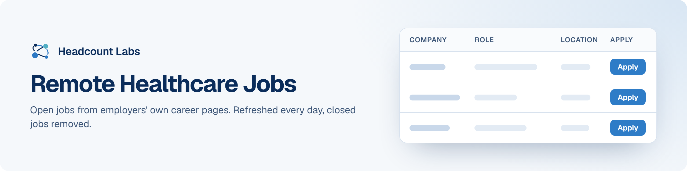

# Remote Healthcare Jobs

Remote nursing, clinical, medical coding and healthcare jobs at US employers.

**296 open jobs** · 250 new since the last update · 27 removed because they closed or left the employer's board · updated November 19, 2026 at 4:51 AM EST

This list is built and refreshed every day by [Headcount Labs](https://headcountlabs.com/?utm_source=github&utm_medium=job-list&utm_campaign=remote-healthcare-jobs), which reads jobs straight from employers' own career pages and job boards. Every job here was still listed on its source board when we last read that board, within the past 3 days, and was posted in the past 30 days. Copies of the same job are merged into one row, and jobs that close are removed at the next update.

Want this data in your own app or agent? Use the [Headcount Labs jobs API](https://headcountlabs.com/docs/?utm_source=github&utm_medium=job-list&utm_campaign=remote-healthcare-jobs) (free tier), the [MCP server](https://headcountlabs.com/mcp/?utm_source=github&utm_medium=job-list&utm_campaign=remote-healthcare-jobs) for Claude, ChatGPT and other AI assistants, or the [public dataset subsets](https://huggingface.co/HeadcountLabs) on Hugging Face (the full dataset is coming soon).

**Full dataset.** A bigger, one-off snapshot dated 2026-10-19 (all matching jobs, not only the open jobs below) is on Hugging Face: [Remote jobs](https://huggingface.co/datasets/HeadcountLabs/remote-jobs) · [Healthcare jobs](https://huggingface.co/datasets/HeadcountLabs/healthcare-jobs). It loads with `datasets.load_dataset` and is under the Open Database License (ODbL) 1.0.

**Jump to:** [Posted in the last 7 days (154)](#posted-in-the-last-7-days) · [Posted 8 to 30 days ago (142)](#posted-8-to-30-days-ago)

**Columns.** *Apply* opens the original posting on the employer's site. *Details* opens the job on Headcount Labs, with every posting we found for it. *Remote* shows what the employer states; a dash means the posting doesn't say. *Pay* is the range the employer published.

## Posted in the last 7 days

| Company | Role | Location | Remote | Pay | Posted | Apply | Details |
| --- | --- | --- | --- | --- | --- | :---: | :---: |
| **Sonova Group** | Clinical Specialist Western Canada | 

2 locations
United States city
 | Remote | — | Nov 19 |  | <a href="https://headcountlabs.com/catalog/jobs/4f2f908c-6f52-4e69-9ea1-1f95d2eed809?utm_source=github&utm_medium=job-list&utm_campaign=remote-healthcare-jobs">via Headcount Labs</a> |
| **Sonova Group** | Senior Clinical Research Associate &#124; REMOTE | 

2 locations
United States city
 | Remote | $91k–$114k/yr | Nov 19 |  | <a href="https://headcountlabs.com/catalog/jobs/2bc202b6-88c9-49fc-b576-4bb3f041bdd1?utm_source=github&utm_medium=job-list&utm_campaign=remote-healthcare-jobs">via Headcount Labs</a> |
| **Jobgether** | Manager, Medical Economics (Cost &amp; Utilization Management) | United States | Remote | $80k–$172k/yr | Nov 19 |  | <a href="https://headcountlabs.com/catalog/jobs/95cf835c-f5e6-457e-858b-62ece563100c?utm_source=github&utm_medium=job-list&utm_campaign=remote-healthcare-jobs">via Headcount Labs</a> |
| **Jobgether** | Sr. Medical Writer (Publications) | United States | Remote | $110k–$125k/yr | Nov 19 |  | <a href="https://headcountlabs.com/catalog/jobs/00da669a-ad2e-40dc-9891-2bbf975cf6fc?utm_source=github&utm_medium=job-list&utm_campaign=remote-healthcare-jobs">via Headcount Labs</a> |
| **voize** | Clinical Expert (US) | New York, NY | Remote | — | Nov 18 |  | <a href="https://headcountlabs.com/catalog/jobs/00778000-31fc-47e0-b4b3-825a8e8ae57f?utm_source=github&utm_medium=job-list&utm_campaign=remote-healthcare-jobs">via Headcount Labs</a> |
| **Talkiatry** | Remote Therapist - Kansas | 

5 locations
United States Wichita, KS Overland Park, KS Topeka, KS Kansas City, KS
 | Remote | $90k–$110k/yr | Nov 18 |  | <a href="https://headcountlabs.com/catalog/jobs/8c15ad33-e032-4cdc-a323-7d6741a8a806?utm_source=github&utm_medium=job-list&utm_campaign=remote-healthcare-jobs">via Headcount Labs</a> |
| **Talkiatry** | Remote Therapist - North Carolina | 

6 locations
United States Raleigh, NC Charlotte, NC Greensboro, NC Raleigh-Durham, NC Asheville, NC
 | Remote | $90k–$110k/yr | Nov 18 |  | <a href="https://headcountlabs.com/catalog/jobs/843baf02-9f76-4b1d-8070-4a3cce2b3a08?utm_source=github&utm_medium=job-list&utm_campaign=remote-healthcare-jobs">via Headcount Labs</a> |
| **Talkiatry** | Remote Therapist - Louisiana | 

5 locations
United States New Orleans, LA Lafayette, LA Baton Rouge, LA Shreveport, LA
 | Remote | — | Nov 18 |  | <a href="https://headcountlabs.com/catalog/jobs/818f2ce5-8c01-4644-ac69-03ce0c769055?utm_source=github&utm_medium=job-list&utm_campaign=remote-healthcare-jobs">via Headcount Labs</a> |
| **Talkiatry** | Remote Therapist - Oklahoma | 

4 locations
United States Norman, OK Tulsa, OK Oklahoma City, OK
 | Remote | — | Nov 18 |  | <a href="https://headcountlabs.com/catalog/jobs/7fd056bc-7030-4013-819c-3dfe9b1bce86?utm_source=github&utm_medium=job-list&utm_campaign=remote-healthcare-jobs">via Headcount Labs</a> |
| **Talkiatry** | Remote Therapist - South Carolina | 

5 locations
United States Columbia, SC Greenville, SC Charleston, SC Florence, SC
 | Remote | $90k–$110k/yr | Nov 18 |  | <a href="https://headcountlabs.com/catalog/jobs/7597a52d-5e4d-46b5-8b8d-49df593e7f9d?utm_source=github&utm_medium=job-list&utm_campaign=remote-healthcare-jobs">via Headcount Labs</a> |
| **Talkiatry** | Remote Therapist - Alabama | 

5 locations
United States Huntsville, AL Montgomery, AL Birmingham, AL Mobile, AL
 | Remote | $90k–$110k/yr | Nov 18 |  | <a href="https://headcountlabs.com/catalog/jobs/73518def-5d0a-48c9-837b-5db4468393d6?utm_source=github&utm_medium=job-list&utm_campaign=remote-healthcare-jobs">via Headcount Labs</a> |
| **Talkiatry** | Remote Therapist - West Virginia | 

4 locations
United States Charleston, WV Huntington, WV Morgantown, WV
 | Remote | $90k–$110k/yr | Nov 18 |  | <a href="https://headcountlabs.com/catalog/jobs/6222e282-f478-47af-b93f-a6ca6e860780?utm_source=github&utm_medium=job-list&utm_campaign=remote-healthcare-jobs">via Headcount Labs</a> |
| **Talkiatry** | Remote Therapist - Arkansas | 

3 locations
United States Fayetteville, AR Little Rock, AR
 | Remote | $90k–$110k/yr | Nov 18 |  | <a href="https://headcountlabs.com/catalog/jobs/16d661c9-023f-4234-8925-508509ebd3fd?utm_source=github&utm_medium=job-list&utm_campaign=remote-healthcare-jobs">via Headcount Labs</a> |
| **Jobgether** | Clinical Technical Support and Data Migration Specialist (B2B SaaS) | United States | Remote | $65k–$75k/yr | Nov 18 |  | <a href="https://headcountlabs.com/catalog/jobs/8c1a3cf7-47bd-4103-bc82-113c9656499f?utm_source=github&utm_medium=job-list&utm_campaign=remote-healthcare-jobs">via Headcount Labs</a> |
| **Jobgether** | CGT- Clinical Senior Project Manager | United States | Remote | $140k–$170k/yr | Nov 18 |  | <a href="https://headcountlabs.com/catalog/jobs/72f68ab0-393b-4570-a7ad-ebca86e88681?utm_source=github&utm_medium=job-list&utm_campaign=remote-healthcare-jobs">via Headcount Labs</a> |
| **Jobgether** | Clinical Project Research Manager - Clinical Oncology | United States | Remote | — | Nov 18 |  | <a href="https://headcountlabs.com/catalog/jobs/6291e242-f37e-4574-b492-d383083c4e35?utm_source=github&utm_medium=job-list&utm_campaign=remote-healthcare-jobs">via Headcount Labs</a> |
| **Jobgether** | Clinical Research Coordinator III - School of Medicine, Otolaryngology | United States | Remote | — | Nov 18 |  | <a href="https://headcountlabs.com/catalog/jobs/3dae2e44-6158-4cbb-bbd1-5b25306402aa?utm_source=github&utm_medium=job-list&utm_campaign=remote-healthcare-jobs">via Headcount Labs</a> |
| **Jobgether** | Manager, Medical Writing | United States | Remote | — | Nov 18 |  | <a href="https://headcountlabs.com/catalog/jobs/11a0279b-0c04-4d17-96bd-1c02be840455?utm_source=github&utm_medium=job-list&utm_campaign=remote-healthcare-jobs">via Headcount Labs</a> |
| **Immunic, Inc.** | Senior Medical Science Liaison (MSL) | 

3 locations
United States New York, NY Boston, MA
 | Remote | $190k–$225k/yr | Nov 18 |  | <a href="https://headcountlabs.com/catalog/jobs/1c83744c-46e4-4663-ab26-ca19f1166ff3?utm_source=github&utm_medium=job-list&utm_campaign=remote-healthcare-jobs">via Headcount Labs</a> |
| **Gotham Enterprises Ltd** | Licensed Clinical Professional Counselor (LCPC) | 

2 locations
Wichita, KS La Plata, MD
 | Remote | — | Nov 18 |  | <a href="https://headcountlabs.com/catalog/jobs/fb8acf94-9b4f-475c-b110-21843cdf1908?utm_source=github&utm_medium=job-list&utm_campaign=remote-healthcare-jobs">via Headcount Labs</a> |
| **Gotham Enterprises Ltd** | Licensed Clinical Social Worker (LCSW) | 

9 locations
Pearl City, HI South Bethany, DE Millersburg, OR Bessemer City, NC Torrington, CT Pinedale, CA New Castle, DE Lake Charles, LA Cornelius, NC
 | Remote | — | Nov 18 |  | <a href="https://headcountlabs.com/catalog/jobs/e7a0b3d1-82bb-42c9-a0bd-363c86d59aff?utm_source=github&utm_medium=job-list&utm_campaign=remote-healthcare-jobs">via Headcount Labs</a> |
| **Gotham Enterprises Ltd** | Licensed Marriage &amp; Family Therapist (LMFT) | 

3 locations
Long Beach, CA Hilo, HI Springdale, AR
 | Remote | — | Nov 18 |  | <a href="https://headcountlabs.com/catalog/jobs/e7306bb3-8dee-4824-86ce-7e1725be8a2f?utm_source=github&utm_medium=job-list&utm_campaign=remote-healthcare-jobs">via Headcount Labs</a> |
| **Gotham Enterprises Ltd** | Licensed Marriage and Family Therapist (LMFT) | 

6 locations
Bend, OR Taos, NM Fort Pierce, FL Coalgate, OK West Halifax, VT Lakeville, MN
 | Remote | — | Nov 18 |  | <a href="https://headcountlabs.com/catalog/jobs/9f4eb9f1-e6f2-4ade-b020-48d530fb49e2?utm_source=github&utm_medium=job-list&utm_campaign=remote-healthcare-jobs">via Headcount Labs</a> |
| **Gotham Enterprises Ltd** | Licensed Independent Clinical Social Worker (LICSW) | 

4 locations
DORCHESTR CTR, MA West Warwick, RI Summerlee, WV Huntington, WV
 | Remote | — | Nov 18 |  | <a href="https://headcountlabs.com/catalog/jobs/56d0252a-0c0b-4722-8900-56003ff94570?utm_source=github&utm_medium=job-list&utm_campaign=remote-healthcare-jobs">via Headcount Labs</a> |
| **Gotham Enterprises Ltd** | Licensed Mental Health Counselor (LMHC) | 

4 locations
Lowell, MA Ottumwa, IA Ames, IA Portsmouth, RI
 | Remote | — | Nov 18 |  | <a href="https://headcountlabs.com/catalog/jobs/cacea0b3-183a-4192-bd71-88f2d6b0b9d4?utm_source=github&utm_medium=job-list&utm_campaign=remote-healthcare-jobs">via Headcount Labs</a> |
| **Gotham Enterprises Ltd** | Licensed Mental Health Therapist (LMFT, LPC, LCSW) | Ruleville, MS | Remote | — | Nov 18 |  | <a href="https://headcountlabs.com/catalog/jobs/29d68d37-ff4c-4820-a2ef-c9767d42c773?utm_source=github&utm_medium=job-list&utm_campaign=remote-healthcare-jobs">via Headcount Labs</a> |
| **Discovery Behavioral Health** | Clinical - MH Group Facilitator | 

2 locations
Illinois New York, IL
 | Remote | $25–$28/hr | Nov 18 |  | <a href="https://headcountlabs.com/catalog/jobs/39c1c151-972e-459a-a8b8-467193584117?utm_source=github&utm_medium=job-list&utm_campaign=remote-healthcare-jobs">via Headcount Labs</a> |
| **Davies** | Nurse Case Manager: FL License (Remote) | Home, AL | Remote | $78k–$82k/yr | Nov 18 |  | <a href="https://headcountlabs.com/catalog/jobs/0e8c9dec-651b-4c07-ad81-aef47d65053f?utm_source=github&utm_medium=job-list&utm_campaign=remote-healthcare-jobs">via Headcount Labs</a> |
| **CQ Medical** | Clinical Applications and Sales Specialist | Virtual, IL | Remote | — | Nov 18 |  | <a href="https://headcountlabs.com/catalog/jobs/01e8450d-c3e8-425a-990b-daf403f0367b?utm_source=github&utm_medium=job-list&utm_campaign=remote-healthcare-jobs">via Headcount Labs</a> |
| **Covista** | Health Assessment I and II - Didactic Nursing Faculty (part-time/remote) | United States | Remote | — | Nov 18 |  | <a href="https://headcountlabs.com/catalog/jobs/57d418e9-bed8-4d10-87f6-9a087b2fc805?utm_source=github&utm_medium=job-list&utm_campaign=remote-healthcare-jobs">via Headcount Labs</a> |
| **CenterWell** | Nurse Practitioner | Virginia | Remote | $150k–$206k/yr | Nov 18 |  | <a href="https://headcountlabs.com/catalog/jobs/0e11a48b-952b-4e08-bb81-9c8441164c3f?utm_source=github&utm_medium=job-list&utm_campaign=remote-healthcare-jobs">via Headcount Labs</a> |
| **Akima** | Nurse Case Manager | Herndon, VA | Remote | $100k–$110k/yr | Nov 18 |  | <a href="https://headcountlabs.com/catalog/jobs/fc6bb47c-c835-4b49-8e6b-c668c07c1492?utm_source=github&utm_medium=job-list&utm_campaign=remote-healthcare-jobs">via Headcount Labs</a> |
| **WellStreet Urgent Care** | Medical Coder - Remote | Atlanta, GA | Remote | — | Nov 17 |  | <a href="https://headcountlabs.com/catalog/jobs/8b73f56b-e2f1-4602-8151-9a3908d29c22?utm_source=github&utm_medium=job-list&utm_campaign=remote-healthcare-jobs">via Headcount Labs</a> |
| **Vitalize** | Enterprise Solutions Consultant, Clinical &amp; EHR Systems | San Francisco, CA | Remote | $160k–$200k/yr | Nov 17 |  | <a href="https://headcountlabs.com/catalog/jobs/abd45ab7-1bf5-46f7-93d6-4150b6aa1d59?utm_source=github&utm_medium=job-list&utm_campaign=remote-healthcare-jobs">via Headcount Labs</a> |
| **University Hospitals Urgent Care** | Medical Coder - Remote | Atlanta, GA | Remote | — | Nov 17 |  | <a href="https://headcountlabs.com/catalog/jobs/63c76667-833f-4328-b30e-fb61d87d04f8?utm_source=github&utm_medium=job-list&utm_campaign=remote-healthcare-jobs">via Headcount Labs</a> |
| **UNAVAILABLE** | Coder II | Rancho Cordova, CA | Remote | $29.44–$43.79/hr | Nov 17 |  | <a href="https://headcountlabs.com/catalog/jobs/63566501-7a06-4f5c-9242-dfc6699f39bf?utm_source=github&utm_medium=job-list&utm_campaign=remote-healthcare-jobs">via Headcount Labs</a> |
| **UNAVAILABLE** | Denials Coder | OMAHA, NE | Remote | $19.87–$28.06/hr | Nov 17 |  | <a href="https://headcountlabs.com/catalog/jobs/cb61db78-44c9-41ba-a208-de8bdedc4a0b?utm_source=github&utm_medium=job-list&utm_campaign=remote-healthcare-jobs">via Headcount Labs</a> |
| **UNAVAILABLE** | Medical Staff Coordinator | Garden City, KS | Remote | $22.12–$32.90/hr | Nov 17 |  | <a href="https://headcountlabs.com/catalog/jobs/8074a656-e48b-4726-8e1e-fa8e293fa1b0?utm_source=github&utm_medium=job-list&utm_campaign=remote-healthcare-jobs">via Headcount Labs</a> |
| **UNAVAILABLE** | Clinic Coder II | OMAHA, NE | Remote | $20.86–$29.46/hr | Nov 17 |  | <a href="https://headcountlabs.com/catalog/jobs/109452aa-64ae-42a0-b3f5-c068adfb9023?utm_source=github&utm_medium=job-list&utm_campaign=remote-healthcare-jobs">via Headcount Labs</a> |
| **Terac** | Dermatologists: Paid Clinical Image Annotation Study | United States | Remote | — | Nov 17 |  | <a href="https://headcountlabs.com/catalog/jobs/34fee385-515c-4e73-a988-54c251da5850?utm_source=github&utm_medium=job-list&utm_campaign=remote-healthcare-jobs">via Headcount Labs</a> |
| **Systimmune** | Sr. Clinical Research Associate - Oncology Biotech | Princeton, NJ | Remote | $90k–$130k/yr | Nov 17 |  | <a href="https://headcountlabs.com/catalog/jobs/4057b77c-1905-4692-974e-359c6c410bae?utm_source=github&utm_medium=job-list&utm_campaign=remote-healthcare-jobs">via Headcount Labs</a> |
| **Seasoned Recruitment** | Psychiatric Mental Health Nurse Practitioner (PMHNP) - Remote | 

54 locations
Bridgeport, CT Hartford, CT New Haven, CT Norwalk, CT Stamford, CT Waterbury, CT Aurora, CO Colorado Springs, CO Denver, CO Fort Collins, CO Lakewood, CO Thornton, CO +42 more
 | Remote | — | Nov 17 |  | <a href="https://headcountlabs.com/catalog/jobs/e1204d56-245f-439b-b7ec-1778d6d44571?utm_source=github&utm_medium=job-list&utm_campaign=remote-healthcare-jobs">via Headcount Labs</a> |
| **Seasoned Recruitment** | Psychiatric Mental Health Nurse Practitioner (PMHNP) | 

6 locations
Chicago, IL Houston, TX Los Angeles, CA Philadelphia, PA Phoenix, AZ San Antonio, TX
 | Remote | — | Nov 17 |  | <a href="https://headcountlabs.com/catalog/jobs/52d44a7a-0794-4b14-b4f2-2513d8971a43?utm_source=github&utm_medium=job-list&utm_campaign=remote-healthcare-jobs">via Headcount Labs</a> |
| **Pavago** | Medical Customer Service Representative | United States | Remote | — | Nov 17 |  | <a href="https://headcountlabs.com/catalog/jobs/dc53b6cd-b2e6-497f-9991-1167d2d5c9d9?utm_source=github&utm_medium=job-list&utm_campaign=remote-healthcare-jobs">via Headcount Labs</a> |
| **Mindoula Health** | FL or LA Licensed Therapist - 100% Remote (LMHC, LCSW, LPC, LMFT) | Florida | Remote | $75k/yr | Nov 17 |  | <a href="https://headcountlabs.com/catalog/jobs/1db2a75a-7d80-42bb-9d40-b4f14c48818e?utm_source=github&utm_medium=job-list&utm_campaign=remote-healthcare-jobs">via Headcount Labs</a> |
| **Johns Hopkins Medicine** | UTILIZATION REVIEW NURSE | Baltimore, MD | Remote | $43.61–$67.59/hr | Nov 17 |  | <a href="https://headcountlabs.com/catalog/jobs/81429a32-9b54-43ea-a2a5-21a927fb3695?utm_source=github&utm_medium=job-list&utm_campaign=remote-healthcare-jobs">via Headcount Labs</a> |
| **Johns Hopkins Medicine** | Home Health Aide - C.N.A (Baltimore County) | Baltimore, MD | Remote | $16.74–$25.94/hr | Nov 17 |  | <a href="https://headcountlabs.com/catalog/jobs/258e317e-a2a3-4d42-b1c1-ecfe8e497f80?utm_source=github&utm_medium=job-list&utm_campaign=remote-healthcare-jobs">via Headcount Labs</a> |
| **Johns Hopkins Medicine** | Home Health Aide - C.N.A (Anne Arundel County) | Baltimore, MD | Remote | $16.74–$25.94/hr | Nov 17 |  | <a href="https://headcountlabs.com/catalog/jobs/1609fada-17ed-40f4-938c-22718e5fc4e9?utm_source=github&utm_medium=job-list&utm_campaign=remote-healthcare-jobs">via Headcount Labs</a> |
| **Johns Hopkins Medicine** | Clinical Documentation Specialist (Clinical Documentation Integrity Specialist) | Baltimore, MD | Remote | $42.33–$69.88/hr | Nov 17 |  | <a href="https://headcountlabs.com/catalog/jobs/6180b2e9-d5ad-49ae-86af-90da1a4f105a?utm_source=github&utm_medium=job-list&utm_campaign=remote-healthcare-jobs">via Headcount Labs</a> |
| **Jobgether** | Behavioral Health Medical Director | United States | Remote | — | Nov 17 |  | <a href="https://headcountlabs.com/catalog/jobs/cc369051-3bf3-4500-968b-4e6bfc75d6bd?utm_source=github&utm_medium=job-list&utm_campaign=remote-healthcare-jobs">via Headcount Labs</a> |
| **InterMed** | Clinical Care Rep RN - Primary Care | South Portland, ME | Remote | — | Nov 17 |  | <a href="https://headcountlabs.com/catalog/jobs/6f7b244b-aeb2-4401-bcff-b1643f531bad?utm_source=github&utm_medium=job-list&utm_campaign=remote-healthcare-jobs">via Headcount Labs</a> |
| **Humana** | Supervisor, Home Health Insurance Authorization | United States | Remote | $65k–$89k/yr | Nov 17 |  | <a href="https://headcountlabs.com/catalog/jobs/a8245407-af69-4936-b931-d6eca9c32dbf?utm_source=github&utm_medium=job-list&utm_campaign=remote-healthcare-jobs">via Headcount Labs</a> |
| **Humana** | Medical Director - OneHome | United States | Remote | $224k–$313k/yr | Nov 17 |  | <a href="https://headcountlabs.com/catalog/jobs/866e8448-3b0c-4bae-8d60-9170ad2c4baf?utm_source=github&utm_medium=job-list&utm_campaign=remote-healthcare-jobs">via Headcount Labs</a> |
| **Humana** | LTSS Utilization Management Nurse | Florida | Remote | $71k–$98k/yr | Nov 17 |  | <a href="https://headcountlabs.com/catalog/jobs/1b667431-8159-4424-8a6b-d60b64506453?utm_source=github&utm_medium=job-list&utm_campaign=remote-healthcare-jobs">via Headcount Labs</a> |
| **Humana** | Community Health Worker | 

4 locations
Oklahoma Richmond, VA Colonial Heights, VA Prince George, VA
 | Remote | $42k–$57k/yr | Nov 17 |  | <a href="https://headcountlabs.com/catalog/jobs/19205768-99ca-4736-b258-48b937c8f740?utm_source=github&utm_medium=job-list&utm_campaign=remote-healthcare-jobs">via Headcount Labs</a> |
| **Guthrie** | EPIC Analyst, Level 3 - IT Epic Clinical - Full Time | 

2 locations
United States Sayre, PA
 | Remote | — | Nov 17 |  | <a href="https://headcountlabs.com/catalog/jobs/e0fb0e1e-38b6-4a50-8122-434d9379dbf3?utm_source=github&utm_medium=job-list&utm_campaign=remote-healthcare-jobs">via Headcount Labs</a> |
| **GT Independence** | Medical Billing (Claims) Specialist | United States | Remote | $18.50–$19.50/hr | Nov 17 |  | <a href="https://headcountlabs.com/catalog/jobs/22cbe227-3630-4bfa-ab5a-a37bdecdeef2?utm_source=github&utm_medium=job-list&utm_campaign=remote-healthcare-jobs">via Headcount Labs</a> |
| **Gotham Enterprises Ltd** | Licensed Professional Clinical Counselor (LPCC) | Minneapolis, MN | Remote | — | Nov 17 |  | <a href="https://headcountlabs.com/catalog/jobs/d2957087-f533-4279-8e1a-d3e29d83750a?utm_source=github&utm_medium=job-list&utm_campaign=remote-healthcare-jobs">via Headcount Labs</a> |
| **Globe Life AO** | Remote Life &amp; Health Insurance Agent - Start ASAP | New York, NY | Remote | — | Nov 17 |  | <a href="https://headcountlabs.com/catalog/jobs/0d9ce481-e0d2-4dfa-aa5a-56a9cbf1511e?utm_source=github&utm_medium=job-list&utm_campaign=remote-healthcare-jobs">via Headcount Labs</a> |
| **ECU Health Medical Center** | Clinical Dietitian I | Greenville, NC | Remote | $54k–$79k/yr | Nov 17 |  | <a href="https://headcountlabs.com/catalog/jobs/a3d8aa46-5c13-47ad-a351-ceed7de9aa5c?utm_source=github&utm_medium=job-list&utm_campaign=remote-healthcare-jobs">via Headcount Labs</a> |
| **ECU Health Medical Center** | Quality Nurse Specialist- Clinical Quality Management | Edenton, NC | Remote | $80k–$116k/yr | Nov 17 |  | <a href="https://headcountlabs.com/catalog/jobs/2d2c17ef-e2ca-4444-ab49-7f09f363018c?utm_source=github&utm_medium=job-list&utm_campaign=remote-healthcare-jobs">via Headcount Labs</a> |
| **Dane Street, LLC** | Board Certified Disability Peer Physician Reviewer - Medical Oncology | United States | Remote | — | Nov 17 |  | <a href="https://headcountlabs.com/catalog/jobs/2155df07-2fe4-40a5-9150-37e08a4982c0?utm_source=github&utm_medium=job-list&utm_campaign=remote-healthcare-jobs">via Headcount Labs</a> |
| **Dane Street, LLC** | Board Certified Physician Reviewer - Medical Oncology MN License Required | United States | Remote | — | Nov 17 |  | <a href="https://headcountlabs.com/catalog/jobs/391ac46c-17f1-44cc-822d-7b7ffc1d412f?utm_source=github&utm_medium=job-list&utm_campaign=remote-healthcare-jobs">via Headcount Labs</a> |
| **Cosan Group** | Medical Assistant Patient Care Coordinator (Part-Time) | United States | Remote | $16.33–$20/hr | Nov 17 |  | <a href="https://headcountlabs.com/catalog/jobs/5588daf1-ceab-4b8c-a28d-300435639df6?utm_source=github&utm_medium=job-list&utm_campaign=remote-healthcare-jobs">via Headcount Labs</a> |
| **Corewell Health Urgent Care** | Medical Coder - Remote | Atlanta, GA | Remote | — | Nov 17 |  | <a href="https://headcountlabs.com/catalog/jobs/4d0edf77-572d-4311-adf5-7ddf3dfba5d7?utm_source=github&utm_medium=job-list&utm_campaign=remote-healthcare-jobs">via Headcount Labs</a> |
| **CenterWell** | Supervisor, Home Health Insurance Authorization | United States | Remote | $65k–$89k/yr | Nov 17 |  | <a href="https://headcountlabs.com/catalog/jobs/d168c2b7-a330-4e70-b3e8-590ceb3cd3b5?utm_source=github&utm_medium=job-list&utm_campaign=remote-healthcare-jobs">via Headcount Labs</a> |
| **Carda Health** | Chief Medical Officer | New York | Remote | — | Nov 17 |  | <a href="https://headcountlabs.com/catalog/jobs/6865f9d9-3f02-4513-be43-165b2da1fb53?utm_source=github&utm_medium=job-list&utm_campaign=remote-healthcare-jobs">via Headcount Labs</a> |
| **Avania** | Clinical Contracts Associate | United States | Remote | $80k–$100k/yr | Nov 17 |  | <a href="https://headcountlabs.com/catalog/jobs/db5528ce-b719-40e0-9f72-a4c192aa05f6?utm_source=github&utm_medium=job-list&utm_campaign=remote-healthcare-jobs">via Headcount Labs</a> |
| **Ascension** | Clinical Documentation Specialist | Nashville, TN | Remote | $72k–$133k/yr | Nov 17 |  | <a href="https://headcountlabs.com/catalog/jobs/81cf2ae5-ffb1-41ef-b792-b10f8ec54feb?utm_source=github&utm_medium=job-list&utm_campaign=remote-healthcare-jobs">via Headcount Labs</a> |
| **Ascension** | Registered Nurse Specialist Denials and Appeals | Wichita, KS | Remote | $71k–$133k/yr | Nov 17 |  | <a href="https://headcountlabs.com/catalog/jobs/bd1703e2-b548-486e-87d4-04e9941bf60e?utm_source=github&utm_medium=job-list&utm_campaign=remote-healthcare-jobs">via Headcount Labs</a> |
| **Ascension** | Instructional Design Lead Clinical Informaticist | Saint Louis, MO | Remote | $79k–$146k/yr | Nov 17 |  | <a href="https://headcountlabs.com/catalog/jobs/349db996-f85e-4ad7-b8c9-43d58ec4fb9c?utm_source=github&utm_medium=job-list&utm_campaign=remote-healthcare-jobs">via Headcount Labs</a> |
| **Ascension** | Registered Nurse Patient Navigator | Jacksonville, FL | Remote | $36.37–$68.46/hr | Nov 17 |  | <a href="https://headcountlabs.com/catalog/jobs/306049a9-d7da-4701-bf7f-ccb06bf799b9?utm_source=github&utm_medium=job-list&utm_campaign=remote-healthcare-jobs">via Headcount Labs</a> |
| **AbbVie** | Clinical Account Executive - Oncology - Baltimore, MD | Baltimore, MD | Remote | $132k–$238k/yr | Nov 17 |  | <a href="https://headcountlabs.com/catalog/jobs/ff8ef92c-a916-4ce4-a647-1e42ea6707d4?utm_source=github&utm_medium=job-list&utm_campaign=remote-healthcare-jobs">via Headcount Labs</a> |
| **AbbVie** | Clinical Account Executive - Oncology - Boston, MA | Boston, MA | Remote | $132k–$238k/yr | Nov 17 |  | <a href="https://headcountlabs.com/catalog/jobs/eca43ebf-1be8-40d1-bcde-5d4242ad053a?utm_source=github&utm_medium=job-list&utm_campaign=remote-healthcare-jobs">via Headcount Labs</a> |
| **AbbVie** | Clinical Account Executive - Kansas City, KS | Kansas City, KS | Remote | $132k–$238k/yr | Nov 17 |  | <a href="https://headcountlabs.com/catalog/jobs/aee3adb4-4b05-4a9f-aa24-2df8d41aba26?utm_source=github&utm_medium=job-list&utm_campaign=remote-healthcare-jobs">via Headcount Labs</a> |
| **800 CenterWell Health Services (USA), LLC** | Intake Coordinator Home Health | United States | Remote | $39k–$49k/yr | Nov 17 |  | <a href="https://headcountlabs.com/catalog/jobs/f1f65152-1a54-4f21-9370-d0e33d5b8c24?utm_source=github&utm_medium=job-list&utm_campaign=remote-healthcare-jobs">via Headcount Labs</a> |
| **004 Humana Insurance Company** | Onsite Care Coordination Nurse | 

6 locations
Wisconsin Milwaukee, WI Racine, WI Waukesha, WI Wauwatosa, WI West Allis, WI
 | Remote | $71k–$98k/yr | Nov 17 |  | <a href="https://headcountlabs.com/catalog/jobs/04b10b08-d9d9-41ae-a6a6-855f976d5ca2?utm_source=github&utm_medium=job-list&utm_campaign=remote-healthcare-jobs">via Headcount Labs</a> |
| **003 Humana Inc.** | Stars Population Health Measure Optimization Lead, Business Intelligence &amp; Analytics | United States | Remote | $118k–$162k/yr | Nov 17 |  | <a href="https://headcountlabs.com/catalog/jobs/f070dd71-b19f-4b5f-a8d6-270dd44c89d5?utm_source=github&utm_medium=job-list&utm_campaign=remote-healthcare-jobs">via Headcount Labs</a> |
| **Workplace Options** | EAP Clinical Counselor | 

3 locations
Atlanta, GA Austin, TX Columbia, SC
 | Remote | $50k/yr | Nov 16 |  | <a href="https://headcountlabs.com/catalog/jobs/aa85e525-6302-4e32-aada-b2426480422b?utm_source=github&utm_medium=job-list&utm_campaign=remote-healthcare-jobs">via Headcount Labs</a> |
| **Veeva Systems** | Solution Consultant - Medical | Boston, MA | Remote | $80k–$160k/yr | Nov 16 |  | <a href="https://headcountlabs.com/catalog/jobs/cea70d2c-6f85-4b98-967f-8378a156bae5?utm_source=github&utm_medium=job-list&utm_campaign=remote-healthcare-jobs">via Headcount Labs</a> |
| **USF University of South Florida** | Temporary Clinical Research Coordinator | Tampa, FL | Remote | — | Nov 16 |  | <a href="https://headcountlabs.com/catalog/jobs/9981dde9-24c1-4841-9c73-a340d0dfb6b8?utm_source=github&utm_medium=job-list&utm_campaign=remote-healthcare-jobs">via Headcount Labs</a> |
| **Two Chairs** | Mental Health Therapist (Part-Time, W2) | California | Remote | $85/hr | Nov 16 |  | <a href="https://headcountlabs.com/catalog/jobs/4d158a98-b6be-4afe-8f50-76988daa6874?utm_source=github&utm_medium=job-list&utm_campaign=remote-healthcare-jobs">via Headcount Labs</a> |
| **STERIS Corporation** | Medical Equipment Service Technician | Wilmington, DE | Remote | $49k–$81k/yr | Nov 16 |  | <a href="https://headcountlabs.com/catalog/jobs/340e6f4f-558f-41e3-aca2-1d57a7a75194?utm_source=github&utm_medium=job-list&utm_campaign=remote-healthcare-jobs">via Headcount Labs</a> |
| **Southern Careers Institute** | Online Medical Billing &amp; Coding Adjunct Instructor | 

2 locations
Austin, TX United States
 | Remote | — | Nov 16 |  | <a href="https://headcountlabs.com/catalog/jobs/da5a8610-464e-4e69-b4fe-d3925e184430?utm_source=github&utm_medium=job-list&utm_campaign=remote-healthcare-jobs">via Headcount Labs</a> |
| **Southcoast Health System, Inc.** | LPN-Personal Health Management | Fairhaven, MA | Remote | $32.21–$48.04/hr | Nov 16 |  | <a href="https://headcountlabs.com/catalog/jobs/5740ef58-066f-4bea-815a-31156a8d0007?utm_source=github&utm_medium=job-list&utm_campaign=remote-healthcare-jobs">via Headcount Labs</a> |
| **Seasoned Recruitment** | Telehealth Mental Health Clinician (LMFT, LCPC, LP, LCSW) - Clients Provided | 

12 locations
Billings, MT Bozeman, MT Butte, MT Great Falls, MT Helena, MT Missoula, MT Carson City, NV Henderson, NV Las Vegas, NV North Las Vegas, NV Reno, NV Sparks, NV
 | Remote | — | Nov 16 |  | <a href="https://headcountlabs.com/catalog/jobs/81de389f-1efe-491d-8ffd-324af331b069?utm_source=github&utm_medium=job-list&utm_campaign=remote-healthcare-jobs">via Headcount Labs</a> |
| **Seasoned Recruitment** | Telehealth Mental Health Clinician (LMFT, LCMHC, LP, LCSW) - Clients Provided | 

6 locations
Concord, NH Dover, NH Keene, NH Manchester, NH Nashua, NH Rochester, NH
 | Remote | — | Nov 16 |  | <a href="https://headcountlabs.com/catalog/jobs/267f72f9-0e04-4769-b2a4-676333c09cec?utm_source=github&utm_medium=job-list&utm_campaign=remote-healthcare-jobs">via Headcount Labs</a> |
| **Seasoned Recruitment** | Telehealth Mental Health Clinician (LMFT, LPC, LP, LCSW) - Clients Provided | 

6 locations
Columbia, MO Independence, MO Kansas City, MO Lee's Summit, MO Springfield, MO St. Louis, MO
 | Remote | — | Nov 16 |  | <a href="https://headcountlabs.com/catalog/jobs/1fc78160-2804-4857-ad50-2fd2494b23bb?utm_source=github&utm_medium=job-list&utm_campaign=remote-healthcare-jobs">via Headcount Labs</a> |
| **Seasoned Recruitment** | Telehealth Mental Health Clinician (LMFT, LIMHP, LMHP, LP) - Clients Provided | 

6 locations
Bellevue, NE Fremont, NE Grand Island, NE Kearney, NE Lincoln, NE Omaha, NE
 | Remote | — | Nov 16 |  | <a href="https://headcountlabs.com/catalog/jobs/0bffea28-2dfc-43fe-842d-e3428e080ef6?utm_source=github&utm_medium=job-list&utm_campaign=remote-healthcare-jobs">via Headcount Labs</a> |
| **Replimune** | Senior Clinical Project Manager | Woburn, MA | Remote | — | Nov 16 |  | <a href="https://headcountlabs.com/catalog/jobs/ecebe143-dee1-4fb5-9a9b-d940b4090f33?utm_source=github&utm_medium=job-list&utm_campaign=remote-healthcare-jobs">via Headcount Labs</a> |
| **ProMedica Health System** | Coder - Remote | Toledo, OH | Remote | $15–$33.95/hr | Nov 16 |  | <a href="https://headcountlabs.com/catalog/jobs/5c864e2c-a075-4627-a04c-0fb8d3c85349?utm_source=github&utm_medium=job-list&utm_campaign=remote-healthcare-jobs">via Headcount Labs</a> |
| **Presbyterian Homes &amp; Services** | RN Director of Nursing /Clinical Administrator II | Spring Park, MN | Remote | $105k–$130k/yr | Nov 16 |  | <a href="https://headcountlabs.com/catalog/jobs/b450ac5d-b6d9-4abd-b9f2-c0456845d99f?utm_source=github&utm_medium=job-list&utm_campaign=remote-healthcare-jobs">via Headcount Labs</a> |
| **Piedmont Healthcare Inc.** | E&amp;M Coder - PHYS | Atlanta, GA | Remote | — | Nov 16 |  | <a href="https://headcountlabs.com/catalog/jobs/5b24051e-d3d8-4dc4-a93e-90c02125e648?utm_source=github&utm_medium=job-list&utm_campaign=remote-healthcare-jobs">via Headcount Labs</a> |
| **Munson Healthcare** | Senior Medical Staff Services Specialist | Michigan | Remote | — | Nov 16 |  | <a href="https://headcountlabs.com/catalog/jobs/394cf3ae-e1ec-432e-8c73-d6e6ff36f3bf?utm_source=github&utm_medium=job-list&utm_campaign=remote-healthcare-jobs">via Headcount Labs</a> |
| **Mosaic Health System** | Remote - PFS Medical Insurance Follow Up Specialist I | United States | Remote | — | Nov 16 |  | <a href="https://headcountlabs.com/catalog/jobs/bc0a2fd7-f954-4402-b21b-26fb81e3233e?utm_source=github&utm_medium=job-list&utm_campaign=remote-healthcare-jobs">via Headcount Labs</a> |
| **Mindoula Health** | Behavioral Health Integration Clinician – Associate Level | 

2 locations
Corvallis, OR Eugene, OR
 | Remote | $50k–$80k/yr | Nov 16 |  | <a href="https://headcountlabs.com/catalog/jobs/c0fa200e-ca43-4162-a44e-0be9ef77d33d?utm_source=github&utm_medium=job-list&utm_campaign=remote-healthcare-jobs">via Headcount Labs</a> |
| **M3USA** | Regional Director of Clinical Operations (West Coast) - Remote | Los Angeles, CA | Remote | $130k–$165k/yr | Nov 16 |  | <a href="https://headcountlabs.com/catalog/jobs/052c449e-fc21-463d-b80c-e1732c558d5f?utm_source=github&utm_medium=job-list&utm_campaign=remote-healthcare-jobs">via Headcount Labs</a> |
| **Koniag Government Services, LLC** | Clinical Informaticist (REMOTE) | Chantilly, VA | Remote | — | Nov 16 |  | <a href="https://headcountlabs.com/catalog/jobs/8ec93c2a-dbc6-449f-b51a-020406c0897e?utm_source=github&utm_medium=job-list&utm_campaign=remote-healthcare-jobs">via Headcount Labs</a> |
| **Johns Hopkins Medicine** | Health System FP&amp;A Analyst I | Baltimore, MD | Remote | — | Nov 16 |  | <a href="https://headcountlabs.com/catalog/jobs/9809ce06-a0a4-43c1-bac4-78ae7fd8cd20?utm_source=github&utm_medium=job-list&utm_campaign=remote-healthcare-jobs">via Headcount Labs</a> |
| **JEVS Care at Home** | Caregiver - Home Health Aide - Non-Medical | 

6 locations
Philadelphia, PA Bethlehem, PA Pittsburgh, PA New Kensington, PA Tarentum, PA Quakertown, PA
 | Remote | — | Nov 16 |  | <a href="https://headcountlabs.com/catalog/jobs/ad65217b-bd8d-40fd-837a-4a6d73442528?utm_source=github&utm_medium=job-list&utm_campaign=remote-healthcare-jobs">via Headcount Labs</a> |
| **IU Health** | Registered Nurse -Primary Care Call Center– Ambulatory Triage | United States | Remote | — | Nov 16 |  | <a href="https://headcountlabs.com/catalog/jobs/e24a56a4-4152-4ac0-b641-b79344be080e?utm_source=github&utm_medium=job-list&utm_campaign=remote-healthcare-jobs">via Headcount Labs</a> |
| **Intuitive** | Clinical Sales Representative | Los Angeles, CA | Remote | — | Nov 16 |  | <a href="https://headcountlabs.com/catalog/jobs/d7f4f76c-2ca4-4369-ad5e-6e50b507a922?utm_source=github&utm_medium=job-list&utm_campaign=remote-healthcare-jobs">via Headcount Labs</a> |
| **Intuitive** | ION Clinical Sales Manager | 

4 locations
Little Rock, AR Oklahoma City, OK Tulsa, OK Fayetteville, AR
 | Remote | — | Nov 16 |  | <a href="https://headcountlabs.com/catalog/jobs/734e4765-c719-4fc3-9f3f-6db5f068d394?utm_source=github&utm_medium=job-list&utm_campaign=remote-healthcare-jobs">via Headcount Labs</a> |
| **Humana** | Medical Director National OP Medicare | United States | Remote | $224k–$313k/yr | Nov 16 |  | <a href="https://headcountlabs.com/catalog/jobs/c2006e70-b8f7-422b-bb54-a272ce2ce986?utm_source=github&utm_medium=job-list&utm_campaign=remote-healthcare-jobs">via Headcount Labs</a> |
| **Humana** | Onsite Care Coordination Nurse | 

5 locations
Georgia Aiken, GA Augusta Evans North Augusta, GA
 | Remote | $71k–$98k/yr | Nov 16 |  | <a href="https://headcountlabs.com/catalog/jobs/0f31b599-f488-4049-b684-69c3392aa73c?utm_source=github&utm_medium=job-list&utm_campaign=remote-healthcare-jobs">via Headcount Labs</a> |
| **Humana** | Behavioral Health Vendor Performance Lead | United States | Remote | $115k–$158k/yr | Nov 16 |  | <a href="https://headcountlabs.com/catalog/jobs/a37ca36d-ccd6-4e4e-b365-7111e72af956?utm_source=github&utm_medium=job-list&utm_campaign=remote-healthcare-jobs">via Headcount Labs</a> |
| **Humana** | Provider Contracting Professional - Behavioral Health/Medicaid | United States | Remote | $65k–$89k/yr | Nov 16 |  | <a href="https://headcountlabs.com/catalog/jobs/5fa53888-81cb-46ca-ad7a-fe2f7ebc37c0?utm_source=github&utm_medium=job-list&utm_campaign=remote-healthcare-jobs">via Headcount Labs</a> |
| **Greenlife Healthcare Staffing** | Telehealth Nurse Practitioner (Primary Care) | 

5 locations
Ohio North Carolina Arkansas South Dakota Kentucky
 | Remote | — | Nov 16 |  | <a href="https://headcountlabs.com/catalog/jobs/fb800632-699f-4d8b-84e4-9b1037680a2f?utm_source=github&utm_medium=job-list&utm_campaign=remote-healthcare-jobs">via Headcount Labs</a> |
| **Fortrea** | Clinical Trial Manager | 

2 locations
North Carolina United States
 | Remote | $76k–$148k/yr | Nov 16 |  | <a href="https://headcountlabs.com/catalog/jobs/e1b2e139-07fb-43a0-b6ef-2e04efc62b7e?utm_source=github&utm_medium=job-list&utm_campaign=remote-healthcare-jobs">via Headcount Labs</a> |
| **Fortrea** | Clinical Trial Manager - CAR T or Ophthalmology | Durham, NC | Remote | $76k–$148k/yr | Nov 16 |  | <a href="https://headcountlabs.com/catalog/jobs/d3a48ce4-f55c-4c56-842a-7a1a051339b1?utm_source=github&utm_medium=job-list&utm_campaign=remote-healthcare-jobs">via Headcount Labs</a> |
| **Fortrea** | CGT- Clinical Project Manager II, Remote US or Canada | 

2 locations
Durham, NC United States
 | Remote | $130k–$150k/yr | Nov 16 |  | <a href="https://headcountlabs.com/catalog/jobs/b82b3f60-44a1-431c-a8bc-b02a4828f581?utm_source=github&utm_medium=job-list&utm_campaign=remote-healthcare-jobs">via Headcount Labs</a> |
| **Fortrea** | Sr. Medical Director, Rheumatology - US or EMEA Remote | 

2 locations
Durham, NC United States
 | Remote | $173k–$320k/yr | Nov 16 |  | <a href="https://headcountlabs.com/catalog/jobs/7dd4576a-9920-4c8a-9ff4-75cf551ace37?utm_source=github&utm_medium=job-list&utm_campaign=remote-healthcare-jobs">via Headcount Labs</a> |
| **Fortrea** | Sr. Clinical Research Associate/CRA2 - Oncology or CAR T | 

2 locations
North Carolina United States
 | Remote | $105k–$145k/yr | Nov 16 |  | <a href="https://headcountlabs.com/catalog/jobs/04f4b6c3-f4fc-4edf-938a-a00fe391529e?utm_source=github&utm_medium=job-list&utm_campaign=remote-healthcare-jobs">via Headcount Labs</a> |
| **Fortrea** | CGT- Clinical Senior Project Manager, Remote- US Or Canada | 

2 locations
Durham, NC United States
 | Remote | $140k–$170k/yr | Nov 16 |  | <a href="https://headcountlabs.com/catalog/jobs/ee438f96-44c9-45be-9525-f98a59095c3c?utm_source=github&utm_medium=job-list&utm_campaign=remote-healthcare-jobs">via Headcount Labs</a> |
| **Family Resource Home Care** | Part- Time Registered Nurse | Coos Bay, OR | Remote | $55/hr | Nov 16 |  | <a href="https://headcountlabs.com/catalog/jobs/75d2e325-1d2c-44be-8303-0120e3ebfcdc?utm_source=github&utm_medium=job-list&utm_campaign=remote-healthcare-jobs">via Headcount Labs</a> |
| **Corewell Health** | Priority Health Data Engineer Senior | Grand Rapids, MI | Remote | — | Nov 16 |  | <a href="https://headcountlabs.com/catalog/jobs/5b08aeb5-d1a0-4d82-beb4-f0b7191cc845?utm_source=github&utm_medium=job-list&utm_campaign=remote-healthcare-jobs">via Headcount Labs</a> |
| **Corewell Health** | Trauma Registrar Clinical Data | Grand Rapids, MI | Remote | — | Nov 16 |  | <a href="https://headcountlabs.com/catalog/jobs/b70796c6-7886-47bd-82ba-a33c97d40d97?utm_source=github&utm_medium=job-list&utm_campaign=remote-healthcare-jobs">via Headcount Labs</a> |
| **Cognito Therapeutics** | Clinical Support Manager | United States | Remote | — | Nov 16 |  | <a href="https://headcountlabs.com/catalog/jobs/6ebff96a-ef3c-44fc-a1ea-dc301089cb70?utm_source=github&utm_medium=job-list&utm_campaign=remote-healthcare-jobs">via Headcount Labs</a> |
| **Brave Health** | Licensed Clinical Social Worker (LCSW) - Remote | 

4 locations
United States Oklahoma City, OK Tulsa, OK New York State
 | Remote | $69k–$76k/yr | Nov 16 |  | <a href="https://headcountlabs.com/catalog/jobs/d20a59b6-e673-43eb-a621-26743607ddca?utm_source=github&utm_medium=job-list&utm_campaign=remote-healthcare-jobs">via Headcount Labs</a> |
| **Brave Health** | Licensed Clinical Professional Counselor (LCPC) - Remote | United States | Remote | $69k–$76k/yr | Nov 16 |  | <a href="https://headcountlabs.com/catalog/jobs/5567362b-e6e2-40bd-95dc-8eff9b107f72?utm_source=github&utm_medium=job-list&utm_campaign=remote-healthcare-jobs">via Headcount Labs</a> |
| **Brave Health** | Licensed Independent Marriage and Family Therapist (LIMFT) - Remote | United States | Remote | $74k–$81k/yr | Nov 16 |  | <a href="https://headcountlabs.com/catalog/jobs/cd106e4c-0efa-4a3a-b042-7d70bbede859?utm_source=github&utm_medium=job-list&utm_campaign=remote-healthcare-jobs">via Headcount Labs</a> |
| **Brave Health** | Licensed Professional Clinical Counselor (LPCC) - Remote | United States | Remote | $74k–$81k/yr | Nov 16 |  | <a href="https://headcountlabs.com/catalog/jobs/c6b06bbd-b071-4cf1-80c1-8619186dc5ba?utm_source=github&utm_medium=job-list&utm_campaign=remote-healthcare-jobs">via Headcount Labs</a> |
| **Brave Health** | Licensed Mental Health Counselor, Diagnotic Privilege (LMHC-DP) - Remote | New York State | Remote | $80k–$89k/yr | Nov 16 |  | <a href="https://headcountlabs.com/catalog/jobs/8aa2338d-dcdb-46aa-9e8f-f110a13cae1a?utm_source=github&utm_medium=job-list&utm_campaign=remote-healthcare-jobs">via Headcount Labs</a> |
| **Alcanza Clinical Research** | Clinical Research Vendor Specialist | Lake Mary, FL | Remote | — | Nov 16 |  | <a href="https://headcountlabs.com/catalog/jobs/097e9b4e-9013-4aa1-b99d-c322ca8d29ea?utm_source=github&utm_medium=job-list&utm_campaign=remote-healthcare-jobs">via Headcount Labs</a> |
| **AIS Healthcare** | PRN Home Infusion Registered Nurse | Pensacola, FL | Remote | — | Nov 16 |  | <a href="https://headcountlabs.com/catalog/jobs/50a44935-5976-49f0-866e-7cd568d1b6b2?utm_source=github&utm_medium=job-list&utm_campaign=remote-healthcare-jobs">via Headcount Labs</a> |
| **AbbVie** | Oncology Nurse Educator - New York | New York, NY | Remote | $132k–$238k/yr | Nov 16 |  | <a href="https://headcountlabs.com/catalog/jobs/94520991-0625-4ed8-b816-361cfb5e3da5?utm_source=github&utm_medium=job-list&utm_campaign=remote-healthcare-jobs">via Headcount Labs</a> |
| **AbbVie** | Oncology Nurse Educator- Manchester/Boston/Hartford | 

2 locations
Manchester, NH Boston, MA
 | Remote | $132k–$238k/yr | Nov 16 |  | <a href="https://headcountlabs.com/catalog/jobs/5e921830-7a34-43aa-9213-ed14f3268446?utm_source=github&utm_medium=job-list&utm_campaign=remote-healthcare-jobs">via Headcount Labs</a> |
| **AbbVie** | Clinical Account Executive, Oncology - Dallas, TX | Dallas, TX | Remote | $132k–$238k/yr | Nov 16 |  | <a href="https://headcountlabs.com/catalog/jobs/5127d8e8-2fb5-4d67-aa81-41c0a39e25d9?utm_source=github&utm_medium=job-list&utm_campaign=remote-healthcare-jobs">via Headcount Labs</a> |
| **AbbVie** | Oncology Nurse Educator- Rocky Mountains | 

3 locations
Salt Lake City, UT Denver, CO Phoenix, AZ
 | Remote | $132k–$238k/yr | Nov 16 |  | <a href="https://headcountlabs.com/catalog/jobs/2f41cf44-80ea-4ca7-8b6f-b2b4c91ec29d?utm_source=github&utm_medium=job-list&utm_campaign=remote-healthcare-jobs">via Headcount Labs</a> |
| **004 Humana Insurance Company** | Clinical Innovation Delivery Lead | Kentucky | Remote | $115k–$158k/yr | Nov 16 |  | <a href="https://headcountlabs.com/catalog/jobs/bd617f60-85c9-48ca-ae0d-c27a51210b74?utm_source=github&utm_medium=job-list&utm_campaign=remote-healthcare-jobs">via Headcount Labs</a> |
| **004 Humana Insurance Company** | Utilization Management Registered Nurse | Alabama | Remote | $71k–$98k/yr | Nov 16 |  | <a href="https://headcountlabs.com/catalog/jobs/355dda74-174c-4081-9a4e-ade372e5538b?utm_source=github&utm_medium=job-list&utm_campaign=remote-healthcare-jobs">via Headcount Labs</a> |
| **004 Humana Insurance Company** | Medical Coding Auditor | United States | Remote | $59k–$81k/yr | Nov 16 |  | <a href="https://headcountlabs.com/catalog/jobs/6ad896cf-8bd9-44cf-bc29-30a01dacf11c?utm_source=github&utm_medium=job-list&utm_campaign=remote-healthcare-jobs">via Headcount Labs</a> |
| **004 Humana Insurance Company** | Utilization Management Administration Coordinator -- Home Health | United States | Remote | $40k–$52k/yr | Nov 16 |  | <a href="https://headcountlabs.com/catalog/jobs/837339bd-5413-44e2-9e2d-68657908a988?utm_source=github&utm_medium=job-list&utm_campaign=remote-healthcare-jobs">via Headcount Labs</a> |
| **004 Humana Insurance Company** | Medical Director - Claims | United States | Remote | $224k–$313k/yr | Nov 16 |  | <a href="https://headcountlabs.com/catalog/jobs/7592020f-f0fe-4370-af49-44e8642bd791?utm_source=github&utm_medium=job-list&utm_campaign=remote-healthcare-jobs">via Headcount Labs</a> |
| **003 Humana Inc.** | Clinical Strategy &amp; Practice Professional | United States | Remote | $86k–$119k/yr | Nov 16 |  | <a href="https://headcountlabs.com/catalog/jobs/f487ad99-77be-4576-a232-6e859b0d7804?utm_source=github&utm_medium=job-list&utm_campaign=remote-healthcare-jobs">via Headcount Labs</a> |
| **Seasoned Recruitment** | Telehealth Mental Health Clinician (LMFT, LMHC, LP, LCSW) - Set Your Own Hours | 

6 locations
Jacksonville, FL Miami, FL Orlando, FL Port St. Lucie, FL St. Petersburg, FL Tampa, FL
 | Remote | — | Nov 15 |  | <a href="https://headcountlabs.com/catalog/jobs/fa2f8c55-1332-4ee2-9828-816e250681ca?utm_source=github&utm_medium=job-list&utm_campaign=remote-healthcare-jobs">via Headcount Labs</a> |
| **Seasoned Recruitment** | Remote FULLY Licensed Therapist (LMFT, LPC, LP, LICSW) | 

6 locations
Birmingham, AL Hoover, AL Huntsville, AL Mobile, AL Montgomery, AL Tuscaloosa, AL
 | Remote | — | Nov 15 |  | <a href="https://headcountlabs.com/catalog/jobs/ea21e3f9-a36e-4846-92da-ab62fff76159?utm_source=github&utm_medium=job-list&utm_campaign=remote-healthcare-jobs">via Headcount Labs</a> |
| **LifeStance Health** | Licensed Marriage &amp; Family Therapist (LMFT) - Couples &amp; Family Therapy | Rehoboth Beach, DE | Remote | — | Nov 15 |  | <a href="https://headcountlabs.com/catalog/jobs/bda95faf-7b84-4fbf-9919-0445dfd1d4ac?utm_source=github&utm_medium=job-list&utm_campaign=remote-healthcare-jobs">via Headcount Labs</a> |
| **Automobile Club Of Missouri** | Claims SIU Complex Major Medical Investigator | Overland Park, KS | Remote | — | Nov 15 |  | <a href="https://headcountlabs.com/catalog/jobs/b32fa579-01a0-422a-93ce-c6b4a829cfc6?utm_source=github&utm_medium=job-list&utm_campaign=remote-healthcare-jobs">via Headcount Labs</a> |
| **Teva Pharmaceuticals** | Senior Medical Science Liaison - New York/New Jersey | Parsippany Troy Hills, NJ | Remote | $175k–$205k/yr | Nov 14 |  | <a href="https://headcountlabs.com/catalog/jobs/f561604d-e114-4965-bdce-47fe58cec12e?utm_source=github&utm_medium=job-list&utm_campaign=remote-healthcare-jobs">via Headcount Labs</a> |
| **INTEGRIS** | Certified Coder | United States | Remote | — | Nov 14 |  | <a href="https://headcountlabs.com/catalog/jobs/0493be8f-8708-4a24-9341-a412792c464f?utm_source=github&utm_medium=job-list&utm_campaign=remote-healthcare-jobs">via Headcount Labs</a> |
| **Two Chairs** | Mental Health Therapist (Part-Time, W-2) | 

2 locations
Massachusetts Oregon
 | Remote | $58.50–$85/hr | Nov 13 |  | <a href="https://headcountlabs.com/catalog/jobs/b24943c2-9a72-4d90-9d45-6c7c30e28620?utm_source=github&utm_medium=job-list&utm_campaign=remote-healthcare-jobs">via Headcount Labs</a> |
| **Tolmar** | Account Manager Men's Health | Houston, TX | Remote | $85k–$105k/yr | Nov 13 |  | <a href="https://headcountlabs.com/catalog/jobs/f66d0430-1b70-4eef-b8b3-e5d6a88288b7?utm_source=github&utm_medium=job-list&utm_campaign=remote-healthcare-jobs">via Headcount Labs</a> |
| **OutcomesAI** | Clinical Nurse Triage Tester | United States | Remote | $35/hr | Nov 13 |  | <a href="https://headcountlabs.com/catalog/jobs/45fcdc33-ae63-4b97-9727-e214d7d04fa3?utm_source=github&utm_medium=job-list&utm_campaign=remote-healthcare-jobs">via Headcount Labs</a> |
| **OpenLoop Health** | Medical Operations Manager | United States | Remote | — | Nov 13 |  | <a href="https://headcountlabs.com/catalog/jobs/7c100cec-49b9-40e3-b437-7aed94b773b2?utm_source=github&utm_medium=job-list&utm_campaign=remote-healthcare-jobs">via Headcount Labs</a> |
| **Monte Nido &amp; Affiliates, LLC** | Traveling Mental Health Therapist | West Linn, OR | Remote | $80k–$110k/yr | Nov 13 |  | <a href="https://headcountlabs.com/catalog/jobs/04224cbb-4f5c-4f56-b016-575f00bef48d?utm_source=github&utm_medium=job-list&utm_campaign=remote-healthcare-jobs">via Headcount Labs</a> |
| **Liberty Healthcare Corporation** | Assessor - child and adolescent mental health | 

2 locations
Pocatello, ID Twin Falls, ID
 | Remote | $80k/yr | Nov 13 |  | <a href="https://headcountlabs.com/catalog/jobs/2ac0fdb5-c4d5-41e0-960e-d2910560a2d6?utm_source=github&utm_medium=job-list&utm_campaign=remote-healthcare-jobs">via Headcount Labs</a> |
| **DAVITA** | Project Manager - Clinical Research | Edina, MN | Remote | $70k–$106k/yr | Nov 13 |  | <a href="https://headcountlabs.com/catalog/jobs/398c4aac-fbbd-4801-9746-113fbc5a12ec?utm_source=github&utm_medium=job-list&utm_campaign=remote-healthcare-jobs">via Headcount Labs</a> |
| **DAVITA** | Manager, Nurse Practitioner - Remote | Minneapolis, MN | Remote | $141k–$175k/yr | Nov 13 |  | <a href="https://headcountlabs.com/catalog/jobs/18c24fdb-9856-464c-8da2-794cdd461882?utm_source=github&utm_medium=job-list&utm_campaign=remote-healthcare-jobs">via Headcount Labs</a> |
| **Urrly** | VP, Clinical Operations (HRA &amp; Transitional Care) | Charlotte, NC | Remote | $180k–$230k/yr | Nov 12 |  | <a href="https://headcountlabs.com/catalog/jobs/e29c048c-c3ea-4cb6-9618-a12d25fba10d?utm_source=github&utm_medium=job-list&utm_campaign=remote-healthcare-jobs">via Headcount Labs</a> |
| **Stanford Health Care** | Relief Oncology Nurse Navigator (RN), GI Oncology | Palo Alto, CA | Remote | $81.59–$108.12/hr | Nov 12 |  | <a href="https://headcountlabs.com/catalog/jobs/739dd8aa-4ed6-427c-91f8-227b10ce5837?utm_source=github&utm_medium=job-list&utm_campaign=remote-healthcare-jobs">via Headcount Labs</a> |
| **Stanford Health Care** | Relief Oncology Nurse Navigator (RN), Thoracic | Palo Alto, CA | Remote | $81.59–$108.12/hr | Nov 12 |  | <a href="https://headcountlabs.com/catalog/jobs/03e73ced-cdbf-42de-bc6d-b536a62e10d8?utm_source=github&utm_medium=job-list&utm_campaign=remote-healthcare-jobs">via Headcount Labs</a> |
| **Clover Health** | Engineering Lead, Clinical Operations | United States | Remote | $223k–$290k/yr | Nov 12 |  | <a href="https://headcountlabs.com/catalog/jobs/e03c679d-36db-46c9-b131-0a53486b92c8?utm_source=github&utm_medium=job-list&utm_campaign=remote-healthcare-jobs">via Headcount Labs</a> |
| **CareDx, Inc.** | Clinical Liaison, Cell Therapy &amp; Transplant | United States | Remote | $88k–$110k/yr | Nov 12 |  | <a href="https://headcountlabs.com/catalog/jobs/036c4868-7222-44fd-99a5-19b4d6be22da?utm_source=github&utm_medium=job-list&utm_campaign=remote-healthcare-jobs">via Headcount Labs</a> |

## Posted 8 to 30 days ago

| Company | Role | Location | Remote | Pay | Posted | Apply | Details |
| --- | --- | --- | --- | --- | --- | :---: | :---: |
| **The Cigna Group** | Managed Care Resident - Remote - Express Scripts (Health Plans) | United States | Remote | $22–$37/hr | Nov 11 |  | <a href="https://headcountlabs.com/catalog/jobs/22a466ff-0d39-4832-b63c-517b211275df?utm_source=github&utm_medium=job-list&utm_campaign=remote-healthcare-jobs">via Headcount Labs</a> |
| **LifeStance Health** | Licensed Mental Health Counselor (LMHC) | 

4 locations
Providence, RI Lincoln, RI Greenville, RI East Greenwich, RI
 | Remote | $72k–$115k/yr | Nov 11 |  | <a href="https://headcountlabs.com/catalog/jobs/e600295e-9620-4bae-8055-e5245945301e?utm_source=github&utm_medium=job-list&utm_campaign=remote-healthcare-jobs">via Headcount Labs</a> |
| **LifeStance Health** | Licensed Marriage and Family Therapist (LMFT) | 

4 locations
East Greenwich, RI Lincoln, RI Greenville, RI Providence, RI
 | Remote | $72k–$115k/yr | Nov 11 |  | <a href="https://headcountlabs.com/catalog/jobs/d1f93139-e6ee-4c33-96d8-dd01d55e0c69?utm_source=github&utm_medium=job-list&utm_campaign=remote-healthcare-jobs">via Headcount Labs</a> |
| **LifeStance Health** | Licensed Independent Clinical Social Worker (LICSW) | 

2 locations
Greenville, RI Providence, RI
 | Remote | $72k–$115k/yr | Nov 11 |  | <a href="https://headcountlabs.com/catalog/jobs/32ee1f78-2f6f-42d9-8364-dd704732cc97?utm_source=github&utm_medium=job-list&utm_campaign=remote-healthcare-jobs">via Headcount Labs</a> |
| **LifeStance Health** | Mental Health Therapist (LCSW, LICSW, LMHC, MHC, LMFT) | Boston, MA | Remote | $75k–$100k/yr | Nov 11 |  | <a href="https://headcountlabs.com/catalog/jobs/0089b129-db0c-48ae-836f-26644efbb089?utm_source=github&utm_medium=job-list&utm_campaign=remote-healthcare-jobs">via Headcount Labs</a> |
| **LeanTaaS** | Senior Clinical Customer Success Manager, iQueue for Care Transitions | United States | Remote | $120k–$160k/yr | Nov 11 |  | <a href="https://headcountlabs.com/catalog/jobs/9692ac3c-6e25-4d36-9d03-601e5f505559?utm_source=github&utm_medium=job-list&utm_campaign=remote-healthcare-jobs">via Headcount Labs</a> |
| **Global University Systems (GUS)** | Assistant Director of Admissions (Medical) | United States | Remote | $80k–$95k/yr | Nov 11 |  | <a href="https://headcountlabs.com/catalog/jobs/09fe9719-88ce-458c-a6d2-c038cd86e0f4?utm_source=github&utm_medium=job-list&utm_campaign=remote-healthcare-jobs">via Headcount Labs</a> |
| **DAVITA** | Manager, Nurse Practitioner (IKC) | Denver, CO | Remote | $141k–$175k/yr | Nov 11 |  | <a href="https://headcountlabs.com/catalog/jobs/9c5b3050-795b-4516-8693-3c404a612fb7?utm_source=github&utm_medium=job-list&utm_campaign=remote-healthcare-jobs">via Headcount Labs</a> |
| **CareDx, Inc.** | Clinical Liaison Floater | United States | Remote | $88k–$110k/yr | Nov 11 |  | <a href="https://headcountlabs.com/catalog/jobs/95ca1f11-e154-49e6-8852-dd5d3cd0173d?utm_source=github&utm_medium=job-list&utm_campaign=remote-healthcare-jobs">via Headcount Labs</a> |
| **CareDx, Inc.** | Clinical Liaison - San Diego, CA | United States | Remote | $88k–$110k/yr | Nov 11 |  | <a href="https://headcountlabs.com/catalog/jobs/5e2556f5-4a09-4f77-a6d1-6e1f606992da?utm_source=github&utm_medium=job-list&utm_campaign=remote-healthcare-jobs">via Headcount Labs</a> |
| **Beckley Clinical** | Mental Health Therapist | San Antonio, TX | Remote | $60k–$95k/yr | Nov 11 |  | <a href="https://headcountlabs.com/catalog/jobs/ebc9d898-efb8-4477-abed-8ba8a907f4da?utm_source=github&utm_medium=job-list&utm_campaign=remote-healthcare-jobs">via Headcount Labs</a> |
| **Beckley Clinical** | Mental Health Therapist (Bilingual) | San Antonio, TX | Remote | $20–$25/hr | Nov 11 |  | <a href="https://headcountlabs.com/catalog/jobs/731a574c-50ae-4ba8-9775-f87df4ce0bc4?utm_source=github&utm_medium=job-list&utm_campaign=remote-healthcare-jobs">via Headcount Labs</a> |
| **Access TeleCare** | Hiring: Telehealth Medical Director – Inpatient Psychiatrist (Texas Licensed) | Dallas, TX | Remote | — | Nov 11 |  | <a href="https://headcountlabs.com/catalog/jobs/73a2d851-4dc1-4b0f-96a6-0f5f04e88bb4?utm_source=github&utm_medium=job-list&utm_campaign=remote-healthcare-jobs">via Headcount Labs</a> |
| **Quantum Health, Inc.** | Registered Nurse, Pre-Certification Review Pharmacy (UM pharmacy experience required) | 

2 locations
United States Dublin, OH
 | Remote | $60k–$118k/yr | Nov 10 |  | <a href="https://headcountlabs.com/catalog/jobs/2a988b37-f8ca-4370-9aa0-eb44a29e41e2?utm_source=github&utm_medium=job-list&utm_campaign=remote-healthcare-jobs">via Headcount Labs</a> |
| **Precision Medicine Group** | Health IT Specialist, Product Solutions | United States | Remote | $125k–$205k/yr | Nov 10 |  | <a href="https://headcountlabs.com/catalog/jobs/46fe59a7-7a88-4431-b619-78ec818a1c56?utm_source=github&utm_medium=job-list&utm_campaign=remote-healthcare-jobs">via Headcount Labs</a> |
| **Noah Medical** | Clinical Specialist - Dallas, TX | United States | Remote | — | Nov 10 |  | <a href="https://headcountlabs.com/catalog/jobs/a390ed1c-188c-4b70-a1d6-a494faaead7f?utm_source=github&utm_medium=job-list&utm_campaign=remote-healthcare-jobs">via Headcount Labs</a> |
| **Lumanity** | Senior Medical Writer | Yardley, PA | Remote | — | Nov 10 |  | <a href="https://headcountlabs.com/catalog/jobs/99964253-cdcf-4e83-82db-01efe498172c?utm_source=github&utm_medium=job-list&utm_campaign=remote-healthcare-jobs">via Headcount Labs</a> |
| **Local Infusion** | Clinical Pharmacist - Remote | 

7 locations
Reston, VA Richmond, VA Bangor, ME Bath, ME Roanoke, VA Portland, ME Leesburg, VA
 | Remote | — | Nov 10 |  | <a href="https://headcountlabs.com/catalog/jobs/db04a282-eaf7-4c86-923f-681cbcd4df4b?utm_source=github&utm_medium=job-list&utm_campaign=remote-healthcare-jobs">via Headcount Labs</a> |
| **JEVS Care at Home** | BECOME A FAMILY Caregiver- Non-Medical | 

2 locations
Bethel Park, PA Clairton, PA
 | Remote | — | Nov 10 |  | <a href="https://headcountlabs.com/catalog/jobs/7e66cae2-b7b9-4330-9af0-45096e4f3c93?utm_source=github&utm_medium=job-list&utm_campaign=remote-healthcare-jobs">via Headcount Labs</a> |
| **DAVITA** | On Call Home Nurse | Deland, FL | Remote | $33.50–$51/hr | Nov 10 |  | <a href="https://headcountlabs.com/catalog/jobs/9817d95b-3855-465f-b985-8b78c6dfd0f6?utm_source=github&utm_medium=job-list&utm_campaign=remote-healthcare-jobs">via Headcount Labs</a> |
| **DAVITA** | Palliative Care Nurse Practitioner | Richmond, VA | Remote | $118k–$135k/yr | Nov 10 |  | <a href="https://headcountlabs.com/catalog/jobs/8a432cf4-bda3-4470-8150-a92ce3de9b1b?utm_source=github&utm_medium=job-list&utm_campaign=remote-healthcare-jobs">via Headcount Labs</a> |
| **Allara** | 1099 Telemedicine Family Nurse Practitioner &#124; Flexible Schedule | 

2 locations
United States District of Columbia (DC)
 | Remote | — | Nov 10 |  | <a href="https://headcountlabs.com/catalog/jobs/5114bd34-7ebb-47d7-9c74-e96eff09416a?utm_source=github&utm_medium=job-list&utm_campaign=remote-healthcare-jobs">via Headcount Labs</a> |
| **Allara** | 1099 Telemedicine Nurse Practitioner &#124; Flexible Schedule | 

2 locations
United States District of Columbia (DC)
 | Remote | — | Nov 10 |  | <a href="https://headcountlabs.com/catalog/jobs/501e39f8-df50-46c7-8db0-a10120088dda?utm_source=github&utm_medium=job-list&utm_campaign=remote-healthcare-jobs">via Headcount Labs</a> |
| **Allara** | 1099 Telemedicine Nurse Practitioner&#124; Evenings, Fridays, and/or Weekends | 

2 locations
United States District of Columbia (DC)
 | Remote | — | Nov 10 |  | <a href="https://headcountlabs.com/catalog/jobs/4eb7ec25-fbe3-4d37-91cb-fff72a92dd57?utm_source=github&utm_medium=job-list&utm_campaign=remote-healthcare-jobs">via Headcount Labs</a> |
| **Allara** | Telehealth Nurse Practitioner &#124; W2 FT | 

2 locations
District of Columbia (DC) United States
 | Remote | — | Nov 10 |  | <a href="https://headcountlabs.com/catalog/jobs/4d3a4f23-7e17-4967-8b60-a8ac7b4b5a9f?utm_source=github&utm_medium=job-list&utm_campaign=remote-healthcare-jobs">via Headcount Labs</a> |
| **Allara** | Telemedicine Nurse Practitioner &#124; Flexible Schedule | United States | Remote | — | Nov 10 |  | <a href="https://headcountlabs.com/catalog/jobs/a46d397b-5ad6-40fd-83e9-604547ed4315?utm_source=github&utm_medium=job-list&utm_campaign=remote-healthcare-jobs">via Headcount Labs</a> |
| **Adaptive Home Health** | Physical Therapist (PT) | Somerset, TX | Remote | — | Nov 10 |  | <a href="https://headcountlabs.com/catalog/jobs/24758395-c3b4-4577-ac56-6568dfc21e5a?utm_source=github&utm_medium=job-list&utm_campaign=remote-healthcare-jobs">via Headcount Labs</a> |
| **Sutter Health** | Project Manager IV, Virtual Health | 

26 locations
Sacramento, CA Emeryville, CA Phoenix, AZ Little Rock, AR Centennial, CO Plantation, FL Lawrenceville, GA Boise, ID Springfield, IL Baton Rouge, LA Lansing, MI St. Paul, MN +14 more
 | Remote | $117k–$176k/yr | Nov 9 |  | <a href="https://headcountlabs.com/catalog/jobs/7b382be0-0c71-475e-845f-d1b28084dc86?utm_source=github&utm_medium=job-list&utm_campaign=remote-healthcare-jobs">via Headcount Labs</a> |
| **Strive Health** | VP, Clinical Product &amp; Strategy | United States | Remote | $173k–$231k/yr | Nov 9 |  | <a href="https://headcountlabs.com/catalog/jobs/6f86ffc4-4413-4147-a1c1-37a40d4ac731?utm_source=github&utm_medium=job-list&utm_campaign=remote-healthcare-jobs">via Headcount Labs</a> |
| **MRO Corporation** | Trauma Clinical Data Specialist (Beginner) | United States | Remote | $25–$26/hr | Nov 9 |  | <a href="https://headcountlabs.com/catalog/jobs/c9822073-7bf1-409d-990a-ce818bd94849?utm_source=github&utm_medium=job-list&utm_campaign=remote-healthcare-jobs">via Headcount Labs</a> |
| **DAVITA** | IKC Kidney Palliative Care Clinical Social Worker - AR Remote | El Dorado, AR | Remote | $66k–$85k/yr | Nov 9 |  | <a href="https://headcountlabs.com/catalog/jobs/3bb07939-f7a8-4ece-aa8f-9664505357aa?utm_source=github&utm_medium=job-list&utm_campaign=remote-healthcare-jobs">via Headcount Labs</a> |
| **DAVITA** | IKC Palliative Care Clinical Social Worker - FL/GA Remote | Deland, FL | Remote | $66k–$85k/yr | Nov 9 |  | <a href="https://headcountlabs.com/catalog/jobs/195d386e-b119-4096-a410-cc657199c9a6?utm_source=github&utm_medium=job-list&utm_campaign=remote-healthcare-jobs">via Headcount Labs</a> |
| **Backpack Healthcare** | Licensed Clinical Social Worker | 

2 locations
Dover, DE Wilmington, DE
 | Remote | — | Nov 9 |  | <a href="https://headcountlabs.com/catalog/jobs/51221b5f-5bdb-4edb-9820-6ede7a1c1f46?utm_source=github&utm_medium=job-list&utm_campaign=remote-healthcare-jobs">via Headcount Labs</a> |
| **360 Behavioral Health** | Talent Acquisition Partner – BCBA Clinical Recruiter | California | Remote | $70k–$72k/yr | Nov 9 |  | <a href="https://headcountlabs.com/catalog/jobs/cddc44e8-f1b3-4ec2-bcba-d357df098401?utm_source=github&utm_medium=job-list&utm_campaign=remote-healthcare-jobs">via Headcount Labs</a> |
| **UL, LLC** | Sales Executive, Testing Services - Consumer Medical Technologies | 

3 locations
Vancouver, WA Brea, CA Fremont, CA
 | Remote | $132k–$163k/yr | Nov 7 |  | <a href="https://headcountlabs.com/catalog/jobs/122db5b6-1c0d-450f-a6c3-a052b24bb15d?utm_source=github&utm_medium=job-list&utm_campaign=remote-healthcare-jobs">via Headcount Labs</a> |
| **Owens &amp; Minor** | Director, Products - Medical | 

20 locations
Harrisburg, PA Pennsylvania Raleigh, NC North Carolina Sioux Falls, SD South Dakota Tallahassee, FL Florida Columbus, OH Ohio Columbia, SC South Carolina +8 more
 | Remote | $160k–$200k/yr | Nov 7 |  | <a href="https://headcountlabs.com/catalog/jobs/30bb8bcb-a233-4787-b076-fc73e8c85f52?utm_source=github&utm_medium=job-list&utm_campaign=remote-healthcare-jobs">via Headcount Labs</a> |
| **American Heart Association** | Program Consultant, Health Care | 

2 locations
New York, NY Dallas, TX
 | Remote | $68k–$93k/yr | Nov 7 |  | <a href="https://headcountlabs.com/catalog/jobs/79fc9a1f-406c-4218-8533-16823ca5a236?utm_source=github&utm_medium=job-list&utm_campaign=remote-healthcare-jobs">via Headcount Labs</a> |
| **VITRA Health** | Licensed Practical Nurse | 

4 locations
Boston, MA Fall River, MA Northampton, MA Lowell, MA
 | Remote | $44–$47/hr | Nov 6 |  | <a href="https://headcountlabs.com/catalog/jobs/e9e53f57-a3ce-4beb-a652-c91d5b79d477?utm_source=github&utm_medium=job-list&utm_campaign=remote-healthcare-jobs">via Headcount Labs</a> |
| **VITRA Health** | Registered Nurse | 

3 locations
Northampton, MA Lowell, MA Boston, MA
 | Remote | $53–$57/hr | Nov 6 |  | <a href="https://headcountlabs.com/catalog/jobs/aa856d7e-63ef-4071-b886-6b153e71a5b0?utm_source=github&utm_medium=job-list&utm_campaign=remote-healthcare-jobs">via Headcount Labs</a> |
| **Sutter Health** | Ambulatory Clinical Pharmacist IV | San Francisco, CA | Remote | $91.61–$128.25/hr | Nov 6 |  | <a href="https://headcountlabs.com/catalog/jobs/2124cbfd-ad7e-4263-9b96-b51f13b9b12a?utm_source=github&utm_medium=job-list&utm_campaign=remote-healthcare-jobs">via Headcount Labs</a> |
| **Precision Medicine Group** | Director, Medical Writing - Market Access Promotional Agency | United States | Remote | $120k–$160k/yr | Nov 6 |  | <a href="https://headcountlabs.com/catalog/jobs/8ff078c8-945f-4331-9293-09013afdd9ad?utm_source=github&utm_medium=job-list&utm_campaign=remote-healthcare-jobs">via Headcount Labs</a> |
| **Navitus Health Solutions, LLC** | Pharmacist I, Clinical Prior Authorization | United States | Remote | $101k–$127k/yr | Nov 6 |  | <a href="https://headcountlabs.com/catalog/jobs/b3422bc7-ac1a-4e2a-ad3e-ed31d4e35d4a?utm_source=github&utm_medium=job-list&utm_campaign=remote-healthcare-jobs">via Headcount Labs</a> |
| **LifeStance Health** | Licensed Clinical Social Worker (LCSW) | Washington, DC | Remote | $78k–$102k/yr | Nov 6 |  | <a href="https://headcountlabs.com/catalog/jobs/ef0d84b6-4dc5-4abf-be33-c24631c4163a?utm_source=github&utm_medium=job-list&utm_campaign=remote-healthcare-jobs">via Headcount Labs</a> |
| **LifeStance Health** | Licensed Clinical Professional Counselor (LCPC) | Washington, DC | Remote | $76k–$106k/yr | Nov 6 |  | <a href="https://headcountlabs.com/catalog/jobs/6abb202e-3f1a-4936-aee6-1977eb0dc226?utm_source=github&utm_medium=job-list&utm_campaign=remote-healthcare-jobs">via Headcount Labs</a> |
| **LifeStance Health** | Licensed Mental Health Therapist (LCSW-C, LCPC, LCMFT) | Washington, DC | Remote | $83k–$102k/yr | Nov 6 |  | <a href="https://headcountlabs.com/catalog/jobs/23027fd9-a815-4347-b0ff-3f60f4f215e9?utm_source=github&utm_medium=job-list&utm_campaign=remote-healthcare-jobs">via Headcount Labs</a> |
| **Johns Hopkins University** | Research Assistant (International Health) - #Staff | Baltimore, MD | Remote | $17.65–$31.05/hr | Nov 6 |  | <a href="https://headcountlabs.com/catalog/jobs/a62ccb74-27ae-46c8-b181-92c88b658586?utm_source=github&utm_medium=job-list&utm_campaign=remote-healthcare-jobs">via Headcount Labs</a> |
| **Vituity** | Senior Medical Recruiter Emergency Medicine - Remote - Nationwide | Sacramento, CA | Remote | $102k–$130k/yr | Nov 5 |  | <a href="https://headcountlabs.com/catalog/jobs/77d3caaa-790a-40e1-80a3-d2f11dcaae56?utm_source=github&utm_medium=job-list&utm_campaign=remote-healthcare-jobs">via Headcount Labs</a> |
| **University of Washington** | RN - Clinical Documentation Specialist - Oncology (Remote) | Seattle, WA | Remote | $126k–$172k/yr | Nov 5 |  | <a href="https://headcountlabs.com/catalog/jobs/e789c085-6660-4cb4-8ae0-1bc6494c7243?utm_source=github&utm_medium=job-list&utm_campaign=remote-healthcare-jobs">via Headcount Labs</a> |
| **Clover Health** | Lead Medical Director, Utilization Management | United States | Remote | $320k–$340k/yr | Nov 5 |  | <a href="https://headcountlabs.com/catalog/jobs/7a64151c-d637-4211-b1ed-3271ff13cb6d?utm_source=github&utm_medium=job-list&utm_campaign=remote-healthcare-jobs">via Headcount Labs</a> |
| **CareDx, Inc.** | Clinical Liaison - New York | New York, NY | Remote | $88k–$110k/yr | Nov 5 |  | <a href="https://headcountlabs.com/catalog/jobs/be123cce-312f-4664-a0fd-9d3c296d89db?utm_source=github&utm_medium=job-list&utm_campaign=remote-healthcare-jobs">via Headcount Labs</a> |
| **Brave Health** | Licensed Clinical Social Worker (LCSW) - Remote - Spanish Speaking | United States | Remote | $68k–$74k/yr | Nov 5 |  | <a href="https://headcountlabs.com/catalog/jobs/7cd75049-07f3-4cd6-b2a4-553aa549cf7b?utm_source=github&utm_medium=job-list&utm_campaign=remote-healthcare-jobs">via Headcount Labs</a> |
| **Brave Health** | Registered Clinical Social Work Intern (RCSWI) - Remote - Spanish Speaking | United States | Remote | $55k–$57k/yr | Nov 5 |  | <a href="https://headcountlabs.com/catalog/jobs/7150b353-68dd-4520-956a-920d5226569e?utm_source=github&utm_medium=job-list&utm_campaign=remote-healthcare-jobs">via Headcount Labs</a> |
| **Brave Health** | Registered Clinical Social Work Intern (RCSWI) - Remote | United States | Remote | $55k–$57k/yr | Nov 5 |  | <a href="https://headcountlabs.com/catalog/jobs/654834bb-2dce-4a8a-ad78-f49d448bf818?utm_source=github&utm_medium=job-list&utm_campaign=remote-healthcare-jobs">via Headcount Labs</a> |
| **Avania** | Clinical Research Associate II | United States | Remote | $90k–$110k/yr | Nov 5 |  | <a href="https://headcountlabs.com/catalog/jobs/b302be8f-6741-4bf8-950a-8a483a1b2034?utm_source=github&utm_medium=job-list&utm_campaign=remote-healthcare-jobs">via Headcount Labs</a> |
| **Avania** | Sr. Clinical Research Associate | United States | Remote | $140k/yr | Nov 5 |  | <a href="https://headcountlabs.com/catalog/jobs/6b3060d5-8ec3-4100-af87-d9761d04c4f9?utm_source=github&utm_medium=job-list&utm_campaign=remote-healthcare-jobs">via Headcount Labs</a> |
| **Veterinary Emergency Group (VEG)** | Director, Medical Quality (Remote) | United States | Remote | $180k–$200k/yr | Nov 4 |  | <a href="https://headcountlabs.com/catalog/jobs/14ebb384-ea3f-4ba8-af25-b56c967a576a?utm_source=github&utm_medium=job-list&utm_campaign=remote-healthcare-jobs">via Headcount Labs</a> |
| **Third Space** | Supervising Therapist, LCSW, MO | United States | Remote | — | Nov 4 |  | <a href="https://headcountlabs.com/catalog/jobs/4c5d9ef5-dfaa-4383-940c-2e28ee37f369?utm_source=github&utm_medium=job-list&utm_campaign=remote-healthcare-jobs">via Headcount Labs</a> |
| **Sailor Health** | Remote Mental Health Therapist – Older Adults (LICSW, LMFT, LMHC) | United States | Remote | — | Nov 4 |  | <a href="https://headcountlabs.com/catalog/jobs/d64a212a-4b57-48ff-bbc8-29960708e48e?utm_source=github&utm_medium=job-list&utm_campaign=remote-healthcare-jobs">via Headcount Labs</a> |
| **Sailor Health** | Remote Mental Health Therapist – Older Adults (LCSW, LMFT, LPCC) | United States | Remote | — | Nov 4 |  | <a href="https://headcountlabs.com/catalog/jobs/d2c4aa97-f251-4f3d-8d09-7bd13bc2698a?utm_source=github&utm_medium=job-list&utm_campaign=remote-healthcare-jobs">via Headcount Labs</a> |
| **Sailor Health** | Remote Mental Health Therapist – Older Adults (CSW-PIP, LMFT, LPC-MH) | United States | Remote | — | Nov 4 |  | <a href="https://headcountlabs.com/catalog/jobs/d1e370f5-4194-4b8b-85df-8fc72e62e624?utm_source=github&utm_medium=job-list&utm_campaign=remote-healthcare-jobs">via Headcount Labs</a> |
| **Sailor Health** | Remote Bilingual Clinical Psychologist (Spanish) – Older Adults (PhD, PsyD) | United States | Remote | — | Nov 4 |  | <a href="https://headcountlabs.com/catalog/jobs/d186e1eb-ebf1-44db-a24c-fa5a02814ac7?utm_source=github&utm_medium=job-list&utm_campaign=remote-healthcare-jobs">via Headcount Labs</a> |
| **Sailor Health** | Remote Clinical Psychologist – Older Adults (PhD, PsyD) | 

2 locations
United States Louisiana, LA
 | Remote | — | Nov 4 |  | <a href="https://headcountlabs.com/catalog/jobs/c8742885-8aa2-4095-ac3c-03ea08362435?utm_source=github&utm_medium=job-list&utm_campaign=remote-healthcare-jobs">via Headcount Labs</a> |
| **Sailor Health** | Remote Bilingual Therapist (Spanish) – Older Adults (LCSW, LMFT, LPC) | United States | Remote | — | Nov 4 |  | <a href="https://headcountlabs.com/catalog/jobs/c7153671-8d0f-4360-8ed4-87929632851b?utm_source=github&utm_medium=job-list&utm_campaign=remote-healthcare-jobs">via Headcount Labs</a> |
| **Sailor Health** | Remote Bilingual Therapist (Haitian Creole) – Older Adults (LCSW, LMFT, LMHC) | United States | Remote | — | Nov 4 |  | <a href="https://headcountlabs.com/catalog/jobs/c4d289b5-84ce-4854-8cd7-14d3c9e0cef8?utm_source=github&utm_medium=job-list&utm_campaign=remote-healthcare-jobs">via Headcount Labs</a> |
| **Sailor Health** | Remote Mental Health Therapist – Older Adults (LCSW, LMFT, LPC) | 

2 locations
United States Louisiana, LA
 | Remote | — | Nov 4 |  | <a href="https://headcountlabs.com/catalog/jobs/c068717f-4c17-44aa-8c53-ca313372ead4?utm_source=github&utm_medium=job-list&utm_campaign=remote-healthcare-jobs">via Headcount Labs</a> |
| **Precision Medicine Group** | Associate Medical Director - Market Access Marketing | United States | Remote | $110k–$145k/yr | Nov 4 |  | <a href="https://headcountlabs.com/catalog/jobs/49dd9e95-cc1e-469d-a2c8-90fad0ba8fc0?utm_source=github&utm_medium=job-list&utm_campaign=remote-healthcare-jobs">via Headcount Labs</a> |
| **Parexel** | Clinical Research Associate II/Sr. Clinical Research Associate - West Coast - FSP | 

2 locations
Any Region New York
 | Remote | — | Nov 4 |  | <a href="https://headcountlabs.com/catalog/jobs/c1af754f-bcef-49a7-9c0c-5fd7bbb13454?utm_source=github&utm_medium=job-list&utm_campaign=remote-healthcare-jobs">via Headcount Labs</a> |
| **OpenLoop Health** | Pharmacy &amp; Clinical Systems Engineer | United States | Remote | — | Nov 4 |  | <a href="https://headcountlabs.com/catalog/jobs/edaa16a1-dcdd-4f66-974c-8e7e717a8969?utm_source=github&utm_medium=job-list&utm_campaign=remote-healthcare-jobs">via Headcount Labs</a> |
| **Everlywell** | VP of Business Development, Health Plans | United States | Remote | $150k–$170k/yr | Nov 4 |  | <a href="https://headcountlabs.com/catalog/jobs/e37818fd-e642-460d-a938-290cc172d5a1?utm_source=github&utm_medium=job-list&utm_campaign=remote-healthcare-jobs">via Headcount Labs</a> |
| **DAVITA** | SNF Dialysis Regional Clinical Services Manager (MCS) | 

2 locations
Weymouth, MA Middleburg Heights, OH
 | Remote | $95k–$135k/yr | Nov 4 |  | <a href="https://headcountlabs.com/catalog/jobs/c72f32f5-8553-4940-973e-0b72985d50cf?utm_source=github&utm_medium=job-list&utm_campaign=remote-healthcare-jobs">via Headcount Labs</a> |
| **Crawford Job Listings - Global** | Medical Case Manager- Palm Desert / Coachella Valley, CA | United States | Remote | $25.65–$46.91/hr | Nov 4 |  | <a href="https://headcountlabs.com/catalog/jobs/2a3329e4-d724-4e7a-b9e2-04571626bb41?utm_source=github&utm_medium=job-list&utm_campaign=remote-healthcare-jobs">via Headcount Labs</a> |
| **Corcept Therapeutics** | Director, Health Economics and Outcomes Research (HEOR) | United States | Remote | $192k–$250k/yr | Nov 4 |  | <a href="https://headcountlabs.com/catalog/jobs/49dd9a30-7e0f-4fe5-a814-28ce2ecc6791?utm_source=github&utm_medium=job-list&utm_campaign=remote-healthcare-jobs">via Headcount Labs</a> |
| **Boston Neurobehavioral Associates** | Remote Outpatient Therapist (LICSW, LCSW, LMHC, Psy.D) Massachusetts | Brookline, MA | Remote | $75k–$105k/yr | Nov 4 |  | <a href="https://headcountlabs.com/catalog/jobs/e929f3bb-39d9-45d0-8254-27ad87534f8e?utm_source=github&utm_medium=job-list&utm_campaign=remote-healthcare-jobs">via Headcount Labs</a> |
| **The Cigna Group** | Medical Director - Radiation Oncology – Evicore - Remote | United States | Remote | $208k–$346k/yr | Nov 3 |  | <a href="https://headcountlabs.com/catalog/jobs/d04941bf-5734-4fff-95e6-117d79444d37?utm_source=github&utm_medium=job-list&utm_campaign=remote-healthcare-jobs">via Headcount Labs</a> |
| **The Cigna Group** | Medical Director – Pediatric Otolaryngology – Evicore - Remote | United States | Remote | $208k–$346k/yr | Nov 3 |  | <a href="https://headcountlabs.com/catalog/jobs/b5c665f5-db12-429f-a09d-189482257cc9?utm_source=github&utm_medium=job-list&utm_campaign=remote-healthcare-jobs">via Headcount Labs</a> |
| **The Cigna Group** | Medical Director – Maternal-Fetal Medicine (OB/GYN) – Evicore - Remote | United States | Remote | $208k–$346k/yr | Nov 3 |  | <a href="https://headcountlabs.com/catalog/jobs/672f335e-91ff-476c-b4ac-681ef78205cc?utm_source=github&utm_medium=job-list&utm_campaign=remote-healthcare-jobs">via Headcount Labs</a> |
| **The Cigna Group** | Medical Director – Medical Oncology – Evicore - Remote | United States | Remote | $208k–$346k/yr | Nov 3 |  | <a href="https://headcountlabs.com/catalog/jobs/6197589d-08a1-429c-981e-1fed719558c3?utm_source=github&utm_medium=job-list&utm_campaign=remote-healthcare-jobs">via Headcount Labs</a> |
| **The Cigna Group** | Medical Director – Otolaryngology – Evicore - Remote | United States | Remote | $208k–$346k/yr | Nov 3 |  | <a href="https://headcountlabs.com/catalog/jobs/37ceafba-5529-4e6c-b900-2c192d861ba9?utm_source=github&utm_medium=job-list&utm_campaign=remote-healthcare-jobs">via Headcount Labs</a> |
| **The Cigna Group** | Medical Director – Pediatric Pulmonology – Evicore - Remote | United States | Remote | $208k–$346k/yr | Nov 3 |  | <a href="https://headcountlabs.com/catalog/jobs/12a61cfb-0fb2-4f84-8a1a-385ee7a78771?utm_source=github&utm_medium=job-list&utm_campaign=remote-healthcare-jobs">via Headcount Labs</a> |
| **The Cigna Group** | Medical Director – Cardiology – Evicore - Remote | United States | Remote | $208k–$346k/yr | Nov 3 |  | <a href="https://headcountlabs.com/catalog/jobs/0e48441b-58f0-471f-887c-75910f6aefd5?utm_source=github&utm_medium=job-list&utm_campaign=remote-healthcare-jobs">via Headcount Labs</a> |
| **ProMedica Health System** | ITS Epic Willow Inpatient Pharmacist Analyst II - Remote | Toledo, OH | Remote | $50–$91.35/hr | Nov 3 |  | <a href="https://headcountlabs.com/catalog/jobs/8e417f45-4c57-4e5f-9ae5-6cc917b847d0?utm_source=github&utm_medium=job-list&utm_campaign=remote-healthcare-jobs">via Headcount Labs</a> |
| **Precision Medicine Group** | Associate Medical Writer, Market Access | United States | Remote | $55k–$70k/yr | Nov 3 |  | <a href="https://headcountlabs.com/catalog/jobs/49381d84-cf68-4a77-9c38-f057077f0511?utm_source=github&utm_medium=job-list&utm_campaign=remote-healthcare-jobs">via Headcount Labs</a> |
| **FMOL Health** | Coder 1 - Clinic | Baton Rouge, LA | Remote | — | Nov 3 |  | <a href="https://headcountlabs.com/catalog/jobs/46e9a931-94e0-43f8-9393-cb2d8341ea7e?utm_source=github&utm_medium=job-list&utm_campaign=remote-healthcare-jobs">via Headcount Labs</a> |
| **Centra Health** | Clinical Documentation Specialist Senior (FT, REMOTE) | Lynchburg, VA | Remote | $36.67–$53.17/hr | Nov 3 |  | <a href="https://headcountlabs.com/catalog/jobs/9b16da23-0450-49bc-8a85-4bb205cb9711?utm_source=github&utm_medium=job-list&utm_campaign=remote-healthcare-jobs">via Headcount Labs</a> |
| **Canon USA &amp; Affiliates** | Mgr Regulatory Affairs (Medical Device) | United States | Remote | $113k/yr | Nov 3 |  | <a href="https://headcountlabs.com/catalog/jobs/401652cc-f765-4aab-91bd-07698057b3c8?utm_source=github&utm_medium=job-list&utm_campaign=remote-healthcare-jobs">via Headcount Labs</a> |
| **Candel Therapeutics** | Clinical Scientist, Associate Director | Needham, MA | Remote | $181k–$194k/yr | Nov 3 |  | <a href="https://headcountlabs.com/catalog/jobs/e615c599-91c7-495a-8682-253c2cd799cc?utm_source=github&utm_medium=job-list&utm_campaign=remote-healthcare-jobs">via Headcount Labs</a> |
| **Providence** | Supervisor Medical Staff Services - Admin | Centralia, WA | Remote | $35.66–$55.37/hr | Nov 2 |  | <a href="https://headcountlabs.com/catalog/jobs/d523aad9-66a7-445d-aaba-4d37f075ef8c?utm_source=github&utm_medium=job-list&utm_campaign=remote-healthcare-jobs">via Headcount Labs</a> |
| **Piedmont Healthcare Inc.** | Inpatient Coder-HOSP | Atlanta, GA | Remote | — | Nov 2 |  | <a href="https://headcountlabs.com/catalog/jobs/e4879bdb-df9b-45cf-a849-330ad330a056?utm_source=github&utm_medium=job-list&utm_campaign=remote-healthcare-jobs">via Headcount Labs</a> |
| **Piedmont Healthcare Inc.** | Inpatient Coder - HOSP, PRN | Atlanta, GA | Remote | — | Nov 2 |  | <a href="https://headcountlabs.com/catalog/jobs/5e7f0b90-6bba-423a-b8ca-2839a12d4409?utm_source=github&utm_medium=job-list&utm_campaign=remote-healthcare-jobs">via Headcount Labs</a> |
| **Koniag Government Services, LLC** | Health IT Analyst - Outpatient Pharmacy | Washington, DC | Remote | — | Nov 2 |  | <a href="https://headcountlabs.com/catalog/jobs/6661f8b3-77eb-409f-b8a8-55dc817fd9f3?utm_source=github&utm_medium=job-list&utm_campaign=remote-healthcare-jobs">via Headcount Labs</a> |
| **Deaconess Health System** | Clinical Documentation Improvement Specialist - RN | Evansville, IN | Remote | — | Nov 2 |  | <a href="https://headcountlabs.com/catalog/jobs/ef393691-71af-4077-9f2a-70fd8271f9c9?utm_source=github&utm_medium=job-list&utm_campaign=remote-healthcare-jobs">via Headcount Labs</a> |
| **CareDx, Inc.** | Sr. Clinical Research Associate | Brisbane, CA | Remote | $100k–$130k/yr | Nov 2 |  | <a href="https://headcountlabs.com/catalog/jobs/5f984d90-e876-4e7f-a84b-e1aa8bf33085?utm_source=github&utm_medium=job-list&utm_campaign=remote-healthcare-jobs">via Headcount Labs</a> |
| **Sonova** | Senior Clinical Research Associate &#124; REMOTE | 

2 locations
United States city
 | Remote | $91k–$114k/yr | Nov 1 |  | <a href="https://headcountlabs.com/catalog/jobs/35ebc8a3-91f2-40d6-bccf-fcefd2230417?utm_source=github&utm_medium=job-list&utm_campaign=remote-healthcare-jobs">via Headcount Labs</a> |
| **Stanford Health Care** | Clinical Documentation Integrity Lead - Service Line (Remote) | 

2 locations
Palo Alto, CA United States
 | Remote | $72.64–$96.23/hr | Oct 31 |  | <a href="https://headcountlabs.com/catalog/jobs/27137710-a7a6-49c6-9e4d-6adf8605c2f0?utm_source=github&utm_medium=job-list&utm_campaign=remote-healthcare-jobs">via Headcount Labs</a> |
| **Johns Hopkins University** | Research Data Analyst (Department of Health Policy and Management) - #Staff | Baltimore, MD | Remote | $49k–$86k/yr | Oct 31 |  | <a href="https://headcountlabs.com/catalog/jobs/23e21388-dee3-4880-814f-3c82cda5881a?utm_source=github&utm_medium=job-list&utm_campaign=remote-healthcare-jobs">via Headcount Labs</a> |
| **Viz.ai** | Senior Clinical Study Manager | United States | Remote | $129k–$145k/yr | Oct 30 |  | <a href="https://headcountlabs.com/catalog/jobs/b83379ad-dee1-42f1-be3e-671ffe08ab97?utm_source=github&utm_medium=job-list&utm_campaign=remote-healthcare-jobs">via Headcount Labs</a> |
| **Sokya** | Licensed Clinical Therapist - Remote (California Only) | United States | Remote | $90k–$111k/yr | Oct 30 |  | <a href="https://headcountlabs.com/catalog/jobs/ea79d21e-8eb6-44b8-9fbe-a08df6c1f69a?utm_source=github&utm_medium=job-list&utm_campaign=remote-healthcare-jobs">via Headcount Labs</a> |
| **Sokya** | Licensed Mental Health Therapist - California Licensed | United States | Remote | $70–$90/hr | Oct 30 |  | <a href="https://headcountlabs.com/catalog/jobs/e95badd7-18cb-4af7-85af-585c968ba138?utm_source=github&utm_medium=job-list&utm_campaign=remote-healthcare-jobs">via Headcount Labs</a> |
| **Sokya** | Licensed Marriage and Family Therapist - California | United States | Remote | $90k–$111k/yr | Oct 30 |  | <a href="https://headcountlabs.com/catalog/jobs/9b5f1d7d-a462-435d-afdd-2c7446e142a5?utm_source=github&utm_medium=job-list&utm_campaign=remote-healthcare-jobs">via Headcount Labs</a> |
| **Sokya** | Licensed Clinical Social Worker- California | United States | Remote | $90k–$111k/yr | Oct 30 |  | <a href="https://headcountlabs.com/catalog/jobs/7c992586-b18c-427b-af2e-92d58f2672c8?utm_source=github&utm_medium=job-list&utm_campaign=remote-healthcare-jobs">via Headcount Labs</a> |
| **Sokya** | Licensed Professional Clinical Counselor - California | United States | Remote | $90k–$111k/yr | Oct 30 |  | <a href="https://headcountlabs.com/catalog/jobs/74333504-7f0a-45ee-b4d2-0159372ac0c9?utm_source=github&utm_medium=job-list&utm_campaign=remote-healthcare-jobs">via Headcount Labs</a> |
| **Sokya** | Licensed Clinical Therapist - California Licensed | United States | Remote | $90k–$111k/yr | Oct 30 |  | <a href="https://headcountlabs.com/catalog/jobs/3ecb5a14-93c0-44c1-9bb6-1b3cd3a4d3e8?utm_source=github&utm_medium=job-list&utm_campaign=remote-healthcare-jobs">via Headcount Labs</a> |
| **Sokya** | Licensed Mental Health Therapist - LCSW - LPC - LMFT | United States | Remote | $70–$90/hr | Oct 30 |  | <a href="https://headcountlabs.com/catalog/jobs/0b0e283d-5ccd-4ee9-8988-88ecd079d12b?utm_source=github&utm_medium=job-list&utm_campaign=remote-healthcare-jobs">via Headcount Labs</a> |
| **Lumina Corps** | Health Communications Associate | Silver Spring, MD | Remote | $65k–$75k/yr | Oct 30 |  | <a href="https://headcountlabs.com/catalog/jobs/ac58717d-02a1-4e7e-b382-2c644dd3d5c4?utm_source=github&utm_medium=job-list&utm_campaign=remote-healthcare-jobs">via Headcount Labs</a> |
| **Local Infusion** | Remote Part Time Nurse Practitioner (NP) - Indiana | 

6 locations
Westfield, IN Evansville, IN Fort Wayne, IN Carmel, IN Indianapolis, IN South Bend, IN
 | Remote | $65–$70/hr | Oct 30 |  | <a href="https://headcountlabs.com/catalog/jobs/d793df6c-1d0d-4ff5-9d78-4c3659b60767?utm_source=github&utm_medium=job-list&utm_campaign=remote-healthcare-jobs">via Headcount Labs</a> |
| **Banyan Brand** | Telehealth Therapist (LMFT, LCSW, or LPC) | 

2 locations
United States Florida
 | Remote | — | Oct 30 |  | <a href="https://headcountlabs.com/catalog/jobs/26669c6a-3c7a-45c1-9780-5f21f3994625?utm_source=github&utm_medium=job-list&utm_campaign=remote-healthcare-jobs">via Headcount Labs</a> |
| **University of Virginia** | Lead Coder – Hospital Outpatient | Charlottesville, VA | Remote | $26–$45.68/hr | Oct 29 |  | <a href="https://headcountlabs.com/catalog/jobs/fe5d42c4-acb9-4c0d-9073-4ff48d612a3d?utm_source=github&utm_medium=job-list&utm_campaign=remote-healthcare-jobs">via Headcount Labs</a> |
| **Prime Therapeutics** | Director, Clinical Strategy and Integrated Specialty Solutions - Remote | 

41 locations
Madison, WI Atlanta, GA Saint Paul, MN Oklahoma City, OK Nashville, TN Providence, RI Lansing, MI Hartford, CT Lincoln, NE Jackson, MS Boston, MA Austin, TX +29 more
 | Remote | $124k–$211k/yr | Oct 29 |  | <a href="https://headcountlabs.com/catalog/jobs/d8734dfb-4352-41d6-bd87-57471871dd07?utm_source=github&utm_medium=job-list&utm_campaign=remote-healthcare-jobs">via Headcount Labs</a> |
| **Medical Mutual** | Prior Authorization Nurse Reviewer II | Cleveland, OH | Remote | — | Oct 29 |  | <a href="https://headcountlabs.com/catalog/jobs/c3a78e38-e0f1-4281-aa8c-9227645eb63b?utm_source=github&utm_medium=job-list&utm_campaign=remote-healthcare-jobs">via Headcount Labs</a> |
| **Lumanity** | Senior Medical Writer/Medical Writer II - Brand/Promo | United States | Remote | — | Oct 29 |  | <a href="https://headcountlabs.com/catalog/jobs/18306a15-cfb7-43bb-a604-a0ba7cfc643e?utm_source=github&utm_medium=job-list&utm_campaign=remote-healthcare-jobs">via Headcount Labs</a> |
| **Clover Health** | Senior Clinical/Operations Internal Monitoring Manager | United States | Remote | $129k–$168k/yr | Oct 29 |  | <a href="https://headcountlabs.com/catalog/jobs/bbc6dd08-58bd-4315-9c48-57756c859d2c?utm_source=github&utm_medium=job-list&utm_campaign=remote-healthcare-jobs">via Headcount Labs</a> |
| **Blueprint Creative Group** | Program Manager, Public Health Marketing &amp; Advertising | Nashville, TN | Remote | — | Oct 29 |  | <a href="https://headcountlabs.com/catalog/jobs/049913ce-8dba-4d14-bf66-1d16bbca331a?utm_source=github&utm_medium=job-list&utm_campaign=remote-healthcare-jobs">via Headcount Labs</a> |
| **Transitions Counseling and Consulting** | Psychiatric Mental Health Nurse Practitioner | Phoenix, AZ | Remote | $115k–$123k/yr | Oct 28 |  | <a href="https://headcountlabs.com/catalog/jobs/424439b4-6ee3-4d78-877e-bf9f1d704813?utm_source=github&utm_medium=job-list&utm_campaign=remote-healthcare-jobs">via Headcount Labs</a> |
| **Staffing Solutions Organization LLC (SSO)** | Registered Nurse - Healthcare Investigator | Ohio | Remote | $53k–$55k/yr | Oct 28 |  | <a href="https://headcountlabs.com/catalog/jobs/68edcfaa-7597-454b-867f-5c8afeaa79a3?utm_source=github&utm_medium=job-list&utm_campaign=remote-healthcare-jobs">via Headcount Labs</a> |
| **Spring Health** | Licensed Therapist, Substance Use Disorders (SUD) - New York State | United States | Remote | $75k–$80k/yr | Oct 28 |  | <a href="https://headcountlabs.com/catalog/jobs/63023648-0f78-4283-bed1-6873fd430279?utm_source=github&utm_medium=job-list&utm_campaign=remote-healthcare-jobs">via Headcount Labs</a> |
| **Spring Health** | Licensed Therapist, Substance Use Disorders (SUD) - Pennsylvania | United States | Remote | $75k–$80k/yr | Oct 28 |  | <a href="https://headcountlabs.com/catalog/jobs/19626235-8d66-4209-99da-9d5c0ce12e1b?utm_source=github&utm_medium=job-list&utm_campaign=remote-healthcare-jobs">via Headcount Labs</a> |
| **Precision Medicine Group** | Senior Medical Director - Oncology | United States | Remote | $255k–$382k/yr | Oct 28 |  | <a href="https://headcountlabs.com/catalog/jobs/29e74010-f7e1-4270-a624-c085ffb82467?utm_source=github&utm_medium=job-list&utm_campaign=remote-healthcare-jobs">via Headcount Labs</a> |
| **Navitus Health Solutions, LLC** | Sr. Analyst, Health System Pharmacy Financial Performance | United States | Remote | $85k–$104k/yr | Oct 28 |  | <a href="https://headcountlabs.com/catalog/jobs/ffe507ba-76f0-4f93-b988-fd6bf9dd5a9d?utm_source=github&utm_medium=job-list&utm_campaign=remote-healthcare-jobs">via Headcount Labs</a> |
| **American Heart Association** | Program Analyst, Health IT Data | Dallas, TX | Remote | $75k–$85k/yr | Oct 28 |  | <a href="https://headcountlabs.com/catalog/jobs/fbcfe34e-7adc-453c-8e9f-d02571e4690e?utm_source=github&utm_medium=job-list&utm_campaign=remote-healthcare-jobs">via Headcount Labs</a> |
| **American Heart Association** | Director, Strategic Clinical Research &amp; Industry | Dallas, TX | Remote | $120k–$140k/yr | Oct 28 |  | <a href="https://headcountlabs.com/catalog/jobs/f1999bfd-ef2a-4d50-b55c-c20ea14ac5b2?utm_source=github&utm_medium=job-list&utm_campaign=remote-healthcare-jobs">via Headcount Labs</a> |
| **American Heart Association** | Program Consultant, Health Care, Quality | Chicago, IL | Remote | $68k–$93k/yr | Oct 28 |  | <a href="https://headcountlabs.com/catalog/jobs/cd43f8c8-6f40-410a-beaa-32d02b3c0cc5?utm_source=github&utm_medium=job-list&utm_campaign=remote-healthcare-jobs">via Headcount Labs</a> |
| **UL, LLC** | Sales Executive, Advisory - Medical Market Access | 

5 locations
Melville, NY Brea, CA Austin, TX Chicago, IL Canton, MA
 | Remote | $131k–$166k/yr | Oct 27 |  | <a href="https://headcountlabs.com/catalog/jobs/fab98651-57d5-4d79-81cf-d9ceb3f26145?utm_source=github&utm_medium=job-list&utm_campaign=remote-healthcare-jobs">via Headcount Labs</a> |
| **Precision Medicine Group** | Senior Copywriter, Promotional Medical Writing | United States | Remote | $80k–$100k/yr | Oct 27 |  | <a href="https://headcountlabs.com/catalog/jobs/eabacd90-722b-4863-a3f4-7454a5aabc04?utm_source=github&utm_medium=job-list&utm_campaign=remote-healthcare-jobs">via Headcount Labs</a> |
| **Precision Medicine Group** | Medical Writer, Market Access | United States | Remote | $65k–$85k/yr | Oct 27 |  | <a href="https://headcountlabs.com/catalog/jobs/c91c9526-d2af-4a83-b8fc-f96c20235175?utm_source=github&utm_medium=job-list&utm_campaign=remote-healthcare-jobs">via Headcount Labs</a> |
| **Expressable** | Occupational Therapist (VA Salary) | United States | Remote | $69k–$82k/yr | Oct 27 |  | <a href="https://headcountlabs.com/catalog/jobs/9c86d236-513e-4f60-a8b2-bb16db861955?utm_source=github&utm_medium=job-list&utm_campaign=remote-healthcare-jobs">via Headcount Labs</a> |
| **Embark Behavioral Health** | Remote Mental Health Therapist - Contract | United States | Remote | $75–$85/hr | Oct 27 |  | <a href="https://headcountlabs.com/catalog/jobs/94889abc-593d-4cd6-a2fa-1a22f5a36da2?utm_source=github&utm_medium=job-list&utm_campaign=remote-healthcare-jobs">via Headcount Labs</a> |
| **Ascension** | Certified Medical Coder Cardiology | 

2 locations
United States Glendale, WI
 | Remote | $22.38–$40.37/hr | Oct 27 |  | <a href="https://headcountlabs.com/catalog/jobs/61a24a50-7583-4164-88f8-7fd6a34384c1?utm_source=github&utm_medium=job-list&utm_campaign=remote-healthcare-jobs">via Headcount Labs</a> |
| **Mindoula Health** | Washington Licensed Therapist - 100% Remote (LMFT, LICSW, LMHC) | 

4 locations
Seattle, WA Spokane, WA Tacoma, WA Bellevue, WA
 | Remote | $90k/yr | Oct 26 |  | <a href="https://headcountlabs.com/catalog/jobs/f976ecab-f973-4603-b034-26f64fc69b32?utm_source=github&utm_medium=job-list&utm_campaign=remote-healthcare-jobs">via Headcount Labs</a> |
| **Tryon Medical Partners** | Certified Professional Coder- Orthopedic | Charlotte, NC | Remote | — | Oct 23 |  | <a href="https://headcountlabs.com/catalog/jobs/b1dddd54-b3d7-4315-bf5a-59d3a99abbff?utm_source=github&utm_medium=job-list&utm_campaign=remote-healthcare-jobs">via Headcount Labs</a> |
| **Mosaic Health System** | Remote - Inpatient Coder II | 

2 locations
United States Saint Joseph, MO
 | Remote | — | Oct 23 |  | <a href="https://headcountlabs.com/catalog/jobs/9f4ee2fc-5ef6-4425-9524-2cbc073c7d60?utm_source=github&utm_medium=job-list&utm_campaign=remote-healthcare-jobs">via Headcount Labs</a> |
| **Heartflow** | Clinical Field Specialist, CT - Texas | Houston, TX | Remote | $90k–$125k/yr | Oct 23 |  | <a href="https://headcountlabs.com/catalog/jobs/840c6d95-29d3-414c-830b-260b16d2fbe0?utm_source=github&utm_medium=job-list&utm_campaign=remote-healthcare-jobs">via Headcount Labs</a> |
| **Canon USA &amp; Affiliates** | Counsel (Medical Device/Equipment) | 

51 locations
Lansing, MI Jefferson City, MO Trenton, NJ Santa Fe, NM Carson City, NV Atlanta, GA Washington, DC Charleston, WV Bismarck, ND Montgomery, AL Harrisburg, PA Nashville, TN +39 more
 | Remote | $133k/yr | Oct 23 |  | <a href="https://headcountlabs.com/catalog/jobs/3cdb3e86-f449-48d8-9803-1f83c0ed939a?utm_source=github&utm_medium=job-list&utm_campaign=remote-healthcare-jobs">via Headcount Labs</a> |
| **Alliance** | Behavioral Health Crisis Clinician (Weekends) (Full-time Remote, North Carolina Based) | 

5 locations
North Carolina Morrisville, NC Charlotte, NC Fayetteville, NC Smithfield, NC
 | Remote | $70k–$89k/yr | Oct 23 |  | <a href="https://headcountlabs.com/catalog/jobs/7baa7345-f478-4687-9b46-fdde29ec3d83?utm_source=github&utm_medium=job-list&utm_campaign=remote-healthcare-jobs">via Headcount Labs</a> |
| **Willow Health** | Remote Medical Director - New York and North Carolina | New York, NY | Remote | $300k–$350k/yr | Oct 22 |  | <a href="https://headcountlabs.com/catalog/jobs/6eeaa5b4-c75e-452f-a2a3-9d86a219c128?utm_source=github&utm_medium=job-list&utm_campaign=remote-healthcare-jobs">via Headcount Labs</a> |
| **MySpectrum** | Licensed Mental Health Therapists (LCSW or LPC) | Greensboro, NC | Remote | $22k–$99k/yr | Oct 21 |  | <a href="https://headcountlabs.com/catalog/jobs/a3ca2312-cb75-490e-a6c6-0e624cf51218?utm_source=github&utm_medium=job-list&utm_campaign=remote-healthcare-jobs">via Headcount Labs</a> |
| **Mosaic Health System** | Remote - Epic Medical Device Integration Application Analyst II | 

2 locations
United States St Joseph, MO
 | Remote | — | Oct 21 |  | <a href="https://headcountlabs.com/catalog/jobs/39a74307-663b-4637-a53f-1c5fa17cde6b?utm_source=github&utm_medium=job-list&utm_campaign=remote-healthcare-jobs">via Headcount Labs</a> |
| **Johns Hopkins University** | Sr. Grants &amp; Contracts Analyst (William H. Gates Institute within Population Family Reproductive Health) - #Staff | Baltimore, MD | Remote | $64k–$113k/yr | Oct 21 |  | <a href="https://headcountlabs.com/catalog/jobs/0bc4e863-513c-4773-a4c8-d7c382980eed?utm_source=github&utm_medium=job-list&utm_campaign=remote-healthcare-jobs">via Headcount Labs</a> |
| **Expressable** | Occupational Therapist | United States | Remote | $40–$54/hr | Oct 21 |  | <a href="https://headcountlabs.com/catalog/jobs/b6f480d4-d13e-49f1-b91b-82c306a7cae2?utm_source=github&utm_medium=job-list&utm_campaign=remote-healthcare-jobs">via Headcount Labs</a> |
| **American Heart Association** | Administrative &amp; Project Coordinator, Clinical Studies | Dallas, TX | Remote | $41k–$55k/yr | Oct 21 |  | <a href="https://headcountlabs.com/catalog/jobs/4d046362-832b-432f-b84f-d0782ba872c0?utm_source=github&utm_medium=job-list&utm_campaign=remote-healthcare-jobs">via Headcount Labs</a> |
| **PruittHealth** | Registered Nurse RN ICD 10 and Oasis Reviewer | Raleigh, NC | Remote | — | Oct 20 |  | <a href="https://headcountlabs.com/catalog/jobs/7454e83e-44fd-4e29-b19a-2aaf33778a96?utm_source=github&utm_medium=job-list&utm_campaign=remote-healthcare-jobs">via Headcount Labs</a> |
| **Expressable** | Occupational Therapist (TX Salary) | United States | Remote | $67k–$79k/yr | Oct 20 |  | <a href="https://headcountlabs.com/catalog/jobs/bf3e48ca-e361-44c2-88db-bed9a2727ba3?utm_source=github&utm_medium=job-list&utm_campaign=remote-healthcare-jobs">via Headcount Labs</a> |
| **Bluesight** | Clinical Diversion Advisor | United States | Remote | $110k–$145k/yr | Oct 20 |  | <a href="https://headcountlabs.com/catalog/jobs/4a15245b-de09-4bea-aa1f-69796aa71ba0?utm_source=github&utm_medium=job-list&utm_campaign=remote-healthcare-jobs">via Headcount Labs</a> |

## Related data on Headcount Labs

- [Registered nurse salary data from posted pay](https://headcountlabs.com/salary-data/registered-nurse/)
- [Nurse practitioner job postings dataset](https://headcountlabs.com/data/nurse-practitioner-job-postings/)
- [US job market report: open jobs by state, top employers, pay and remote share](https://headcountlabs.com/reports/us-job-market/)

## More lists from Headcount Labs

[Software Engineering Internships](https://github.com/HeadcountLabs/software-engineering-internships) · [Data Science, AI and Machine Learning Internships](https://github.com/HeadcountLabs/data-science-ai-internships) · [Engineering Internships](https://github.com/HeadcountLabs/engineering-internships) · [Business, Finance and Marketing Internships](https://github.com/HeadcountLabs/business-finance-internships) · [Internships in the US](https://github.com/HeadcountLabs/internships) · [New Grad Software Engineer Jobs](https://github.com/HeadcountLabs/new-grad-software-engineer-jobs) · [Entry-Level and New Grad Jobs](https://github.com/HeadcountLabs/entry-level-jobs) · [Entry-Level Data Analyst Jobs](https://github.com/HeadcountLabs/entry-level-data-analyst-jobs) · [Remote Software Engineer Jobs](https://github.com/HeadcountLabs/remote-software-engineer-jobs) · [Remote Data, AI and Machine Learning Jobs](https://github.com/HeadcountLabs/remote-data-jobs) · [Remote Product Manager Jobs](https://github.com/HeadcountLabs/remote-product-manager-jobs) · [Remote Marketing Jobs](https://github.com/HeadcountLabs/remote-marketing-jobs) · [Remote Sales Jobs](https://github.com/HeadcountLabs/remote-sales-jobs) · [Remote Customer Support and Success Jobs](https://github.com/HeadcountLabs/remote-customer-support-jobs) · [Remote Finance and Accounting Jobs](https://github.com/HeadcountLabs/remote-finance-accounting-jobs) · [Remote Jobs in the US](https://github.com/HeadcountLabs/remote-jobs) · [AI and Machine Learning Engineer Jobs](https://github.com/HeadcountLabs/ai-ml-engineer-jobs) · [Data Engineer Jobs](https://github.com/HeadcountLabs/data-engineer-jobs) · [Cybersecurity Jobs](https://github.com/HeadcountLabs/cybersecurity-jobs) · [Product Manager Jobs](https://github.com/HeadcountLabs/product-manager-jobs) · [Registered Nurse Jobs](https://github.com/HeadcountLabs/registered-nurse-jobs) · [Software Jobs Paying $200k+](https://github.com/HeadcountLabs/high-paying-software-jobs) · [Tech and Software Jobs in the US](https://github.com/HeadcountLabs/tech-jobs) · [Jobs with Salary Listed in the US](https://github.com/HeadcountLabs/pay-transparency-jobs) · [San Francisco Bay Area Tech Jobs](https://github.com/HeadcountLabs/bay-area-tech-jobs) · [New York City Tech Jobs](https://github.com/HeadcountLabs/new-york-tech-jobs) · [Seattle Tech Jobs](https://github.com/HeadcountLabs/seattle-tech-jobs) · [Austin Tech Jobs](https://github.com/HeadcountLabs/austin-tech-jobs) · [Boston Tech Jobs](https://github.com/HeadcountLabs/boston-tech-jobs) · [Los Angeles Tech Jobs](https://github.com/HeadcountLabs/los-angeles-tech-jobs) · [Washington, DC Tech Jobs](https://github.com/HeadcountLabs/washington-dc-tech-jobs)

## Contributing

This README is generated, so edits to it are overwritten at the next update. If a job is closed, a link is broken or a detail is wrong, [open an issue](../../issues/new) with the link and we'll fix it in the data, which fixes it everywhere. Requests for new lists are welcome too.

## License

The list data is under the [Open Database License (ODbL) 1.0](LICENSE). Our own values in it are under the [Database Contents License (DbCL) 1.0](https://opendatacommons.org/licenses/dbcl/1-0/). Credit "Headcount Labs (https://headcountlabs.com)" when you reuse it. Job description text is the employer's own text and is not licensed by us. Takedown requests: [https://headcountlabs.com/remove/](https://headcountlabs.com/remove/). Location data includes data from OpenStreetMap contributors (ODbL) and Overture Maps. The same rows are in [`data/jobs.csv`](data/jobs.csv).

Generated by Headcount Labs from the jobs API on November 19, 2026 at 4:51 AM EST. At most 8 jobs per employer are shown in each list.
