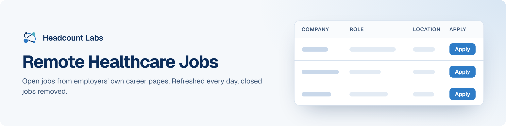

# Remote Healthcare Jobs

Remote nursing, clinical, medical coding and healthcare jobs at US employers.

**400 open jobs** · 80 new since the last update · 80 removed because they closed or left the employer's board · updated October 23, 2026 at 5:47 AM EDT

This list is built and refreshed every day by [Headcount Labs](https://headcountlabs.com/?utm_source=github&utm_medium=job-list&utm_campaign=remote-healthcare-jobs), which reads jobs straight from employers' own career pages and job boards. Every job here was still listed on its source board when we last read that board, within the past 3 days, and was posted in the past 30 days. Copies of the same job are merged into one row, and jobs that close are removed at the next update.

Want this data in your own app or agent? Use the [Headcount Labs jobs API](https://headcountlabs.com/docs/?utm_source=github&utm_medium=job-list&utm_campaign=remote-healthcare-jobs) (free tier), the [MCP server](https://headcountlabs.com/mcp/?utm_source=github&utm_medium=job-list&utm_campaign=remote-healthcare-jobs) for Claude, ChatGPT and other AI assistants, or the [public dataset subsets](https://huggingface.co/HeadcountLabs) on Hugging Face (the full dataset is coming soon).

**Full dataset.** A bigger, one-off snapshot dated 2026-10-19 (all matching jobs, not only the open jobs below) is on Hugging Face: [Remote jobs](https://huggingface.co/datasets/HeadcountLabs/remote-jobs) · [Healthcare jobs](https://huggingface.co/datasets/HeadcountLabs/healthcare-jobs). It loads with `datasets.load_dataset` and is under the Open Database License (ODbL) 1.0.

**Jump to:** [Posted in the last 7 days (201)](#posted-in-the-last-7-days) · [Posted 8 to 30 days ago (199)](#posted-8-to-30-days-ago)

**Columns.** *Apply* opens the original posting on the employer's site. *Details* opens the job on Headcount Labs, with every posting we found for it. *Remote* shows what the employer states; a dash means the posting doesn't say. *Pay* is the range the employer published.

## Posted in the last 7 days

| Company | Role | Location | Remote | Pay | Posted | Apply | Details |
| --- | --- | --- | --- | --- | --- | :---: | :---: |
| **USO US Oncology Corporate, Inc.** | Director of National Accounts, Health Systems | 

2 locations
Tennessee Texas
 | Remote | $177k–$296k/yr | Oct 21 |  | <a href="https://headcountlabs.com/catalog/jobs/da49e0ac-050d-49d9-a5f3-790d1258cadf?utm_source=github&utm_medium=job-list&utm_campaign=remote-healthcare-jobs">via Headcount Labs</a> |
| **TransPerfect** | Freelance Translator - Thai (Thailand) - Medical Benefits | New York, NY | Remote | — | Oct 21 |  | <a href="https://headcountlabs.com/catalog/jobs/0edfdbe0-7abf-450d-b617-0a07bfa21d29?utm_source=github&utm_medium=job-list&utm_campaign=remote-healthcare-jobs">via Headcount Labs</a> |
| **The CTI Team** | Medical Director - Oncology | Covington, KY | Remote | — | Oct 21 |  | <a href="https://headcountlabs.com/catalog/jobs/8063e8e7-149c-4f96-b633-558e5273a3af?utm_source=github&utm_medium=job-list&utm_campaign=remote-healthcare-jobs">via Headcount Labs</a> |
| **The Christ Hospital Health Network** | TCHP Coder | United States | Remote | — | Oct 21 |  | <a href="https://headcountlabs.com/catalog/jobs/876e24b4-14f6-41d9-90b0-caeafd4440c8?utm_source=github&utm_medium=job-list&utm_campaign=remote-healthcare-jobs">via Headcount Labs</a> |
| **SCI Summit Consulting, LLC** | Medical Only Claims Representative | Illinois | Remote | $56k–$76k/yr | Oct 21 |  | <a href="https://headcountlabs.com/catalog/jobs/f3264408-8035-4c7c-bca8-4c79ddedce0a?utm_source=github&utm_medium=job-list&utm_campaign=remote-healthcare-jobs">via Headcount Labs</a> |
| **Parexel International, LLC** | Clinical Scientist - FSP | 

51 locations
North Carolina Any Region Alabama Alaska Arizona Arkansas California Colorado Connecticut Delaware Florida Georgia +39 more
 | Remote | — | Oct 21 |  | <a href="https://headcountlabs.com/catalog/jobs/c5ef1b7d-586d-451b-88d1-d539613ef271?utm_source=github&utm_medium=job-list&utm_campaign=remote-healthcare-jobs">via Headcount Labs</a> |
| **OTN McKesson Specialty Care Distribution LLC** | MTCS Pharmacist (Delaware Licensure) | United States | Remote | $116k–$194k/yr | Oct 21 |  | <a href="https://headcountlabs.com/catalog/jobs/c1126db9-3317-4195-b2f9-338f066f7221?utm_source=github&utm_medium=job-list&utm_campaign=remote-healthcare-jobs">via Headcount Labs</a> |
| **NCD** | Clinical Research &amp; Escalation Specialist | Dallas, TX | Remote | — | Oct 21 |  | <a href="https://headcountlabs.com/catalog/jobs/6d241f7d-530e-4aff-878f-87a3add42c67?utm_source=github&utm_medium=job-list&utm_campaign=remote-healthcare-jobs">via Headcount Labs</a> |
| **MySpectrum** | Licensed Mental Health Therapists (LCSW or LPC) | 

3 locations
Winston Salem, NC Greensboro, NC Wake Forest, NC
 | Remote | $22k–$99k/yr | Oct 21 |  | <a href="https://headcountlabs.com/catalog/jobs/bf0450da-821d-43d0-89c7-d205e502e0aa?utm_source=github&utm_medium=job-list&utm_campaign=remote-healthcare-jobs">via Headcount Labs</a> |
| **Modernizing Medicine, Inc.** | Medical Director, Gastroenterology | United States | Remote | — | Oct 21 |  | <a href="https://headcountlabs.com/catalog/jobs/8569c8db-87ee-4d28-881c-6fd4380490ed?utm_source=github&utm_medium=job-list&utm_campaign=remote-healthcare-jobs">via Headcount Labs</a> |
| **MDU Medtronic USA Inc** | Coronary Principal Clinical Specialist - Bakersfield, CA | Bakersfield, CA | Remote | $120k/yr | Oct 21 |  | <a href="https://headcountlabs.com/catalog/jobs/80e3ff4e-41f0-473a-af0d-cdc90731b559?utm_source=github&utm_medium=job-list&utm_campaign=remote-healthcare-jobs">via Headcount Labs</a> |
| **MDU Medtronic USA Inc** | CRM Associate Clinical Specialist - Birmingham, AL | Birmingham, AL | Remote | $70k–$79k/yr | Oct 21 |  | <a href="https://headcountlabs.com/catalog/jobs/75fefc3e-c33f-4244-b55e-8fa26e854289?utm_source=github&utm_medium=job-list&utm_campaign=remote-healthcare-jobs">via Headcount Labs</a> |
| **MDU Medtronic USA Inc** | Clinical Specialist, Deep Brain Stimulation (DBS) - Iowa City / Des Moines, IA | 

2 locations
Iowa City, IA Des Moines, IA
 | Remote | $76k–$114k/yr | Oct 21 |  | <a href="https://headcountlabs.com/catalog/jobs/280e6da4-36e1-41ba-913d-87ae9f9dde7c?utm_source=github&utm_medium=job-list&utm_campaign=remote-healthcare-jobs">via Headcount Labs</a> |
| **LE001 Dana-Farber Cancer Institute, Inc.** | Outpatient Coder | United States | Remote | $56k–$64k/yr | Oct 21 |  | <a href="https://headcountlabs.com/catalog/jobs/3051cbf1-741a-462e-8c45-9151be406ec5?utm_source=github&utm_medium=job-list&utm_campaign=remote-healthcare-jobs">via Headcount Labs</a> |
| **Kite Pharma, Inc.** | Sr Manager, Clinical Data Management | offsite | Remote | $143k–$185k/yr | Oct 21 |  | <a href="https://headcountlabs.com/catalog/jobs/87a823a0-afa0-4a95-ba7b-9e94c2b8c67d?utm_source=github&utm_medium=job-list&utm_campaign=remote-healthcare-jobs">via Headcount Labs</a> |
| **Jobgether** | Senior Director of Strategy - Women's Health | United States | Remote | $176k–$264k/yr | Oct 21 |  | <a href="https://headcountlabs.com/catalog/jobs/ea9cb766-0326-4594-b3e4-3e3c0932866c?utm_source=github&utm_medium=job-list&utm_campaign=remote-healthcare-jobs">via Headcount Labs</a> |
| **Jobgether** | RN Clinical Data Annotation Specialist | United States | Remote | — | Oct 21 |  | <a href="https://headcountlabs.com/catalog/jobs/54b04825-9960-498c-b011-de7786494777?utm_source=github&utm_medium=job-list&utm_campaign=remote-healthcare-jobs">via Headcount Labs</a> |
| **Jobgether** | Senior Manager, Clinical Data Management, Study Lead | United States | Remote | $134k–$219k/yr | Oct 21 |  | <a href="https://headcountlabs.com/catalog/jobs/e4de9bca-74af-41e5-aa09-cc3fc5612855?utm_source=github&utm_medium=job-list&utm_campaign=remote-healthcare-jobs">via Headcount Labs</a> |
| **Jobgether** | Senior Project Manager - Health &amp; Life Sciences Market Research | United States | Remote | $85k–$110k/yr | Oct 21 |  | <a href="https://headcountlabs.com/catalog/jobs/22faf2c6-87d2-499e-94cd-3245f5d057d2?utm_source=github&utm_medium=job-list&utm_campaign=remote-healthcare-jobs">via Headcount Labs</a> |
| **Jobgether** | Salesforce Health Cloud Business Systems Analyst (BSA) | United States | Remote | — | Oct 21 |  | <a href="https://headcountlabs.com/catalog/jobs/b3181da2-1623-469a-9aca-760ea3a36a83?utm_source=github&utm_medium=job-list&utm_campaign=remote-healthcare-jobs">via Headcount Labs</a> |
| **Jobgether** | Clinical Denials Management Specialist | United States | Remote | $71k–$133k/yr | Oct 21 |  | <a href="https://headcountlabs.com/catalog/jobs/e54b2c4d-77e7-4458-9515-dfd6e0e48201?utm_source=github&utm_medium=job-list&utm_campaign=remote-healthcare-jobs">via Headcount Labs</a> |
| **Jobgether** | Clinical Dispatcher - Full-Time/2nd Shift | United States | Remote | — | Oct 21 |  | <a href="https://headcountlabs.com/catalog/jobs/f9987c9e-f6e9-4f03-b3b1-5505d228252a?utm_source=github&utm_medium=job-list&utm_campaign=remote-healthcare-jobs">via Headcount Labs</a> |
| **Jobgether** | Director, AI Strategy &amp; Mental Health | United States | Remote | $120k–$160k/yr | Oct 21 |  | <a href="https://headcountlabs.com/catalog/jobs/c2cbaf5e-be48-409d-8fd4-83f3d170472e?utm_source=github&utm_medium=job-list&utm_campaign=remote-healthcare-jobs">via Headcount Labs</a> |
| **InterMed** | Clinical Care Rep RN OBGYN | South Portland, ME | Remote | — | Oct 21 |  | <a href="https://headcountlabs.com/catalog/jobs/50076b0d-44d1-4daf-a7fd-28c36fc00978?utm_source=github&utm_medium=job-list&utm_campaign=remote-healthcare-jobs">via Headcount Labs</a> |
| **Health Care Service Corp.** | Clinical Pharmacist (Remote in Arizona or New Mexico) | 

2 locations
United States Phoenix, AZ
 | Remote | $102k–$184k/yr | Oct 21 |  | <a href="https://headcountlabs.com/catalog/jobs/b8d4f00c-e3b3-4c6b-a89d-58cf32f9cea3?utm_source=github&utm_medium=job-list&utm_campaign=remote-healthcare-jobs">via Headcount Labs</a> |
| **Gotham Enterprises Ltd** | Licensed Professional Clinical Counselor (LPCC) | 

2 locations
Albuquerque, NM Jeffersontown, KY
 | Remote | — | Oct 21 |  | <a href="https://headcountlabs.com/catalog/jobs/352e9f77-fcf7-4d47-8782-46f7569d8c78?utm_source=github&utm_medium=job-list&utm_campaign=remote-healthcare-jobs">via Headcount Labs</a> |
| **Gotham Enterprises Ltd** | Licensed Clinical Social Worker (LCSW) | 

8 locations
Overland Park, KS Middletown, DE Los Angeles, CA Chicago, IL Rio Rancho, NM Knoxville, TN Jersey City, NJ Weatherford, OK
 | Remote | — | Oct 21 |  | <a href="https://headcountlabs.com/catalog/jobs/bf43e5ae-e500-432b-a0d7-2b3d34904d42?utm_source=github&utm_medium=job-list&utm_campaign=remote-healthcare-jobs">via Headcount Labs</a> |
| **Gotham Enterprises Ltd** | Licensed Clinical Professional Counselor (LCPC) | 

4 locations
Garden City, KS Plentywood, MT Cal-Nev-Ari, NV Frederick, MD
 | Remote | — | Oct 21 |  | <a href="https://headcountlabs.com/catalog/jobs/d5981db3-c3fb-43bf-be82-11c89a429d0d?utm_source=github&utm_medium=job-list&utm_campaign=remote-healthcare-jobs">via Headcount Labs</a> |
| **Gotham Enterprises Ltd** | Licensed Marriage and Family Therapist (LMFT) | 

12 locations
Louisville, KY Northfield, NH Moline, IL Carrollton, TX Milbank, SD Battle Creek, MI Mobile, AL Blue Springs, MO Augusta, GA Anchorage, AK Rocky Mount, NC Parkersburg, WV
 | Remote | — | Oct 21 |  | <a href="https://headcountlabs.com/catalog/jobs/d9c9e9b6-4fe2-4662-85f6-b4e230e13a55?utm_source=github&utm_medium=job-list&utm_campaign=remote-healthcare-jobs">via Headcount Labs</a> |
| **Gotham Enterprises Ltd** | Licensed Mental Health Counselor (LMHC) | 

2 locations
Lakeland, FL Worcester, MA
 | Remote | — | Oct 21 |  | <a href="https://headcountlabs.com/catalog/jobs/dff1763a-0864-4d65-9e9d-22ae04368e79?utm_source=github&utm_medium=job-list&utm_campaign=remote-healthcare-jobs">via Headcount Labs</a> |
| **Gotham Enterprises Ltd** | Licensed Mental Health Counselor (LCSW, LMFT, LMHC) | Auburn, NY | Remote | — | Oct 21 |  | <a href="https://headcountlabs.com/catalog/jobs/b200c939-be62-4342-884f-7a477edf5320?utm_source=github&utm_medium=job-list&utm_campaign=remote-healthcare-jobs">via Headcount Labs</a> |
| **Gotham Enterprises Ltd** | Licensed Mental Health Counselor (LMFT, LMHC, LCSW) | Cartersburg, IN | Remote | — | Oct 21 |  | <a href="https://headcountlabs.com/catalog/jobs/2dca2f08-3d1e-4b70-b931-ae60e299edb6?utm_source=github&utm_medium=job-list&utm_campaign=remote-healthcare-jobs">via Headcount Labs</a> |
| **Gotham Enterprises Ltd** | Licensed Certified Social Worker-Clinical (LCSW-C) | Baltimore, MD | Remote | — | Oct 21 |  | <a href="https://headcountlabs.com/catalog/jobs/ec0c4bc3-f77e-4aca-a136-a555640c5840?utm_source=github&utm_medium=job-list&utm_campaign=remote-healthcare-jobs">via Headcount Labs</a> |
| **FTINC Fortrea Inc.** | Clinical Trial Manager | 

3 locations
Durham North Carolina United States
 | Remote | $76k–$148k/yr | Oct 21 |  | <a href="https://headcountlabs.com/catalog/jobs/f84b6b94-c860-43b4-9dfb-f378798a124c?utm_source=github&utm_medium=job-list&utm_campaign=remote-healthcare-jobs">via Headcount Labs</a> |
| **FTINC Fortrea Inc.** | Senior Clinical Data Manager | 

2 locations
Durham Durham, NC
 | Remote | $110k–$130k/yr | Oct 21 |  | <a href="https://headcountlabs.com/catalog/jobs/17830e8f-1366-4654-b67b-a04635a5609b?utm_source=github&utm_medium=job-list&utm_campaign=remote-healthcare-jobs">via Headcount Labs</a> |
| **Flourish and Thrive Labs** | Salesforce Architect &#124; Public Health &#124; Public Sector | United States | Remote | — | Oct 21 |  | <a href="https://headcountlabs.com/catalog/jobs/b1eab97a-07d4-42a7-a44a-56558e639330?utm_source=github&utm_medium=job-list&utm_campaign=remote-healthcare-jobs">via Headcount Labs</a> |
| **Eli Lilly and Company** | Manager, Clinical Supply Chain | United States | Remote | $105k–$169k/yr | Oct 21 |  | <a href="https://headcountlabs.com/catalog/jobs/9e8fdc1a-477c-4b7f-b59c-5423da09e60c?utm_source=github&utm_medium=job-list&utm_campaign=remote-healthcare-jobs">via Headcount Labs</a> |
| **Eisai Inc.** | Director, Clinical Quality Assurance | 

3 locations
United States Nutley Pennsylvania
 | Remote | $195k–$256k/yr | Oct 21 |  | <a href="https://headcountlabs.com/catalog/jobs/a5d20188-c54e-47e2-a59b-6c101a0544fc?utm_source=github&utm_medium=job-list&utm_campaign=remote-healthcare-jobs">via Headcount Labs</a> |
| **Daymark Health** | Licensed Independent Clinical Social Worker | California | Remote | $85k–$110k/yr | Oct 21 |  | <a href="https://headcountlabs.com/catalog/jobs/d5de9a4d-455d-4859-9e91-11e0b45b666e?utm_source=github&utm_medium=job-list&utm_campaign=remote-healthcare-jobs">via Headcount Labs</a> |
| **Datavant** | EG- Health Information Specialist I-Entry Level | Alabama, Georgia, Louisiana, Kansas, Mississippi, North Carolina, SC | Remote | $15/hr | Oct 21 |  | <a href="https://headcountlabs.com/catalog/jobs/2f9a93d8-403f-4157-991a-40acfefaec57?utm_source=github&utm_medium=job-list&utm_campaign=remote-healthcare-jobs">via Headcount Labs</a> |
| **COV Covidien LP** | Senior Field Market Development Manager - Digital Health, Acute Care and Monitoring | Lafayette, CO | Remote | $127k–$191k/yr | Oct 21 |  | <a href="https://headcountlabs.com/catalog/jobs/67bc91b3-b226-46c6-a67c-d35957fc19a4?utm_source=github&utm_medium=job-list&utm_campaign=remote-healthcare-jobs">via Headcount Labs</a> |
| **CHPW** | HEDIS Quality Improvement Nurse | Seattle, WA | Remote | — | Oct 21 |  | <a href="https://headcountlabs.com/catalog/jobs/1e89e72a-6fbd-44fa-b6a0-4ff88682fdc5?utm_source=github&utm_medium=job-list&utm_campaign=remote-healthcare-jobs">via Headcount Labs</a> |
| **Caring Hand Home Health Solutions, Inc.** | Certified Home Health Aide | 

11 locations
Linda, CA Loma Rica, CA Marysville, CA Olivehurst, CA Plumas Lake, CA Wheatland, CA Cameron Park, CA Diamond Springs, CA El Dorado City, CA Placerville, CA Shingle Springs, CA
 | Remote | — | Oct 21 |  | <a href="https://headcountlabs.com/catalog/jobs/c55b7717-04b0-4828-9708-fa1cd0957409?utm_source=github&utm_medium=job-list&utm_campaign=remote-healthcare-jobs">via Headcount Labs</a> |
| **Brown &amp; Brown, Inc** | Accident and Health Claims Examiner | United States | Remote | $18–$19/hr | Oct 21 |  | <a href="https://headcountlabs.com/catalog/jobs/c3733478-5079-439f-972e-475afd5e72a8?utm_source=github&utm_medium=job-list&utm_campaign=remote-healthcare-jobs">via Headcount Labs</a> |
| **BEHAVIORAL HEALTH PRACTICE SERVICES LLC.** | Head of Clinical Quality and Regulatory | United States | Remote | $208k–$220k/yr | Oct 21 |  | <a href="https://headcountlabs.com/catalog/jobs/c155d9ff-8d52-42ec-a047-bfbb40de994d?utm_source=github&utm_medium=job-list&utm_campaign=remote-healthcare-jobs">via Headcount Labs</a> |
| **Alimentiv** | Clinical Project Manager | 

8 locations
Raleigh-Durham, NC Philadelphia, PA Cincinatti, OH Houston, TX Dallas, TX Toronto Vancouver Montreal
 | Remote | $96k–$159k/yr | Oct 21 |  | <a href="https://headcountlabs.com/catalog/jobs/9c2e658b-8e49-4455-9e82-4638c2ac48bc?utm_source=github&utm_medium=job-list&utm_campaign=remote-healthcare-jobs">via Headcount Labs</a> |
| **Alimentiv** | Project Director - Clinical Study Management | 

8 locations
Raleigh-Durham, NC Newark, NJ Philadelphia, PA Boston, MA Columbus, OH Dallas, TX Toronto Montreal
 | Remote | $110k–$184k/yr | Oct 21 |  | <a href="https://headcountlabs.com/catalog/jobs/03ebe713-7ae6-4b9f-a6d3-960d23130c31?utm_source=github&utm_medium=job-list&utm_campaign=remote-healthcare-jobs">via Headcount Labs</a> |
| **AbbVie** | Clinical Account Executive - Multiple Myeloma - Charleston, SC | Charleston, SC | Remote | $132k–$238k/yr | Oct 21 |  | <a href="https://headcountlabs.com/catalog/jobs/2a5f0c87-d0cc-4ed8-9c72-c2f8b23eb45b?utm_source=github&utm_medium=job-list&utm_campaign=remote-healthcare-jobs">via Headcount Labs</a> |
| **11 Premier Research International LLC** | Clinical Lead III | Regional_FL | Remote | $122k/yr | Oct 21 |  | <a href="https://headcountlabs.com/catalog/jobs/dcf86e98-43e5-42bd-ac44-fa3ca2fef141?utm_source=github&utm_medium=job-list&utm_campaign=remote-healthcare-jobs">via Headcount Labs</a> |
| **Yale University** | Medical Coding and Billing Assistant 2 | United States | Remote | — | Oct 20 |  | <a href="https://headcountlabs.com/catalog/jobs/825742fc-51c4-4916-afcd-0c0d9fb36bf1?utm_source=github&utm_medium=job-list&utm_campaign=remote-healthcare-jobs">via Headcount Labs</a> |
| **Worldwide Clinical Trials Holdings, Inc.** | Senior Clinical Research Associate - Psychiatry (US, Central) | United States | Remote | — | Oct 20 |  | <a href="https://headcountlabs.com/catalog/jobs/47999833-4510-4a57-9969-137ebf56d39d?utm_source=github&utm_medium=job-list&utm_campaign=remote-healthcare-jobs">via Headcount Labs</a> |
| **WellSky Administrative Services Corporation** | Clinical Operations Nurse - Emergency Department Transitions | United States | Remote | — | Oct 20 |  | <a href="https://headcountlabs.com/catalog/jobs/0560f367-efd9-4237-9fb5-c6b2ab4e3065?utm_source=github&utm_medium=job-list&utm_campaign=remote-healthcare-jobs">via Headcount Labs</a> |
| **Valeris, Inc.** | Program Manager, Client Services, Clinical Trial Support | North Carolina | Remote | — | Oct 20 |  | <a href="https://headcountlabs.com/catalog/jobs/b361b6b3-338e-4219-855c-b27f66e331f2?utm_source=github&utm_medium=job-list&utm_campaign=remote-healthcare-jobs">via Headcount Labs</a> |
| **Upperline Health** | Clinical Dietitian | 

3 locations
Orlando, FL Birmingham, AL Columbia, SC
 | Remote | — | Oct 20 |  | <a href="https://headcountlabs.com/catalog/jobs/67aed121-78a3-4f21-a06b-07dbfde74f66?utm_source=github&utm_medium=job-list&utm_campaign=remote-healthcare-jobs">via Headcount Labs</a> |
| **UL, LLC** | Senior Project Engineer - Medical Regulatory Services | United States | Remote | — | Oct 20 |  | <a href="https://headcountlabs.com/catalog/jobs/969e8390-57b3-4fc2-9758-37325ac8f313?utm_source=github&utm_medium=job-list&utm_campaign=remote-healthcare-jobs">via Headcount Labs</a> |
| **The Cigna Group** | Agile Product Manager, Global Health Benefits - Cigna Healthcare - Remote | United States | Remote | $99k–$165k/yr | Oct 20 |  | <a href="https://headcountlabs.com/catalog/jobs/0339418d-28ce-45ce-9092-43d0f6508cc4?utm_source=github&utm_medium=job-list&utm_campaign=remote-healthcare-jobs">via Headcount Labs</a> |
| **The Cigna Group** | Senior Director, Head of Enterprise Clinical AI &amp; Technology - Remote - The Cigna Group | United States | Remote | $193k–$322k/yr | Oct 20 |  | <a href="https://headcountlabs.com/catalog/jobs/dee53855-cf2d-46c8-bc0b-c3950836647c?utm_source=github&utm_medium=job-list&utm_campaign=remote-healthcare-jobs">via Headcount Labs</a> |
| **SynergenX Health Holdings LLC** | Telehealth Family Nurse Practitioner | Indianapolis, IN | Remote | $120k/yr | Oct 20 |  | <a href="https://headcountlabs.com/catalog/jobs/c6c999b8-2eff-480f-b01c-9410e88b6e3a?utm_source=github&utm_medium=job-list&utm_campaign=remote-healthcare-jobs">via Headcount Labs</a> |
| **Syneos Health, LLC** | Experienced Clinical Research Associate &#124; Regionally Aligned Across US | 

52 locations
Texas Alaska Alabama Arkansas Arizona California Colorado Connecticut District of Columbia Delaware Florida Georgia +40 more
 | Remote | — | Oct 20 |  | <a href="https://headcountlabs.com/catalog/jobs/3e6cfa79-6bdd-42db-a71e-4ee7bcfe0c14?utm_source=github&utm_medium=job-list&utm_campaign=remote-healthcare-jobs">via Headcount Labs</a> |
| **ServiceNow** | Client Director - Health Life Sciences | New York City, NY | Remote | $174k–$198k/yr | Oct 20 |  | <a href="https://headcountlabs.com/catalog/jobs/2bd26668-b7cf-4491-8f18-f612a5784730?utm_source=github&utm_medium=job-list&utm_campaign=remote-healthcare-jobs">via Headcount Labs</a> |
| **Seasoned Recruitment** | Telehealth: Psychiatric Mental Health Nurse Practitioner (PMHNP) | 

118 locations
Arlington, TX Bakersfield, CA Honolulu, HI New Orleans, LA Tampa, FL Wichita, KS Cambridge, MA High Point, NC Murrieta, CA Pueblo, CO Richmond, CA West Covina, CA +106 more
 | Remote | — | Oct 20 |  | <a href="https://headcountlabs.com/catalog/jobs/fe9eb583-a468-4d5a-b671-c7244144f20d?utm_source=github&utm_medium=job-list&utm_campaign=remote-healthcare-jobs">via Headcount Labs</a> |
| **Rogers Memorial Hospital, Inc.** | Lead Professional Coder | Oconomowoc, WI | Remote | — | Oct 20 |  | <a href="https://headcountlabs.com/catalog/jobs/66b379c0-833d-41a8-83c5-f8f30e776b6c?utm_source=github&utm_medium=job-list&utm_campaign=remote-healthcare-jobs">via Headcount Labs</a> |
| **Rising Medical Solutions** | Utilization Review Nurse | Chicago, IL | Remote | — | Oct 20 |  | <a href="https://headcountlabs.com/catalog/jobs/78bbaaa2-402a-4147-aaaf-ee450222ff7b?utm_source=github&utm_medium=job-list&utm_campaign=remote-healthcare-jobs">via Headcount Labs</a> |
| **RHI Radion Health, Inc.** | Entry-Level Sales Representative - Great American Employer Health Solutions | 

45 locations
Ohio Alabama Alaska Arizona Arkansas Colorado Connecticut Delaware Florida Georgia Idaho Illinois +33 more
 | Remote | $65k/yr | Oct 20 |  | <a href="https://headcountlabs.com/catalog/jobs/db4d5a73-6f02-47f3-b07d-2d8b5bdf3b1f?utm_source=github&utm_medium=job-list&utm_campaign=remote-healthcare-jobs">via Headcount Labs</a> |
| **Regeneron Pharmaceuticals, Inc (USA)** | Senior Manager, Clinical Data Management, Study Lead | United States | Remote | $134k–$219k/yr | Oct 20 |  | <a href="https://headcountlabs.com/catalog/jobs/3bbd5e0f-d16c-4653-9c34-7919b780246a?utm_source=github&utm_medium=job-list&utm_campaign=remote-healthcare-jobs">via Headcount Labs</a> |
| **Receptive** | Nurse Practitioner - ADHD Diagnosis and Treatment (New York) | New York, NY | Remote | $120/hr | Oct 20 |  | <a href="https://headcountlabs.com/catalog/jobs/e56b41b8-26c7-44a3-a511-7c9945166d45?utm_source=github&utm_medium=job-list&utm_campaign=remote-healthcare-jobs">via Headcount Labs</a> |
| **Pinnacle Treatment Centers** | Dir. Medical Records | United States | Remote | — | Oct 20 |  | <a href="https://headcountlabs.com/catalog/jobs/f25113b0-4e21-45ef-b6ba-e9b118e84846?utm_source=github&utm_medium=job-list&utm_campaign=remote-healthcare-jobs">via Headcount Labs</a> |
| **Penumbra** | Clinical Data Manager (Temporary Position, 20 hours/week) | Your US Home Office | Remote | $50–$80/hr | Oct 20 |  | <a href="https://headcountlabs.com/catalog/jobs/a798e340-4881-42c3-b166-05d3f960f095?utm_source=github&utm_medium=job-list&utm_campaign=remote-healthcare-jobs">via Headcount Labs</a> |
| **Pavion** | Director of Environmental, Health &amp; Safety (EH&amp;S) | Chantilly, VA | Remote | $150k–$200k/yr | Oct 20 |  | <a href="https://headcountlabs.com/catalog/jobs/7b0b94c5-7371-45d3-b972-36b0cd6add90?utm_source=github&utm_medium=job-list&utm_campaign=remote-healthcare-jobs">via Headcount Labs</a> |
| **Orthopaedic Management Services** | Coder | Omaha, NE | Remote | — | Oct 20 |  | <a href="https://headcountlabs.com/catalog/jobs/521352c2-74fb-4595-8f12-1b918ba28a12?utm_source=github&utm_medium=job-list&utm_campaign=remote-healthcare-jobs">via Headcount Labs</a> |
| **Navita Health** | Clinical Counselor: SUD and Mental Health | Dublin, OH | Remote | $60k–$70k/yr | Oct 20 |  | <a href="https://headcountlabs.com/catalog/jobs/7439163d-8467-4837-9ba4-adcf8d785729?utm_source=github&utm_medium=job-list&utm_campaign=remote-healthcare-jobs">via Headcount Labs</a> |
| **MRO Corporation** | Remote ROI Medical Records Specialist | 

2 locations
Jackson, MS Pikeville, KY
 | Remote | $15–$19/hr | Oct 20 |  | <a href="https://headcountlabs.com/catalog/jobs/ca3b7092-0f62-4448-9812-fba2e31322b4?utm_source=github&utm_medium=job-list&utm_campaign=remote-healthcare-jobs">via Headcount Labs</a> |
| **Mindrift** | Hospitalist / Internist - Medical AI Evaluation (Remote, Part-Time) | United States | Remote | — | Oct 20 |  | <a href="https://headcountlabs.com/catalog/jobs/07ddfee1-9e90-404f-9e50-339f4e26aa5f?utm_source=github&utm_medium=job-list&utm_campaign=remote-healthcare-jobs">via Headcount Labs</a> |
| **MedWatch** | Medical Review Coordinator / LPN | Lake Mary, FL | Remote | $23–$27/hr | Oct 20 |  | <a href="https://headcountlabs.com/catalog/jobs/b95c6fd0-7cf4-444e-9bb5-10c4f9a09d6c?utm_source=github&utm_medium=job-list&utm_campaign=remote-healthcare-jobs">via Headcount Labs</a> |
| **MedWatch** | Medical Review Specialist / RN | Lake Mary, FL | Remote | $61k–$68k/yr | Oct 20 |  | <a href="https://headcountlabs.com/catalog/jobs/4caf4252-2b75-4350-8aa8-7b8f849549c0?utm_source=github&utm_medium=job-list&utm_campaign=remote-healthcare-jobs">via Headcount Labs</a> |
| **MED Medtronic Inc** | Field Service Engineer III - San Antonio, TX (Medical Imaging / X-ray) | 

2 locations
State of Texas San Antonio, TX
 | Remote | $60k–$90k/yr | Oct 20 |  | <a href="https://headcountlabs.com/catalog/jobs/6bfcfdfa-f1c6-4d2b-a178-10adc42afc37?utm_source=github&utm_medium=job-list&utm_campaign=remote-healthcare-jobs">via Headcount Labs</a> |
| **MDU Medtronic USA Inc** | Associate Clinical Specialist, Pain Interventions - Charleston, WV | Charleston, WV | Remote | $64k–$96k/yr | Oct 20 |  | <a href="https://headcountlabs.com/catalog/jobs/2e543328-e794-44e1-90aa-e569178a8307?utm_source=github&utm_medium=job-list&utm_campaign=remote-healthcare-jobs">via Headcount Labs</a> |
| **MDU Medtronic USA Inc** | Cardiac Rhythm Management Clinical Specialist - Columbus, GA | Atlanta, GA | Remote | $72k–$90k/yr | Oct 20 |  | <a href="https://headcountlabs.com/catalog/jobs/4b5e18c0-5908-4573-889c-3bac422d16cb?utm_source=github&utm_medium=job-list&utm_campaign=remote-healthcare-jobs">via Headcount Labs</a> |
| **MDU Medtronic USA Inc** | Cardiac Rhythm Management Clinical Specialist - Gainsville/Athens/Gwinnett | Atlanta, GA | Remote | $72k–$90k/yr | Oct 20 |  | <a href="https://headcountlabs.com/catalog/jobs/2befeb45-85ae-416f-bb92-3b8ef5920d08?utm_source=github&utm_medium=job-list&utm_campaign=remote-healthcare-jobs">via Headcount Labs</a> |
| **MDU Medtronic USA Inc** | Clinical Specialist CRM - Sarasota / Fort Myers | Sarasota, FL | Remote | $72k–$90k/yr | Oct 20 |  | <a href="https://headcountlabs.com/catalog/jobs/969d17c2-0435-4230-9b48-a49ad6081843?utm_source=github&utm_medium=job-list&utm_campaign=remote-healthcare-jobs">via Headcount Labs</a> |
| **MDU Medtronic USA Inc** | Associate Clinical Specialist (CRM): Winter 2026 &amp; Spring 2027 Undergraduates | 

50 locations
State of Minnesota State of Alabama State of Alaska State of Arizona State of Arkansas State of California State of Colorado State of Connecticut State of Delaware State of Florida State of Georgia State of Hawaii +38 more
 | Remote | — | Oct 20 |  | <a href="https://headcountlabs.com/catalog/jobs/daaee0af-1030-47c2-b10f-e6cd96fc0ab9?utm_source=github&utm_medium=job-list&utm_campaign=remote-healthcare-jobs">via Headcount Labs</a> |
| **Matrix Absence Management, Inc.** | Clinical Nurse Specialist | Arizona | Remote | $67k–$96k/yr | Oct 20 |  | <a href="https://headcountlabs.com/catalog/jobs/14d9f695-571c-4850-b828-3912786d3a6d?utm_source=github&utm_medium=job-list&utm_campaign=remote-healthcare-jobs">via Headcount Labs</a> |
| **JumpstartMD, Inc** | Physician Assistant / Nurse Practitioner Telehealth | 

3 locations
California Florida Texas
 | Remote | — | Oct 20 |  | <a href="https://headcountlabs.com/catalog/jobs/07409660-654c-436b-b691-2764e22c2c98?utm_source=github&utm_medium=job-list&utm_campaign=remote-healthcare-jobs">via Headcount Labs</a> |
| **IKS Health** | Remote Full Time Facility Inpatient Acute Care Medical Coder | Virtual | Remote | $36/hr | Oct 20 |  | <a href="https://headcountlabs.com/catalog/jobs/4ccd4625-6b0a-4ea6-95d9-8aa6297738b3?utm_source=github&utm_medium=job-list&utm_campaign=remote-healthcare-jobs">via Headcount Labs</a> |
| **ICR United States USA** | Senior Clinical Research Associate | Blue Bell | Remote | — | Oct 20 |  | <a href="https://headcountlabs.com/catalog/jobs/7b8ad372-c19c-47cf-9a52-3302b955b055?utm_source=github&utm_medium=job-list&utm_campaign=remote-healthcare-jobs">via Headcount Labs</a> |
| **ICR United States USA** | Clinical Research Associate | 

14 locations
Blue Bell California Arizona Nebraska Nevada New Mexico Texas Washington Connecticut Massachusetts New Jersey Pennsylvania +2 more
 | Remote | $91k–$114k/yr | Oct 20 |  | <a href="https://headcountlabs.com/catalog/jobs/8c0d5624-d9ae-4a73-a395-5ed38add9c4d?utm_source=github&utm_medium=job-list&utm_campaign=remote-healthcare-jobs">via Headcount Labs</a> |
| **Health Care Service Corp.** | Nurse Liaison I - Utilization Management &amp; Quality Review - Remote | United States | Remote | $70k–$126k/yr | Oct 20 |  | <a href="https://headcountlabs.com/catalog/jobs/d8fdb988-b069-46b2-af42-d01522e96900?utm_source=github&utm_medium=job-list&utm_campaign=remote-healthcare-jobs">via Headcount Labs</a> |
| **Fotona** | Territory Manager - Aesthetic/Medical Lasers (San Diego) | San Diego, CA | Remote | $60k–$130k/yr | Oct 20 |  | <a href="https://headcountlabs.com/catalog/jobs/dd940387-afe0-4fbc-bf15-fb637c1b9a26?utm_source=github&utm_medium=job-list&utm_campaign=remote-healthcare-jobs">via Headcount Labs</a> |
| **Entrada Therapeutics** | Clinical Pharmacology Consultant | Boston, MA | Remote | — | Oct 20 |  | <a href="https://headcountlabs.com/catalog/jobs/30f5caac-603f-4875-9577-5cad663dbb77?utm_source=github&utm_medium=job-list&utm_campaign=remote-healthcare-jobs">via Headcount Labs</a> |
| **Datavant** | Health Information Specialist I | South Carolina, AL | Remote | $15/hr | Oct 20 |  | <a href="https://headcountlabs.com/catalog/jobs/ec94041d-0891-4459-9011-3956668f9be3?utm_source=github&utm_medium=job-list&utm_campaign=remote-healthcare-jobs">via Headcount Labs</a> |
| **CVS Covidien Sales LLC** | Surgical Onsite Specialist - Lung Health (Chicago, IL/Kansas City, MO) | 

2 locations
Chicago, IL Kansas City, MO
 | Remote | $70k/yr | Oct 20 |  | <a href="https://headcountlabs.com/catalog/jobs/c838996e-cf29-43d4-b556-83a4a951709a?utm_source=github&utm_medium=job-list&utm_campaign=remote-healthcare-jobs">via Headcount Labs</a> |
| **Clover Health** | Wound Care Certified Nurse Practitioner (NP) | United States | Remote | $130k–$150k/yr | Oct 20 |  | <a href="https://headcountlabs.com/catalog/jobs/14e3d98f-45e4-47c4-ac34-6f9fd5111f45?utm_source=github&utm_medium=job-list&utm_campaign=remote-healthcare-jobs">via Headcount Labs</a> |
| **Clarity Pediatrics** | Part Time Remote Group Therapist - Texas Licensed | United States | Remote | — | Oct 20 |  | <a href="https://headcountlabs.com/catalog/jobs/3bfa99e4-843a-4ffd-9310-bde55a9253ea?utm_source=github&utm_medium=job-list&utm_campaign=remote-healthcare-jobs">via Headcount Labs</a> |
| **Clarity Pediatrics** | Part Time Remote Behavioral Health Assessment Clinician - Texas Licensed | United States | Remote | — | Oct 20 |  | <a href="https://headcountlabs.com/catalog/jobs/8c36afad-fec4-44f5-9132-99fc88c7a529?utm_source=github&utm_medium=job-list&utm_campaign=remote-healthcare-jobs">via Headcount Labs</a> |
| **Clarity Pediatrics** | Licensed Therapist (Telehealth) - Texas | Los Angeles, CA | Remote | — | Oct 20 |  | <a href="https://headcountlabs.com/catalog/jobs/21ecdad5-de6c-417f-a413-58d2842898de?utm_source=github&utm_medium=job-list&utm_campaign=remote-healthcare-jobs">via Headcount Labs</a> |
| **CareSource** | Manager, Clinical Appeals | 

2 locations
United States Indianapolis, IN
 | Remote | $83k–$133k/yr | Oct 20 |  | <a href="https://headcountlabs.com/catalog/jobs/cce440bd-3847-4618-ab8b-56f374d4bb65?utm_source=github&utm_medium=job-list&utm_campaign=remote-healthcare-jobs">via Headcount Labs</a> |
| **CareSource** | Clinical Care Reviewer II-RN with Compact License | United States | Remote | $63k–$100k/yr | Oct 20 |  | <a href="https://headcountlabs.com/catalog/jobs/230d55db-9dc1-4e4f-8545-beb1b1364b53?utm_source=github&utm_medium=job-list&utm_campaign=remote-healthcare-jobs">via Headcount Labs</a> |
| **CareSource** | Member Health Assessor | 

2 locations
United States Dayton, OH
 | Remote | $36k–$57k/yr | Oct 20 |  | <a href="https://headcountlabs.com/catalog/jobs/1e35831a-df33-4db8-955a-be98a6547826?utm_source=github&utm_medium=job-list&utm_campaign=remote-healthcare-jobs">via Headcount Labs</a> |
| **CareSource** | Medical/Clinical Policy Writer (Work From Home) | 

2 locations
Richmond, VA United States
 | Remote | $72k–$116k/yr | Oct 20 |  | <a href="https://headcountlabs.com/catalog/jobs/dff5c80e-a5b4-4d15-9092-58d13da40567?utm_source=github&utm_medium=job-list&utm_campaign=remote-healthcare-jobs">via Headcount Labs</a> |
| **Carenet Health** | VP, Sales - Health Services and Technology | United States | Remote | — | Oct 20 |  | <a href="https://headcountlabs.com/catalog/jobs/628c1a91-0c8d-4708-9aa0-ead88271723a?utm_source=github&utm_medium=job-list&utm_campaign=remote-healthcare-jobs">via Headcount Labs</a> |
| **Carbon Health** | Mental Health Specialist - Full Time | California | Remote | $97k/yr | Oct 20 |  | <a href="https://headcountlabs.com/catalog/jobs/22009765-7dcd-4b71-9b16-e2a41d232938?utm_source=github&utm_medium=job-list&utm_campaign=remote-healthcare-jobs">via Headcount Labs</a> |
| **Bluesight** | Clinical Diversion Advisor | United States | Remote | $110k–$145k/yr | Oct 20 |  | <a href="https://headcountlabs.com/catalog/jobs/4a15245b-de09-4bea-aa1f-69796aa71ba0?utm_source=github&utm_medium=job-list&utm_campaign=remote-healthcare-jobs">via Headcount Labs</a> |
| **Baptist Health** | Physical Therapist Assistant | HOMEWOOD, AL | Remote | — | Oct 20 |  | <a href="https://headcountlabs.com/catalog/jobs/648726cb-dd71-4026-afaf-ed780a57fe87?utm_source=github&utm_medium=job-list&utm_campaign=remote-healthcare-jobs">via Headcount Labs</a> |
| **ArchWell Health** | Vice President, Clinical Applications | Nashville, TN | Remote | — | Oct 20 |  | <a href="https://headcountlabs.com/catalog/jobs/be76f11f-8853-4a9c-ba0a-0c3b3c67f3a8?utm_source=github&utm_medium=job-list&utm_campaign=remote-healthcare-jobs">via Headcount Labs</a> |
| **AnsibleHealth Inc.** | Registered Nurse | United States | Remote | $75k–$85k/yr | Oct 20 |  | <a href="https://headcountlabs.com/catalog/jobs/6a718544-6189-4db7-ab80-ee071a700c83?utm_source=github&utm_medium=job-list&utm_campaign=remote-healthcare-jobs">via Headcount Labs</a> |
| **AbbVie** | Clinical Account Executive - Multiple Myeloma - Harrisburg, PA | Harrisburg, PA | Remote | $132k–$238k/yr | Oct 20 |  | <a href="https://headcountlabs.com/catalog/jobs/7c264262-6249-4e13-ad63-7d4e6ef55fee?utm_source=github&utm_medium=job-list&utm_campaign=remote-healthcare-jobs">via Headcount Labs</a> |
| **AbbVie** | Clinical Account Executive - Multiple Myeloma - Lehigh Valley / Allentown, PA | Allentown, PA | Remote | $132k–$238k/yr | Oct 20 |  | <a href="https://headcountlabs.com/catalog/jobs/30aa4e63-285d-49fd-a209-0aba3162e4a4?utm_source=github&utm_medium=job-list&utm_campaign=remote-healthcare-jobs">via Headcount Labs</a> |
| **AbbVie** | Sr. Clinical Account Executive - Oncology - Wichita, KS | Wichita, KS | Remote | $139k–$250k/yr | Oct 20 |  | <a href="https://headcountlabs.com/catalog/jobs/fe85eea3-e34b-4a65-bb02-af35583ce9d7?utm_source=github&utm_medium=job-list&utm_campaign=remote-healthcare-jobs">via Headcount Labs</a> |
| **AbbVie** | Sr. Clinical Account Executive - Oncology - Jackson, MS | Jackson, MS | Remote | $139k–$250k/yr | Oct 20 |  | <a href="https://headcountlabs.com/catalog/jobs/79c9e061-1ba0-4f8f-9a86-6b4f899f6162?utm_source=github&utm_medium=job-list&utm_campaign=remote-healthcare-jobs">via Headcount Labs</a> |
| **AbbVie** | Sr. Clinical Account Executive - Oncology - Tulsa, OK | Tulsa, OK | Remote | $139k–$250k/yr | Oct 20 |  | <a href="https://headcountlabs.com/catalog/jobs/6fa7e253-186e-44c1-b5c4-a1d2adefad68?utm_source=github&utm_medium=job-list&utm_campaign=remote-healthcare-jobs">via Headcount Labs</a> |
| **AbbVie** | Sr. Clinical Account Executive - Oncology - Houston, TX | Houston, TX | Remote | $139k–$250k/yr | Oct 20 |  | <a href="https://headcountlabs.com/catalog/jobs/29c98d11-82b1-41aa-b076-2a62ff17c40a?utm_source=github&utm_medium=job-list&utm_campaign=remote-healthcare-jobs">via Headcount Labs</a> |
| **AbbVie** | Sr. Clinical Account Executive - Oncology - New Orleans, LA | New Orleans, LA | Remote | $139k–$250k/yr | Oct 20 |  | <a href="https://headcountlabs.com/catalog/jobs/1a1763e5-c87f-44ec-88e4-5d3b34707f45?utm_source=github&utm_medium=job-list&utm_campaign=remote-healthcare-jobs">via Headcount Labs</a> |
| **563d Siemens Medical Solutions USA, Inc.** | CT Clinical Education Specialist- Central (CO, KS, NV, MO) | 

3 locations
DEN Lenexa, KS Oklahoma City, OK
 | Remote | $77k–$105k/yr | Oct 20 |  | <a href="https://headcountlabs.com/catalog/jobs/4daaa7ef-39f8-41a2-b64a-169ad92a5b6b?utm_source=github&utm_medium=job-list&utm_campaign=remote-healthcare-jobs">via Headcount Labs</a> |
| **ZMC-US CMS ZOLL Services LLC** | Clinical Support Representative - Evansville | Evansville, IN | Remote | $85k–$105k/yr | Oct 19 |  | <a href="https://headcountlabs.com/catalog/jobs/9fe4f704-f27d-4819-8f4d-8691cdb6c1c3?utm_source=github&utm_medium=job-list&utm_campaign=remote-healthcare-jobs">via Headcount Labs</a> |
| **Worldwide Clinical Trials Holdings, Inc.** | Senior Clinical Research Associate-- CNS/ - Psychiatry - Southeast | Research Triangle Park, NC | Remote | — | Oct 19 |  | <a href="https://headcountlabs.com/catalog/jobs/c3852b6c-44d7-4e9f-9712-a12a1422a0ad?utm_source=github&utm_medium=job-list&utm_campaign=remote-healthcare-jobs">via Headcount Labs</a> |
| **WEP Clinical** | Clinical Research Nurse - Home Visits (PRN); New Orleans, Louisiana | 

2 locations
New Orleans, LA United States
 | Remote | $55/hr | Oct 19 |  | <a href="https://headcountlabs.com/catalog/jobs/fe579d8e-9b2a-4d10-8231-b2b6813169da?utm_source=github&utm_medium=job-list&utm_campaign=remote-healthcare-jobs">via Headcount Labs</a> |
| **WEP Clinical** | Clinical Research Nurse - Home Visits (PRN); Nashville and Eastern Tennessee | 

2 locations
Nashville, TN United States
 | Remote | $55/hr | Oct 19 |  | <a href="https://headcountlabs.com/catalog/jobs/fc5d9992-1443-4dc5-add0-a45e1a7e8769?utm_source=github&utm_medium=job-list&utm_campaign=remote-healthcare-jobs">via Headcount Labs</a> |
| **WEP Clinical** | Clinical Research Nurse - Home Visits (PRN); Tulsa, Oklahoma | 

2 locations
Tulsa, OK United States
 | Remote | $55/hr | Oct 19 |  | <a href="https://headcountlabs.com/catalog/jobs/e27f4de6-99d9-4118-96ac-71756f872657?utm_source=github&utm_medium=job-list&utm_campaign=remote-healthcare-jobs">via Headcount Labs</a> |
| **Welbehealth** | Medical Assistant, Utilization Management | Los Angeles, CA | Remote | $70k–$74k/yr | Oct 19 |  | <a href="https://headcountlabs.com/catalog/jobs/ccedc28c-c77d-4ad8-8ce2-393ea81b818c?utm_source=github&utm_medium=job-list&utm_campaign=remote-healthcare-jobs">via Headcount Labs</a> |
| **VSP** | Associate Medical Director | United States | Remote | — | Oct 19 |  | <a href="https://headcountlabs.com/catalog/jobs/b3b0bfa6-4e71-45b6-b9ae-1089f2494f40?utm_source=github&utm_medium=job-list&utm_campaign=remote-healthcare-jobs">via Headcount Labs</a> |
| **Volga Partners** | IM &amp; PA Medical Student SME - AI Model Evaluation (USA) | United States | Remote | — | Oct 19 |  | <a href="https://headcountlabs.com/catalog/jobs/9a5068b9-cac1-4924-b81d-d1c9dbcdf8b6?utm_source=github&utm_medium=job-list&utm_campaign=remote-healthcare-jobs">via Headcount Labs</a> |
| **Tuesday Health** | Clinical Supervisor (Massachusetts) | Massachusetts | Remote | — | Oct 19 |  | <a href="https://headcountlabs.com/catalog/jobs/418525cc-4a3c-4212-8dbb-62a31f22c950?utm_source=github&utm_medium=job-list&utm_campaign=remote-healthcare-jobs">via Headcount Labs</a> |
| **Trilogy Federal** | Clinical Informaticist II | Arlington, VA | Remote | $95k–$110k/yr | Oct 19 |  | <a href="https://headcountlabs.com/catalog/jobs/0cc2d888-3369-41d2-95f2-6b0f9de4a75d?utm_source=github&utm_medium=job-list&utm_campaign=remote-healthcare-jobs">via Headcount Labs</a> |
| **The Cigna Group** | Implementation Manager - Cigna Global Health Benefits - Remote | United States | Remote | $83k–$138k/yr | Oct 19 |  | <a href="https://headcountlabs.com/catalog/jobs/8dbc7ca7-98c3-4d74-ae12-9e99f09fb3dd?utm_source=github&utm_medium=job-list&utm_campaign=remote-healthcare-jobs">via Headcount Labs</a> |
| **Syneos Health, LLC** | Sr Medical Writer (FSP) | Massachusetts | Remote | $81k–$176k/yr | Oct 19 |  | <a href="https://headcountlabs.com/catalog/jobs/87e79a87-ec75-4fad-9481-6078f1ab5942?utm_source=github&utm_medium=job-list&utm_campaign=remote-healthcare-jobs">via Headcount Labs</a> |
| **Seven Starling** | PMHNP Clinical Manager - Women's Mental Health - Full-time Remote | United States | Remote | $150k/yr | Oct 19 |  | <a href="https://headcountlabs.com/catalog/jobs/974b9970-ed61-4fe5-9718-7c6650868f5a?utm_source=github&utm_medium=job-list&utm_campaign=remote-healthcare-jobs">via Headcount Labs</a> |
| **SC&amp;A Inc** | Health Physicist/Nuclear Engineer | Arlington, VA | Remote | $120k–$140k/yr | Oct 19 |  | <a href="https://headcountlabs.com/catalog/jobs/e28272ad-9058-4a02-ad8b-bb6d17c6dd2a?utm_source=github&utm_medium=job-list&utm_campaign=remote-healthcare-jobs">via Headcount Labs</a> |
| **Sagility LLC** | Clinical Pharmacist | United States | Remote | — | Oct 19 |  | <a href="https://headcountlabs.com/catalog/jobs/5696746e-4547-4f63-8e57-ad842de9a8e3?utm_source=github&utm_medium=job-list&utm_campaign=remote-healthcare-jobs">via Headcount Labs</a> |
| **Rivia Mind - Mental Healthcare** | W-2: LCSW or MHC Outpatient Private Practice Therapist (Remote or Hybrid Option - Boston,MA) | Boston, MA | Remote | $60k–$74k/yr | Oct 19 |  | <a href="https://headcountlabs.com/catalog/jobs/c545add1-cc75-4286-ab99-a7902cb78d24?utm_source=github&utm_medium=job-list&utm_campaign=remote-healthcare-jobs">via Headcount Labs</a> |
| **Rivia Mind - Mental Healthcare** | LMSW or MHC-LP Outpatient Private Practice Therapist (Remote or Hybrid Option - NY,NY) | New York, NY | Remote | $60k–$74k/yr | Oct 19 |  | <a href="https://headcountlabs.com/catalog/jobs/88aa783e-0445-4a71-b4ec-93cf3eeda006?utm_source=github&utm_medium=job-list&utm_campaign=remote-healthcare-jobs">via Headcount Labs</a> |
| **Rivia Mind** | LMSW or MHC-LP Outpatient Private Practice Therapist (Remote or Hybrid Option - NY,NY) | New York, NY | Remote | $60k–$74k/yr | Oct 19 |  | <a href="https://headcountlabs.com/catalog/jobs/81a1f60f-3133-4ee5-be15-5a667ae88d20?utm_source=github&utm_medium=job-list&utm_campaign=remote-healthcare-jobs">via Headcount Labs</a> |
| **Rho Inc** | Clinical Team Lead | United States | Remote | — | Oct 19 |  | <a href="https://headcountlabs.com/catalog/jobs/dd5d60b4-84c0-4eaa-aba9-51c8090642ed?utm_source=github&utm_medium=job-list&utm_campaign=remote-healthcare-jobs">via Headcount Labs</a> |
| **Revolution Medicines** | Director, Medical Communication | Redwood City, CA | Remote | $211k–$264k/yr | Oct 19 |  | <a href="https://headcountlabs.com/catalog/jobs/6eb457a1-4a9f-4688-97f0-0ded8f72d3ae?utm_source=github&utm_medium=job-list&utm_campaign=remote-healthcare-jobs">via Headcount Labs</a> |
| **Parexel** | Senior Clinical Research Associate/Clinical Research Associate II - US Any Region - FSP | 

51 locations
Any Region Alabama Alaska Arizona Arkansas California Colorado Connecticut Delaware Florida Georgia Hawaii +39 more
 | Remote | — | Oct 19 |  | <a href="https://headcountlabs.com/catalog/jobs/a0786dca-4553-48ed-83e4-e8d6cd3c78b9?utm_source=github&utm_medium=job-list&utm_campaign=remote-healthcare-jobs">via Headcount Labs</a> |
| **Palmetto GBA** | Physical Medicine and Rehabilitation Medical Director | 

52 locations
W@H South Carolina W@H Alabama W@H Alaska W@H Arizona W@H Arkansas W@H California W@H Colorado W@H Connecticut W@H Delaware W@H District of Columbia W@H Florida W@H Georgia +40 more
 | Remote | — | Oct 19 |  | <a href="https://headcountlabs.com/catalog/jobs/c0ea4296-bc61-478b-bec4-98756a9ca40e?utm_source=github&utm_medium=job-list&utm_campaign=remote-healthcare-jobs">via Headcount Labs</a> |
| **Paired** | Florida-Licensed Couples &amp; Individual Therapist (Remote, Contract) | Florida | Remote | — | Oct 19 |  | <a href="https://headcountlabs.com/catalog/jobs/992fa079-e9ee-44ff-957a-a289365bc065?utm_source=github&utm_medium=job-list&utm_campaign=remote-healthcare-jobs">via Headcount Labs</a> |
| **Nemours** | Medical Reimbursement Specialist | Jacksonville, FL | Remote | $17.21–$25.82/hr | Oct 19 |  | <a href="https://headcountlabs.com/catalog/jobs/0085f0c7-1f61-422b-8601-611f4e3affc9?utm_source=github&utm_medium=job-list&utm_campaign=remote-healthcare-jobs">via Headcount Labs</a> |
| **MRO Corporation** | ROI Medical Records Specialist | Norristown, PA | Remote | $16–$22/hr | Oct 19 |  | <a href="https://headcountlabs.com/catalog/jobs/970222e6-5524-4ec3-a80b-1a2a406fe6cb?utm_source=github&utm_medium=job-list&utm_campaign=remote-healthcare-jobs">via Headcount Labs</a> |
| **Mosaic Health System** | Remote - Clinical Documentation Integrity Specialist | 

2 locations
United States Saint Joseph, MO
 | Remote | — | Oct 19 |  | <a href="https://headcountlabs.com/catalog/jobs/2d060cc9-f24d-43a0-b439-6df5bd2a9deb?utm_source=github&utm_medium=job-list&utm_campaign=remote-healthcare-jobs">via Headcount Labs</a> |
| **MCKESSON** | VP of Regional Sales - Employers &amp; Health Plans (West Region) | 

2 locations
Overland Park, KS United States
 | Remote | $142k–$237k/yr | Oct 19 |  | <a href="https://headcountlabs.com/catalog/jobs/490885ca-2eb2-4661-aa3f-3f34c3332603?utm_source=github&utm_medium=job-list&utm_campaign=remote-healthcare-jobs">via Headcount Labs</a> |
| **Max AI, Inc.** | Medical Biller/ AR Specialist - Dermatology | California | Remote | — | Oct 19 |  | <a href="https://headcountlabs.com/catalog/jobs/64f5fdaf-23e4-4fb0-a76d-dcafe8e7d538?utm_source=github&utm_medium=job-list&utm_campaign=remote-healthcare-jobs">via Headcount Labs</a> |
| **Madrona Hospice Care Inc.** | On- Call Licensed Practical/ Vocational Nurse | 

5 locations
Cotati, CA Petaluma, CA Santa Rosa, CA Sebastopol, CA Sonoma, CA
 | Remote | — | Oct 19 |  | <a href="https://headcountlabs.com/catalog/jobs/17969e3e-92a4-46d7-ba84-26a50b5fd364?utm_source=github&utm_medium=job-list&utm_campaign=remote-healthcare-jobs">via Headcount Labs</a> |
| **LifeMD** | Medical Licensing Specialist | New York, NY | Remote | — | Oct 19 |  | <a href="https://headcountlabs.com/catalog/jobs/5f04908d-68be-4c10-9418-a465931a9d01?utm_source=github&utm_medium=job-list&utm_campaign=remote-healthcare-jobs">via Headcount Labs</a> |
| **Leica Biosystems Imaging, Inc.** | Senior Manager, Clinical Programs | 

2 locations
United States Vista, CA
 | Remote | $145k–$175k/yr | Oct 19 |  | <a href="https://headcountlabs.com/catalog/jobs/686a0f01-483f-48eb-a98b-271597f8a561?utm_source=github&utm_medium=job-list&utm_campaign=remote-healthcare-jobs">via Headcount Labs</a> |
| **Kelly Services, Inc** | Account Executive - Science and Clinical | Troy, MI | Remote | $74k–$98k/yr | Oct 19 |  | <a href="https://headcountlabs.com/catalog/jobs/c1f0360d-003a-4dcc-9c6e-9b09e67abd6a?utm_source=github&utm_medium=job-list&utm_campaign=remote-healthcare-jobs">via Headcount Labs</a> |
| **ICR United States USA** | Clinical Trial Liaison | 

9 locations
Blue Bell North Carolina Ohio Rhode Island Texas Arizona Colorado Utah Wyoming
 | Remote | $111k–$138k/yr | Oct 19 |  | <a href="https://headcountlabs.com/catalog/jobs/0ac99adf-4079-4437-901e-7b970392b156?utm_source=github&utm_medium=job-list&utm_campaign=remote-healthcare-jobs">via Headcount Labs</a> |
| **ICR United States USA** | Clinical Trial Manager | 

2 locations
Blue Bell North Carolina
 | Remote | — | Oct 19 |  | <a href="https://headcountlabs.com/catalog/jobs/9d79b2dd-e73a-4646-a9bf-6c0e0f6eb6ec?utm_source=github&utm_medium=job-list&utm_campaign=remote-healthcare-jobs">via Headcount Labs</a> |
| **ICR United States USA** | Senior Clinical Scientist | 

3 locations
Blue Bell Burlington Montreal
 | Remote | — | Oct 19 |  | <a href="https://headcountlabs.com/catalog/jobs/7c37a396-3914-46f4-91ed-62df31d2b01b?utm_source=github&utm_medium=job-list&utm_campaign=remote-healthcare-jobs">via Headcount Labs</a> |
| **Health Care Service Corporation** | Quality of Care and Clinical Review Nurse | 

2 locations
Nashville, TN Home Run, IL
 | Remote | $70k–$126k/yr | Oct 19 |  | <a href="https://headcountlabs.com/catalog/jobs/c43707c4-4474-4379-9a0a-b7bc959b78ae?utm_source=github&utm_medium=job-list&utm_campaign=remote-healthcare-jobs">via Headcount Labs</a> |
| **Guidehealth** | Remote Clinical Quality Improvement Coordinator | Dallas, TX | Remote | $28–$30/hr | Oct 19 |  | <a href="https://headcountlabs.com/catalog/jobs/6a43ecce-e548-4fb1-b8ed-9876eaf4506a?utm_source=github&utm_medium=job-list&utm_campaign=remote-healthcare-jobs">via Headcount Labs</a> |
| **GU** | Clinical Placement Manager | United States | Remote | $67k–$127k/yr | Oct 19 |  | <a href="https://headcountlabs.com/catalog/jobs/76c3a9fb-5525-4681-b6b4-dc67ff00404a?utm_source=github&utm_medium=job-list&utm_campaign=remote-healthcare-jobs">via Headcount Labs</a> |
| **Fortrea** | Sr. CRA, FSP - Surgical / Medical Device - Central region | 

13 locations
North Carolina United States Illinois Iowa Kansas Michigan Missouri Nebraska New Mexico Oklahoma Texas Wisconsin +1 more
 | Remote | $130k–$133k/yr | Oct 19 |  | <a href="https://headcountlabs.com/catalog/jobs/77c8e0e6-0a35-43f5-949a-6e8a137d25e9?utm_source=github&utm_medium=job-list&utm_campaign=remote-healthcare-jobs">via Headcount Labs</a> |
| **Envision** | Clinical Recruiting Coordinator | 

2 locations
United States Nashville, TN
 | Remote | — | Oct 19 |  | <a href="https://headcountlabs.com/catalog/jobs/31ee8346-550a-4595-aaf6-872d6c956112?utm_source=github&utm_medium=job-list&utm_campaign=remote-healthcare-jobs">via Headcount Labs</a> |
| **Eli Lilly and Company** | Senior Director, Counsel, Diagnostics &amp; Medical Devices (USA Remote Role) | 

2 locations
United States Indianapolis IN
 | Remote | $200k–$321k/yr | Oct 19 |  | <a href="https://headcountlabs.com/catalog/jobs/61b1ca8f-5009-4177-b3fe-aa6573c29ef3?utm_source=github&utm_medium=job-list&utm_campaign=remote-healthcare-jobs">via Headcount Labs</a> |
| **E2E Alignment Healthcare USA, LLC** | Clinical Pharmacist I - Medicare Part D / Prior Auth (Remote &#124; M-F, 8am-5pm Pacific) | United States | Remote | $113k–$170k/yr | Oct 19 |  | <a href="https://headcountlabs.com/catalog/jobs/6822cd4f-18f5-4735-8b65-59729ef710ca?utm_source=github&utm_medium=job-list&utm_campaign=remote-healthcare-jobs">via Headcount Labs</a> |
| **Danaher** | Principal Clinical Scientist (Neurodegenerative) | 

20 locations
Chaska, MN Atlanta, GA Boston, MA Charlotte, NC Cleveland, OH Dallas, TX Denver, CO Detroit, MI Houston, TX Las Vegas, NV Los Angeles, CA Miami, FL +8 more
 | Remote | $120k–$130k/yr | Oct 19 |  | <a href="https://headcountlabs.com/catalog/jobs/d21995da-5dc3-4e66-9e49-23875b5155a9?utm_source=github&utm_medium=job-list&utm_campaign=remote-healthcare-jobs">via Headcount Labs</a> |
| **CVS Covidien Sales LLC** | Sr. Clinical Specialist, Superficial Venous Interventions (SVI) - Sacramento, CA/San Francisco, CA | 

2 locations
San Francisco, CA Sacramento, CA
 | Remote | — | Oct 19 |  | <a href="https://headcountlabs.com/catalog/jobs/e0d695ff-1bd3-4f16-a634-38838d3a9d56?utm_source=github&utm_medium=job-list&utm_campaign=remote-healthcare-jobs">via Headcount Labs</a> |
| **Cross Country Healthcare** | Travel Nurse Recruiter | United States | Remote | — | Oct 19 |  | <a href="https://headcountlabs.com/catalog/jobs/8bf8bf5d-f574-4345-9747-c49e4084d825?utm_source=github&utm_medium=job-list&utm_campaign=remote-healthcare-jobs">via Headcount Labs</a> |
| **CrewBloom** | Physical Therapist Assistant | Glen Carbon, IL | Remote | — | Oct 19 |  | <a href="https://headcountlabs.com/catalog/jobs/0af603a2-810c-406a-b5cd-cb501655361f?utm_source=github&utm_medium=job-list&utm_campaign=remote-healthcare-jobs">via Headcount Labs</a> |
| **Counsel Health** | Medical Director | United States | Remote | — | Oct 19 |  | <a href="https://headcountlabs.com/catalog/jobs/1aa473a8-12f7-4f21-a9bc-cb3d26dd6a56?utm_source=github&utm_medium=job-list&utm_campaign=remote-healthcare-jobs">via Headcount Labs</a> |
| **Chr. Hansen, Inc.** | Manager of Technical Service, Ruminant Animal Health | West Allis | Remote | $140k–$190k/yr | Oct 19 |  | <a href="https://headcountlabs.com/catalog/jobs/12668c17-cc9f-4e63-ad25-81e79ae7cac5?utm_source=github&utm_medium=job-list&utm_campaign=remote-healthcare-jobs">via Headcount Labs</a> |
| **CenterWell Senior Primary Care (VA), P.L.L.C.** | Nurse Practitioner | 

2 locations
Virginia United States
 | Remote | $150k–$206k/yr | Oct 19 |  | <a href="https://headcountlabs.com/catalog/jobs/12a9dcb9-bf79-4f5d-a65e-a16fc494d677?utm_source=github&utm_medium=job-list&utm_campaign=remote-healthcare-jobs">via Headcount Labs</a> |
| **Carenet Health** | Bilingual Medical Receptionist &#124; Remote | United States | Remote | $17.50/hr | Oct 19 |  | <a href="https://headcountlabs.com/catalog/jobs/8555b5f9-8976-4324-89a2-5bc68dcd701b?utm_source=github&utm_medium=job-list&utm_campaign=remote-healthcare-jobs">via Headcount Labs</a> |
| **Brave Health** | Psychiatric Nurse Practitioner (PMHNP) - Remote | 

5 locations
Houston, TX Oak Park, IL San Antonio, TX Hoffman Estates, IL Plainfield, IL
 | Remote | $125k–$135k/yr | Oct 19 |  | <a href="https://headcountlabs.com/catalog/jobs/ccb8ffd1-9e98-4a89-b6da-dffb47c4a651?utm_source=github&utm_medium=job-list&utm_campaign=remote-healthcare-jobs">via Headcount Labs</a> |
| **Brave Health** | Licensed Clinical Social Worker (LCSW) - Remote | 

7 locations
Huntington Station, NY Jackson Heights, NY Long Island City, NY Oak Park, IL Romeoville, IL Hoffman Estates, IL Plainfield, IL
 | Remote | $80k–$89k/yr | Oct 19 |  | <a href="https://headcountlabs.com/catalog/jobs/e0670836-62f9-43ec-8433-dddd2b58880b?utm_source=github&utm_medium=job-list&utm_campaign=remote-healthcare-jobs">via Headcount Labs</a> |
| **Brave Health** | Licensed Mental Health Counselor (LMHC-D) - Remote | 

3 locations
Huntington Station, NY Jackson Heights, NY Long Island City, NY
 | Remote | $80k–$89k/yr | Oct 19 |  | <a href="https://headcountlabs.com/catalog/jobs/f217a9b3-c807-40ac-88bd-ab53fbc5104e?utm_source=github&utm_medium=job-list&utm_campaign=remote-healthcare-jobs">via Headcount Labs</a> |
| **BodySpec** | Client Support Specialist &amp; Health Enthusiast | Casper, WY | Remote | $42k/yr | Oct 19 |  | <a href="https://headcountlabs.com/catalog/jobs/1277e110-c779-4bac-a2b0-bff412be7250?utm_source=github&utm_medium=job-list&utm_campaign=remote-healthcare-jobs">via Headcount Labs</a> |
| **BlueCross and BlueShield of South Carolina** | Behavioral Health Intensive Care Management Coordinator (Chareston, SC) | 

2 locations
W@H South Carolina United States
 | Remote | — | Oct 19 |  | <a href="https://headcountlabs.com/catalog/jobs/c6331fcf-ccaf-45a6-bf8c-dd53ddc810e1?utm_source=github&utm_medium=job-list&utm_campaign=remote-healthcare-jobs">via Headcount Labs</a> |
| **BEHAVIORAL HEALTH PRACTICE SERVICES LLC.** | Medical Billing Coordinator | United States | Remote | $20–$24/hr | Oct 19 |  | <a href="https://headcountlabs.com/catalog/jobs/d5b09b5c-0858-4737-b7c0-eb7901ab419c?utm_source=github&utm_medium=job-list&utm_campaign=remote-healthcare-jobs">via Headcount Labs</a> |
| **BEHAVIORAL HEALTH PRACTICE SERVICES LLC.** | Behavioral Health Sales Representative | 

2 locations
TAMPA United States
 | Remote | $70k–$80k/yr | Oct 19 |  | <a href="https://headcountlabs.com/catalog/jobs/8d3be85b-ed40-4841-922a-c3c950dfe203?utm_source=github&utm_medium=job-list&utm_campaign=remote-healthcare-jobs">via Headcount Labs</a> |
| **AngioDynamics** | Clinical Specialist, Surgical Oncology- N. California- Remote | 

3 locations
California San Jose, CA Sacramento, CA
 | Remote | — | Oct 19 |  | <a href="https://headcountlabs.com/catalog/jobs/e7b92322-942b-42c7-b8f4-36c418dc4d03?utm_source=github&utm_medium=job-list&utm_campaign=remote-healthcare-jobs">via Headcount Labs</a> |
| **Alcanza Clinical Research** | Clinical Research Regulatory Specialist | Lake Mary, FL | Remote | — | Oct 19 |  | <a href="https://headcountlabs.com/catalog/jobs/b482135e-0833-4747-8d16-e7d02f6af057?utm_source=github&utm_medium=job-list&utm_campaign=remote-healthcare-jobs">via Headcount Labs</a> |
| **Air Methods Clinical** | Clinical Director II | New York | Remote | $108k–$167k/yr | Oct 19 |  | <a href="https://headcountlabs.com/catalog/jobs/65fb305b-e741-4591-81b7-df66bb46b51d?utm_source=github&utm_medium=job-list&utm_campaign=remote-healthcare-jobs">via Headcount Labs</a> |
| **Air Methods** | Clinical Director II | New York | Remote | $108k–$167k/yr | Oct 19 |  | <a href="https://headcountlabs.com/catalog/jobs/9b424296-d2af-4f10-bbd9-778b4f51663f?utm_source=github&utm_medium=job-list&utm_campaign=remote-healthcare-jobs">via Headcount Labs</a> |
| **563d Siemens Medical Solutions USA, Inc.** | Medical Imaging Field Engineer - Madison WI | CYA | Remote | $52k–$71k/yr | Oct 19 |  | <a href="https://headcountlabs.com/catalog/jobs/6cb260d0-a139-462e-88d5-89778bdc793f?utm_source=github&utm_medium=job-list&utm_campaign=remote-healthcare-jobs">via Headcount Labs</a> |
| **563d Siemens Medical Solutions USA, Inc.** | Medical Imaging Field Engineer - Memphis, TN | MEM | Remote | $52k–$71k/yr | Oct 19 |  | <a href="https://headcountlabs.com/catalog/jobs/322e1a91-1899-4d83-ae07-568423578d4d?utm_source=github&utm_medium=job-list&utm_campaign=remote-healthcare-jobs">via Headcount Labs</a> |
| **30 Masimo Americas, Inc.** | Clinical Sales Specialist II | 

3 locations
Long Island City, NY New York, NY New York
 | Remote | $85k–$120k/yr | Oct 19 |  | <a href="https://headcountlabs.com/catalog/jobs/9654cd67-6167-4c77-a835-52f10eafa9ae?utm_source=github&utm_medium=job-list&utm_campaign=remote-healthcare-jobs">via Headcount Labs</a> |
| **Worldwide Clinical Trials Holdings, Inc.** | Clinical Innovation Executive Director - US | Research Triangle Park | Remote | — | Oct 18 |  | <a href="https://headcountlabs.com/catalog/jobs/55f0d517-18db-4275-a2da-7824cbcdfc7a?utm_source=github&utm_medium=job-list&utm_campaign=remote-healthcare-jobs">via Headcount Labs</a> |
| **MED Medtronic Inc** | Senior Clinical Analyst - TAVR/CHD | 

2 locations
State of Montana State of Michigan
 | Remote | $90k–$136k/yr | Oct 18 |  | <a href="https://headcountlabs.com/catalog/jobs/cc0912d8-f201-42d3-b836-95eb8c881b3e?utm_source=github&utm_medium=job-list&utm_campaign=remote-healthcare-jobs">via Headcount Labs</a> |
| **Brookdale** | RN District Director of Clinical Services | 

4 locations
Santa Rosa, CA Auburn, CA Scotts Valley, CA Brentwood, TN
 | Remote | — | Oct 18 |  | <a href="https://headcountlabs.com/catalog/jobs/b76a1d30-5d17-4422-8e99-3136b4bdbfeb?utm_source=github&utm_medium=job-list&utm_campaign=remote-healthcare-jobs">via Headcount Labs</a> |
| **Wipfli Advisory LLC** | Audit Manager, Health Care Industry | Irvine, CA | Remote | $111k–$149k/yr | Oct 17 |  | <a href="https://headcountlabs.com/catalog/jobs/f8d1f451-1741-443a-bedb-d7ade0a49099?utm_source=github&utm_medium=job-list&utm_campaign=remote-healthcare-jobs">via Headcount Labs</a> |
| **The Cigna Group** | RN Diabetes - GLP 1 Educator Health Coach - Evernorth | 

2 locations
United States Texas
 | Remote | $78k–$129k/yr | Oct 16 |  | <a href="https://headcountlabs.com/catalog/jobs/2c48caff-d916-4b98-981a-11a94c711d12?utm_source=github&utm_medium=job-list&utm_campaign=remote-healthcare-jobs">via Headcount Labs</a> |
| **Syneos Health, LLC** | Sponsor Dedicated - Senior Medical Writer (Regulatory Documents - CSR, Protocols, IB) - North America or EMEA | North Carolina | Remote | $81k–$176k/yr | Oct 16 |  | <a href="https://headcountlabs.com/catalog/jobs/7f826fb1-036d-4e72-ae82-63b1ba16205c?utm_source=github&utm_medium=job-list&utm_campaign=remote-healthcare-jobs">via Headcount Labs</a> |
| **Steadfast Health** | Remote Clinical Supervisor - Part-Time | United States | Remote | — | Oct 16 |  | <a href="https://headcountlabs.com/catalog/jobs/7a956b17-5b7b-4eea-bb27-b33ad9584f3a?utm_source=github&utm_medium=job-list&utm_campaign=remote-healthcare-jobs">via Headcount Labs</a> |
| **Raintree Systems, Inc.** | Payment Reconciliation Specialist (Physical Therapy/Medical Payments/EHR) | United States | Remote | — | Oct 16 |  | <a href="https://headcountlabs.com/catalog/jobs/22df7de1-5eb0-472f-89a4-150a7692c9ff?utm_source=github&utm_medium=job-list&utm_campaign=remote-healthcare-jobs">via Headcount Labs</a> |
| **Raintree Systems, Inc.** | Accounts Receivable Specialist - (Physical Therapy/Medical Billing/EHR) | United States | Remote | — | Oct 16 |  | <a href="https://headcountlabs.com/catalog/jobs/1f44aff5-7950-4b9e-af7e-84d174f25454?utm_source=github&utm_medium=job-list&utm_campaign=remote-healthcare-jobs">via Headcount Labs</a> |
| **PHP Administrative** | Remote Clinical Program and Population Health Strategist-Commercial | Santa Fe, NM | Remote | — | Oct 16 |  | <a href="https://headcountlabs.com/catalog/jobs/98809b97-820d-4891-9055-a2e500810cba?utm_source=github&utm_medium=job-list&utm_campaign=remote-healthcare-jobs">via Headcount Labs</a> |
| **Navitus Health Solutions, LLC** | Specialist, Clinical Engagement (CPhT) | US | Remote | $20.19–$23.75/hr | Oct 16 |  | <a href="https://headcountlabs.com/catalog/jobs/f89439dc-f164-4a24-97cc-5a6232b8805d?utm_source=github&utm_medium=job-list&utm_campaign=remote-healthcare-jobs">via Headcount Labs</a> |
| **Karius** | Clinical Sales Manager (Denver) | Denver, CO | Remote | $118k–$178k/yr | Oct 16 |  | <a href="https://headcountlabs.com/catalog/jobs/ee911b74-2018-4b91-bb2c-7925b9a95aa3?utm_source=github&utm_medium=job-list&utm_campaign=remote-healthcare-jobs">via Headcount Labs</a> |
| **Karius** | Clinical Sales Manager (Orlando) | Orlando, FL | Remote | $118k–$178k/yr | Oct 16 |  | <a href="https://headcountlabs.com/catalog/jobs/c3ae4b01-4707-4a1d-b8e0-8f940035ad81?utm_source=github&utm_medium=job-list&utm_campaign=remote-healthcare-jobs">via Headcount Labs</a> |
| **Karius** | Clinical Sales Manager (Birmingham) | Birmingham, AL | Remote | $118k–$178k/yr | Oct 16 |  | <a href="https://headcountlabs.com/catalog/jobs/9c4322fc-3769-41e4-8f09-747828253d70?utm_source=github&utm_medium=job-list&utm_campaign=remote-healthcare-jobs">via Headcount Labs</a> |
| **Karius** | Clinical Sales Manager (Raleigh) | Raleigh, NC | Remote | $118k–$178k/yr | Oct 16 |  | <a href="https://headcountlabs.com/catalog/jobs/7b2cc6ed-c501-40ec-b1dd-8a376b446255?utm_source=github&utm_medium=job-list&utm_campaign=remote-healthcare-jobs">via Headcount Labs</a> |
| **Karius** | Clinical Sales Manager (Tulsa) | Tulsa, OK | Remote | $118k–$178k/yr | Oct 16 |  | <a href="https://headcountlabs.com/catalog/jobs/747658fd-c92c-48d8-8bc0-cd26b2b58856?utm_source=github&utm_medium=job-list&utm_campaign=remote-healthcare-jobs">via Headcount Labs</a> |
| **Karius** | Clinical Sales Manager (Fresno) | Fresno, CA | Remote | $118k–$178k/yr | Oct 16 |  | <a href="https://headcountlabs.com/catalog/jobs/6eea1c6d-fda4-46e5-8336-3f3a4c3d3436?utm_source=github&utm_medium=job-list&utm_campaign=remote-healthcare-jobs">via Headcount Labs</a> |
| **Karius** | Clinical Sales Manager (New York City &amp; Long Island) | New York City, NY | Remote | $118k–$178k/yr | Oct 16 |  | <a href="https://headcountlabs.com/catalog/jobs/4b576131-a32d-4b72-8164-daaef7b84a20?utm_source=github&utm_medium=job-list&utm_campaign=remote-healthcare-jobs">via Headcount Labs</a> |
| **Karius** | Clinical Sales Manager (Seattle) | Seattle, WA | Remote | $118k–$178k/yr | Oct 16 |  | <a href="https://headcountlabs.com/catalog/jobs/29ce613d-85d4-40c4-b3ee-7e770f349720?utm_source=github&utm_medium=job-list&utm_campaign=remote-healthcare-jobs">via Headcount Labs</a> |
| **ICR United States USA** | Clinical Research Associate II | 

2 locations
Orlando, FL Florida
 | Remote | — | Oct 16 |  | <a href="https://headcountlabs.com/catalog/jobs/426ae053-40c9-4848-a2cc-065f8426ed46?utm_source=github&utm_medium=job-list&utm_campaign=remote-healthcare-jobs">via Headcount Labs</a> |
| **CU Medicine** | Coder - Cardiology | AURORA, CO | Remote | — | Oct 16 |  | <a href="https://headcountlabs.com/catalog/jobs/42eac5fd-43fc-4907-8791-4916c6eb84ab?utm_source=github&utm_medium=job-list&utm_campaign=remote-healthcare-jobs">via Headcount Labs</a> |
| **Care Access** | Senior Manager, Clinical Conduct | United States | Remote | $90k–$110k/yr | Oct 16 |  | <a href="https://headcountlabs.com/catalog/jobs/b63ae148-b5cb-4105-a281-3379186335b5?utm_source=github&utm_medium=job-list&utm_campaign=remote-healthcare-jobs">via Headcount Labs</a> |
| **Backpack Healthcare** | Licensed Clinical Social Worker | 

2 locations
Dover, DE Wilmington, DE
 | Remote | — | Oct 16 |  | <a href="https://headcountlabs.com/catalog/jobs/e216f20c-16ff-4beb-aa43-80211cf74bb1?utm_source=github&utm_medium=job-list&utm_campaign=remote-healthcare-jobs">via Headcount Labs</a> |
| **Akumin** | Mobile Medical Trailer Truck Driver - WV | United States | Remote | $27–$35/hr | Oct 16 |  | <a href="https://headcountlabs.com/catalog/jobs/0bf09c9e-561a-480a-b60f-c21ef2f79307?utm_source=github&utm_medium=job-list&utm_campaign=remote-healthcare-jobs">via Headcount Labs</a> |

## Posted 8 to 30 days ago

| Company | Role | Location | Remote | Pay | Posted | Apply | Details |
| --- | --- | --- | --- | --- | --- | :---: | :---: |
| **Xeris Pharmaceuticals Inc** | Regional Medical Affairs Director - Pacific Northwest | United States | Remote | $185k–$277k/yr | Oct 15 |  | <a href="https://headcountlabs.com/catalog/jobs/f24cc7e0-4b10-40d2-8faa-1b85bdd94e75?utm_source=github&utm_medium=job-list&utm_campaign=remote-healthcare-jobs">via Headcount Labs</a> |
| **Viz.ai** | Clinical Data Engineer | United States | Remote | $129k–$145k/yr | Oct 15 |  | <a href="https://headcountlabs.com/catalog/jobs/434d2a18-e4ed-45d7-b999-49c5f42c1a85?utm_source=github&utm_medium=job-list&utm_campaign=remote-healthcare-jobs">via Headcount Labs</a> |
| **USAble Mutual Insurance Company** | Clinical Pharmacist Part-Time | United States | Remote | $18.13–$89.07/hr | Oct 15 |  | <a href="https://headcountlabs.com/catalog/jobs/8843217d-aec4-41e6-967d-a1b215b0e493?utm_source=github&utm_medium=job-list&utm_campaign=remote-healthcare-jobs">via Headcount Labs</a> |
| **Tuesday Health** | Registered Nurse (Massachusetts) | Massachusetts | Remote | — | Oct 15 |  | <a href="https://headcountlabs.com/catalog/jobs/949c0760-8a19-461c-8ff8-ae981da79208?utm_source=github&utm_medium=job-list&utm_campaign=remote-healthcare-jobs">via Headcount Labs</a> |
| **Tuesday Health** | Registered Nurse (Ohio) | Ohio | Remote | — | Oct 15 |  | <a href="https://headcountlabs.com/catalog/jobs/176f8759-6746-47d7-b678-1230263ab9f1?utm_source=github&utm_medium=job-list&utm_campaign=remote-healthcare-jobs">via Headcount Labs</a> |
| **Syndax Pharmaceuticals** | Senior Medical Director, Clinical Development | New York, NY | Remote | $375k–$398k/yr | Oct 15 |  | <a href="https://headcountlabs.com/catalog/jobs/dd917c7f-9117-4a63-9159-ddbfd51320ab?utm_source=github&utm_medium=job-list&utm_campaign=remote-healthcare-jobs">via Headcount Labs</a> |
| **SonderMind** | Account Manager, Health Plans | 

3 locations
Denver, CO Dallas, TX Jacksonville, FL
 | Remote | — | Oct 15 |  | <a href="https://headcountlabs.com/catalog/jobs/41fb241d-bc3c-4b90-8cf8-556d380591e7?utm_source=github&utm_medium=job-list&utm_campaign=remote-healthcare-jobs">via Headcount Labs</a> |
| **Services for the Underserved** | Medical Director (Substance Use &amp; Psychiatry) | Brooklyn, NY | Remote | — | Oct 15 |  | <a href="https://headcountlabs.com/catalog/jobs/c5cf630a-cd36-4ee8-a025-8f3e7e21e5cc?utm_source=github&utm_medium=job-list&utm_campaign=remote-healthcare-jobs">via Headcount Labs</a> |
| **ProMedica Shared Services, LLC** | ITS Epic Willow Inpatient Pharmacist Analyst II - Remote | United States | Remote | $104k–$190k/yr | Oct 15 |  | <a href="https://headcountlabs.com/catalog/jobs/7dc3bf2a-aeee-408a-a014-544167f9ac9a?utm_source=github&utm_medium=job-list&utm_campaign=remote-healthcare-jobs">via Headcount Labs</a> |
| **Parexel** | Clinical Scientist/Sr. Clinical Scientist - Oncology - Home-based anywhere in the US - FSP | 

51 locations
New Jersey Any Region Alabama Alaska Arizona Arkansas California Colorado Connecticut Delaware Florida Georgia +39 more
 | Remote | — | Oct 15 |  | <a href="https://headcountlabs.com/catalog/jobs/f247f701-6a32-4513-b3b4-826e122a153a?utm_source=github&utm_medium=job-list&utm_campaign=remote-healthcare-jobs">via Headcount Labs</a> |
| **Parexel** | Clinical Research Associate II - All US Locations - FSP | 

51 locations
Virginia United States Alabama Alaska Arizona Arkansas California Colorado Connecticut Delaware Florida Georgia +39 more
 | Remote | — | Oct 15 |  | <a href="https://headcountlabs.com/catalog/jobs/bcd8cf66-fc20-4667-882e-261f0e347e0e?utm_source=github&utm_medium=job-list&utm_campaign=remote-healthcare-jobs">via Headcount Labs</a> |
| **Parexel** | Project Leadership (clinical trials) - Homebased | 

51 locations
North Carolina Any Region Alabama Alaska Arizona Arkansas California Colorado Connecticut Delaware Florida Georgia +39 more
 | Remote | — | Oct 15 |  | <a href="https://headcountlabs.com/catalog/jobs/175d6157-aebf-45f7-be79-2878d1b11568?utm_source=github&utm_medium=job-list&utm_campaign=remote-healthcare-jobs">via Headcount Labs</a> |
| **Palmetto GBA** | Molecular Diagnostics Medicare Medical Director - Palmetto GBA | 

52 locations
United States W@H South Carolina W@H Alabama W@H Alaska W@H Arizona W@H Arkansas W@H California W@H Colorado W@H Connecticut W@H Delaware W@H District of Columbia W@H Florida +40 more
 | Remote | — | Oct 15 |  | <a href="https://headcountlabs.com/catalog/jobs/b00ab3bb-5896-4eaf-9533-8f7c2cb57b4a?utm_source=github&utm_medium=job-list&utm_campaign=remote-healthcare-jobs">via Headcount Labs</a> |
| **Mineralys Therapeutics** | Senior Medical Science Liaisons (MSL) - Cardiovascular, Florida | United States | Remote | $215k–$240k/yr | Oct 15 |  | <a href="https://headcountlabs.com/catalog/jobs/84ca1476-0cd0-4541-ab55-df0461b92826?utm_source=github&utm_medium=job-list&utm_campaign=remote-healthcare-jobs">via Headcount Labs</a> |
| **Mineralys Therapeutics** | Senior Medical Science Liaisons (MSL) - Cardiovascular, Arizona | United States | Remote | $215k–$240k/yr | Oct 15 |  | <a href="https://headcountlabs.com/catalog/jobs/40ddc1e0-aa59-49ca-8776-8e6641548cb6?utm_source=github&utm_medium=job-list&utm_campaign=remote-healthcare-jobs">via Headcount Labs</a> |
| **ITF Therapeutics** | Global Medical Lead, Neurometabolic | Concord, MA | Remote | $295k–$380k/yr | Oct 15 |  | <a href="https://headcountlabs.com/catalog/jobs/2c1b8fd7-9826-46c9-9f64-b7e60c3de2c7?utm_source=github&utm_medium=job-list&utm_campaign=remote-healthcare-jobs">via Headcount Labs</a> |
| **Intuitive** | Clinical Sales Manager- Cincinnati, OH | Cincinnati, OH | Remote | — | Oct 15 |  | <a href="https://headcountlabs.com/catalog/jobs/908c9f27-2bce-4d23-9793-62eabf3aecba?utm_source=github&utm_medium=job-list&utm_campaign=remote-healthcare-jobs">via Headcount Labs</a> |
| **Intuitive** | Clinical Sales Representative - Cincinnati, OH | Cincinnati, OH | Remote | — | Oct 15 |  | <a href="https://headcountlabs.com/catalog/jobs/74f2fe04-ac18-4bb8-9b4e-41a3c48af2fa?utm_source=github&utm_medium=job-list&utm_campaign=remote-healthcare-jobs">via Headcount Labs</a> |
| **Illingworth Research Group (USA) Inc.** | Research Nurse (Per Diem) - Fort Wayne, Seymour, Indianapolis, IN | Indiana | Remote | $68k–$115k/yr | Oct 15 |  | <a href="https://headcountlabs.com/catalog/jobs/c39c20b0-a649-4ae7-898f-17799d5bd887?utm_source=github&utm_medium=job-list&utm_campaign=remote-healthcare-jobs">via Headcount Labs</a> |
| **ICR United States USA** | Principal Medical Writer | 

2 locations
Blue Bell Paris
 | Remote | — | Oct 15 |  | <a href="https://headcountlabs.com/catalog/jobs/afd79a9c-0264-4324-9fb7-5ad5a0058a50?utm_source=github&utm_medium=job-list&utm_campaign=remote-healthcare-jobs">via Headcount Labs</a> |
| **ICR United States USA** | Senior Clinical Research Associate - Medical Device | 

7 locations
Blue Bell Illinois Iowa Kansas Missouri Nebraska Oklahoma
 | Remote | $111k–$138k/yr | Oct 15 |  | <a href="https://headcountlabs.com/catalog/jobs/5852bdae-e1ee-4a5a-928a-6fee7fa49706?utm_source=github&utm_medium=job-list&utm_campaign=remote-healthcare-jobs">via Headcount Labs</a> |
| **Fortrea** | FSP Clinical Research Associate 2 - Central &amp; East Coast - Oncology Preferred | 

22 locations
Durham Durham, NC Florida Illinois Indiana Iowa Massachusetts Michigan Minnesota New Jersey New York North Carolina +10 more
 | Remote | $100k–$112k/yr | Oct 15 |  | <a href="https://headcountlabs.com/catalog/jobs/63a7c0d6-9a3f-4cc4-952f-1e99deb639d1?utm_source=github&utm_medium=job-list&utm_campaign=remote-healthcare-jobs">via Headcount Labs</a> |
| **EPIC Brokers** | Account Manager- Medical Malpractice P&amp;C Insurance | West Hartford, CT | Remote | $60k–$80k/yr | Oct 15 |  | <a href="https://headcountlabs.com/catalog/jobs/4363714c-07be-474b-b1dc-a92ce49affdc?utm_source=github&utm_medium=job-list&utm_campaign=remote-healthcare-jobs">via Headcount Labs</a> |
| **Danaher** | Health Systems Executive | 

3 locations
Houston, TX Dallas, TX San Antonio, TX
 | Remote | $160k–$170k/yr | Oct 15 |  | <a href="https://headcountlabs.com/catalog/jobs/55f13cb9-dc01-431b-ac83-7443662151a1?utm_source=github&utm_medium=job-list&utm_campaign=remote-healthcare-jobs">via Headcount Labs</a> |
| **Danaher** | Health Systems Executive, Pacific Northwest | 

2 locations
Seattle, WA Portland, OR
 | Remote | $155k–$185k/yr | Oct 15 |  | <a href="https://headcountlabs.com/catalog/jobs/3044454c-5353-4319-a0be-2eb9066ccb09?utm_source=github&utm_medium=job-list&utm_campaign=remote-healthcare-jobs">via Headcount Labs</a> |
| **Cohere Health** | Sr. Clinical Informaticist | United States | Remote | $85k–$100k/yr | Oct 15 |  | <a href="https://headcountlabs.com/catalog/jobs/e5f95537-b55f-49b3-84f4-5035148a9d10?utm_source=github&utm_medium=job-list&utm_campaign=remote-healthcare-jobs">via Headcount Labs</a> |
| **CareTalk Health** | Telehealth Nurse Practitioner – Remote 1099 | United States | Remote | — | Oct 15 |  | <a href="https://headcountlabs.com/catalog/jobs/a2cd4ea7-5393-4004-a6c8-c65513289076?utm_source=github&utm_medium=job-list&utm_campaign=remote-healthcare-jobs">via Headcount Labs</a> |
| **591x Varian Medical Systems, Inc.** | Radiation Oncology Clinical Implementation Consultant (Remote/Travel) | 

2 locations
United States MEM
 | Remote | $92k–$126k/yr | Oct 15 |  | <a href="https://headcountlabs.com/catalog/jobs/a12fdda9-8e95-4a12-927d-583d2606a569?utm_source=github&utm_medium=job-list&utm_campaign=remote-healthcare-jobs">via Headcount Labs</a> |
| **Wipfli Advisory LLC** | Audit Senior Manager, Health Care Industry | Irvine, CA | Remote | $162k–$220k/yr | Oct 14 |  | <a href="https://headcountlabs.com/catalog/jobs/29539c7e-7df7-4237-9131-b6ba180b58b9?utm_source=github&utm_medium=job-list&utm_campaign=remote-healthcare-jobs">via Headcount Labs</a> |
| **Syneos Health, LLC** | Experienced Clinical Research Associate - Sponsor Dedicated | 

105 locations
USA-NC CAN USA-AK USA-AL USA-AR USA-AZ USA-CA USA-CO USA-CT USA-DC USA-DE USA-FL +93 more
 | Remote | — | Oct 14 |  | <a href="https://headcountlabs.com/catalog/jobs/795b2ba0-f3ea-44f4-8269-03d15bdcd109?utm_source=github&utm_medium=job-list&utm_campaign=remote-healthcare-jobs">via Headcount Labs</a> |
| **Regeneron Pharmaceuticals, Inc (USA)** | Associate Director, Clinical Pathologist | 

2 locations
United States Cambridge, MA
 | Remote | $176k–$287k/yr | Oct 14 |  | <a href="https://headcountlabs.com/catalog/jobs/f3d06eb1-898f-4764-b113-b5fa3955a0f0?utm_source=github&utm_medium=job-list&utm_campaign=remote-healthcare-jobs">via Headcount Labs</a> |
| **Parexel** | Clinical Research Associate (CRA) - US Any Region | 

51 locations
Any Region Alabama Alaska Arizona Arkansas California Colorado Connecticut Delaware Florida Georgia Hawaii +39 more
 | Remote | — | Oct 14 |  | <a href="https://headcountlabs.com/catalog/jobs/9da73082-8667-439f-a88f-b144a1ac0b68?utm_source=github&utm_medium=job-list&utm_campaign=remote-healthcare-jobs">via Headcount Labs</a> |
| **MGA Home Healthcare Colorado LLC** | Physical Therapist - PT | 

2 locations
Aurora, CO Saddle Rock, CO
 | Remote | $80k–$150k/yr | Oct 14 |  | <a href="https://headcountlabs.com/catalog/jobs/ebdbad8f-2b78-4822-aadd-21e3908a6e81?utm_source=github&utm_medium=job-list&utm_campaign=remote-healthcare-jobs">via Headcount Labs</a> |
| **MGA Home Healthcare Colorado LLC** | Occupational Therapist - OT - Lakewood - Sign On Bonus | 

2 locations
Green Valley Ranch, CO Aurora, CO
 | Remote | $80k–$150k/yr | Oct 14 |  | <a href="https://headcountlabs.com/catalog/jobs/ce565cde-07ac-440b-bf45-3e1ac45df204?utm_source=github&utm_medium=job-list&utm_campaign=remote-healthcare-jobs">via Headcount Labs</a> |
| **MGA Home Healthcare Colorado LLC** | Occupational Therapist, OT - GVR - Sign On Bonus (up to $10,000 - FT) | 

3 locations
Green Valley Ranch, CO Aurora, CO Commerce CIty, CO
 | Remote | $80k–$170k/yr | Oct 14 |  | <a href="https://headcountlabs.com/catalog/jobs/4b8def8a-994d-4f77-8a79-7c2d80fba166?utm_source=github&utm_medium=job-list&utm_campaign=remote-healthcare-jobs">via Headcount Labs</a> |
| **MGA Home Healthcare Colorado LLC** | Speech Language Pathologist, Clinical Fellow - CFY | 

3 locations
Denver, CO Aurora, CO Green Valley Ranch, CO
 | Remote | $62k–$100k/yr | Oct 14 |  | <a href="https://headcountlabs.com/catalog/jobs/3a1185df-75ce-492a-8e36-1eb3045200ab?utm_source=github&utm_medium=job-list&utm_campaign=remote-healthcare-jobs">via Headcount Labs</a> |
| **Inspire Medical Systems Inc.** | Field Clinical Representative - Dallas | Dallas, TX | Remote | $100k–$130k/yr | Oct 14 |  | <a href="https://headcountlabs.com/catalog/jobs/d78c0a0d-d983-4314-92d4-7a5f1ba39943?utm_source=github&utm_medium=job-list&utm_campaign=remote-healthcare-jobs">via Headcount Labs</a> |
| **Inspire Medical Systems Inc.** | Field Clinical Representative - Southwest OH (Cincy/Dayton) | Cincinnati, OH | Remote | $100k–$130k/yr | Oct 14 |  | <a href="https://headcountlabs.com/catalog/jobs/7ecc8c32-9929-4478-ad58-77b2bf9f6551?utm_source=github&utm_medium=job-list&utm_campaign=remote-healthcare-jobs">via Headcount Labs</a> |
| **CP00001 Washington University in St Louis** | EPIC Protocol Content Administrator (Remote) - Medical Oncology | United States | Remote | $69k–$124k/yr | Oct 14 |  | <a href="https://headcountlabs.com/catalog/jobs/be3b5b2c-cd52-4ce1-bbb3-6971c8dc137d?utm_source=github&utm_medium=job-list&utm_campaign=remote-healthcare-jobs">via Headcount Labs</a> |
| **Centauri Health Solutions** | Coder Quality Specialist - Remote, United States | Phoenix, AZ | Remote | — | Oct 14 |  | <a href="https://headcountlabs.com/catalog/jobs/63fafd2f-1d40-4326-a01f-3d205e6d47b2?utm_source=github&utm_medium=job-list&utm_campaign=remote-healthcare-jobs">via Headcount Labs</a> |
| **Worldwide Clinical Trials Holdings, Inc.** | Senior Clinical Research Associate - Psychiatry (East Coast) | United States | Remote | — | Oct 13 |  | <a href="https://headcountlabs.com/catalog/jobs/d62ccab1-2daf-4735-bbb0-9237bb9647f0?utm_source=github&utm_medium=job-list&utm_campaign=remote-healthcare-jobs">via Headcount Labs</a> |
| **Vynca** | Clinical Intake Specialist | United States | Remote | $28–$32/hr | Oct 13 |  | <a href="https://headcountlabs.com/catalog/jobs/a2b21371-a810-4029-9302-461b2d03f000?utm_source=github&utm_medium=job-list&utm_campaign=remote-healthcare-jobs">via Headcount Labs</a> |
| **TridentCare** | Medical Billing Representative | 

5 locations
Horsham Twp, PA Clearwater, FL Hunt Valley, MD Columbus, OH Carrollton, TX
 | Remote | $16–$19/hr | Oct 13 |  | <a href="https://headcountlabs.com/catalog/jobs/7a439526-098f-44d9-98d2-b638815e9d26?utm_source=github&utm_medium=job-list&utm_campaign=remote-healthcare-jobs">via Headcount Labs</a> |
| **TotalMed** | Clinical Liaison, Shared Services | United States | Remote | $70k–$75k/yr | Oct 13 |  | <a href="https://headcountlabs.com/catalog/jobs/e05e888e-c90b-4eec-968f-5ba246b167b8?utm_source=github&utm_medium=job-list&utm_campaign=remote-healthcare-jobs">via Headcount Labs</a> |
| **Strive Health** | Director, Clinical Product Management | 

2 locations
United States Denver, CO
 | Remote | $130k–$196k/yr | Oct 13 |  | <a href="https://headcountlabs.com/catalog/jobs/12a2636a-429c-4337-aee4-fee4c7b4df38?utm_source=github&utm_medium=job-list&utm_campaign=remote-healthcare-jobs">via Headcount Labs</a> |
| **Stanford University** | Quality Improvement Clinical Lead (65% FTE) | Stanford, CA | Remote | $106k–$199k/yr | Oct 13 |  | <a href="https://headcountlabs.com/catalog/jobs/3ee40a50-d91b-4e24-bcfa-a887da8c327e?utm_source=github&utm_medium=job-list&utm_campaign=remote-healthcare-jobs">via Headcount Labs</a> |
| **Sprinter Health** | Medical Coder - Remote | United States | Remote | $30–$33/hr | Oct 13 |  | <a href="https://headcountlabs.com/catalog/jobs/c79d10c0-fc4f-49b4-bb04-8cb7abfcec4b?utm_source=github&utm_medium=job-list&utm_campaign=remote-healthcare-jobs">via Headcount Labs</a> |
| **Springfield Clinic** | Registered Nurse - TeleNurse | Springfield, IL | Remote | $35.87–$53.82/hr | Oct 13 |  | <a href="https://headcountlabs.com/catalog/jobs/9e27a055-07cb-44c9-884c-50f6e50de36b?utm_source=github&utm_medium=job-list&utm_campaign=remote-healthcare-jobs">via Headcount Labs</a> |
| **SonderMind** | Senior Therapist | Los Angeles, CA | Remote | — | Oct 13 |  | <a href="https://headcountlabs.com/catalog/jobs/f996a862-137d-4ae1-a910-98a26212f32b?utm_source=github&utm_medium=job-list&utm_campaign=remote-healthcare-jobs">via Headcount Labs</a> |
| **Parexel International, LLC** | Senior Clinical Research Associate - US - West Coast - FSP | 

51 locations
United States Alabama Alaska Arizona Arkansas California Colorado Connecticut Delaware Florida Georgia Hawaii +39 more
 | Remote | — | Oct 13 |  | <a href="https://headcountlabs.com/catalog/jobs/ead1e22c-7b8d-47a2-a748-597e9728333d?utm_source=github&utm_medium=job-list&utm_campaign=remote-healthcare-jobs">via Headcount Labs</a> |
| **Parexel** | Sr. Clinical Research Associate - US - Midwest or Northeast - FSP | 

51 locations
United States Alabama Alaska Arizona Arkansas California Colorado Connecticut Delaware Florida Georgia Hawaii +39 more
 | Remote | — | Oct 13 |  | <a href="https://headcountlabs.com/catalog/jobs/08a1c4ac-fd69-4c51-b5c4-dd636573795c?utm_source=github&utm_medium=job-list&utm_campaign=remote-healthcare-jobs">via Headcount Labs</a> |
| **Navitus Health Solutions, LLC** | Clinical Liaison | US | Remote | $20.19–$23.75/hr | Oct 13 |  | <a href="https://headcountlabs.com/catalog/jobs/15f460f1-b7df-4752-8115-f8198c9b17bd?utm_source=github&utm_medium=job-list&utm_campaign=remote-healthcare-jobs">via Headcount Labs</a> |
| **Mineralys Therapeutics** | Director, Legal (Commercial and Medical Review) | United States | Remote | $250k–$275k/yr | Oct 13 |  | <a href="https://headcountlabs.com/catalog/jobs/d6a2af24-2b37-4a91-afa3-b9c715d92960?utm_source=github&utm_medium=job-list&utm_campaign=remote-healthcare-jobs">via Headcount Labs</a> |
| **Main Template** | Nurse Practitioner, Psych PMHNP - Floating Telepsych | Alameda, CA | Remote | $85–$105/hr | Oct 13 |  | <a href="https://headcountlabs.com/catalog/jobs/48452a1d-723c-458b-aa89-b569e10fd8b9?utm_source=github&utm_medium=job-list&utm_campaign=remote-healthcare-jobs">via Headcount Labs</a> |
| **Inspire Medical Systems Inc.** | Field Clinical Representative - South Denver | Denver, CO | Remote | $100k–$130k/yr | Oct 13 |  | <a href="https://headcountlabs.com/catalog/jobs/6b999559-e5cd-456b-9a8c-e697edde8865?utm_source=github&utm_medium=job-list&utm_campaign=remote-healthcare-jobs">via Headcount Labs</a> |
| **Inspire Medical Systems Inc.** | Field Clinical Representative - Lake Oswego/S Portland, OR | Lake Oswego, OR | Remote | $100k–$130k/yr | Oct 13 |  | <a href="https://headcountlabs.com/catalog/jobs/444d5492-ac70-4122-a476-31782ed553e6?utm_source=github&utm_medium=job-list&utm_campaign=remote-healthcare-jobs">via Headcount Labs</a> |
| **Health Family Insurance Services, LLC** | Health and Life Insurance Agent | MIAMI LAKES, FL | Remote | — | Oct 13 |  | <a href="https://headcountlabs.com/catalog/jobs/35a39b77-6eab-4633-9b82-4ae88b372b7b?utm_source=github&utm_medium=job-list&utm_campaign=remote-healthcare-jobs">via Headcount Labs</a> |
| **Ecumen** | Nurse Assessment Coordinator | Shoreview, MN | Remote | $68k–$76k/yr | Oct 13 |  | <a href="https://headcountlabs.com/catalog/jobs/88a21281-995d-4d7d-8d29-92d5ea55e741?utm_source=github&utm_medium=job-list&utm_campaign=remote-healthcare-jobs">via Headcount Labs</a> |
| **Call 4 Health** | Licensed Practical Nurse (LPN) – Full-Time, Call Center Remote &#124; Compact License Required | 

17 locations
Alabama South Dakota Tennessee Florida Texas South Carolina Georgia Indiana Iowa Kentucky Missouri New Hampshire +5 more
 | Remote | — | Oct 13 |  | <a href="https://headcountlabs.com/catalog/jobs/05bfd1d8-e96f-4605-a4e4-a2da50708e09?utm_source=github&utm_medium=job-list&utm_campaign=remote-healthcare-jobs">via Headcount Labs</a> |
| **Air Methods** | Flight Nurse Float - South Central Region | Homebased, LA | Remote | $89k–$109k/yr | Oct 13 |  | <a href="https://headcountlabs.com/catalog/jobs/fda8b0c9-cda8-4374-8c4f-4172dd120ddc?utm_source=github&utm_medium=job-list&utm_campaign=remote-healthcare-jobs">via Headcount Labs</a> |
| **11 Premier Research International LLC** | Clinical Lead II (Dermatology) | 

2 locations
United States of America Regional_MI
 | Remote | $116k/yr | Oct 13 |  | <a href="https://headcountlabs.com/catalog/jobs/0f3eb291-b38a-4c50-87a5-3bfd083245d9?utm_source=github&utm_medium=job-list&utm_campaign=remote-healthcare-jobs">via Headcount Labs</a> |
| **ZMC-US MA ZOLL Medical Corporation** | Clinical Implementation Specialist I | 

6 locations
San Francisco, CA Los Angeles, CA San Diego, CA San Jose, CA Denver, CO Broomfield, CO
 | Remote | $92k–$128k/yr | Oct 12 |  | <a href="https://headcountlabs.com/catalog/jobs/6c8a53c3-08af-4ac6-a42d-dedb78fcc10b?utm_source=github&utm_medium=job-list&utm_campaign=remote-healthcare-jobs">via Headcount Labs</a> |
| **ZMC-US CMS ZOLL Services LLC** | Clinical Support Representative - Florence | Florence, SC | Remote | $85k–$105k/yr | Oct 12 |  | <a href="https://headcountlabs.com/catalog/jobs/57faa1bb-1104-4f77-97c8-0ec4168851f4?utm_source=github&utm_medium=job-list&utm_campaign=remote-healthcare-jobs">via Headcount Labs</a> |
| **Worldwide Clinical Trials Holdings, Inc.** | Senior Clinical Research Associate - Psychiatry/Alzheimer's (East Coast) | United States | Remote | — | Oct 12 |  | <a href="https://headcountlabs.com/catalog/jobs/c348c7c3-39cb-4027-92c4-8107963da27a?utm_source=github&utm_medium=job-list&utm_campaign=remote-healthcare-jobs">via Headcount Labs</a> |
| **Vynca** | Enrollment Medical Assistant | United States | Remote | $24–$26/hr | Oct 12 |  | <a href="https://headcountlabs.com/catalog/jobs/4bc23fc1-ed36-441b-ae62-654945276c87?utm_source=github&utm_medium=job-list&utm_campaign=remote-healthcare-jobs">via Headcount Labs</a> |
| **Tuesday Health** | Registered Nurse (Texas) - Bilingual, Spanish | Texas | Remote | — | Oct 12 |  | <a href="https://headcountlabs.com/catalog/jobs/3d6afb1a-f397-426f-87b4-6b46f6b9a53d?utm_source=github&utm_medium=job-list&utm_campaign=remote-healthcare-jobs">via Headcount Labs</a> |
| **tapouts** | Youth Mental Health Coach (Weekend Availability) | Venice Beach, CA | Remote | — | Oct 12 |  | <a href="https://headcountlabs.com/catalog/jobs/0f0fe265-1050-41e4-b475-0bcda7b176c1?utm_source=github&utm_medium=job-list&utm_campaign=remote-healthcare-jobs">via Headcount Labs</a> |
| **Sailor Health** | Remote Clinical Psychologist – Older Adults &#124; PhD / PsyD &#124; Telehealth | United States | Remote | — | Oct 12 |  | <a href="https://headcountlabs.com/catalog/jobs/f1978acd-967a-4dc7-8e08-d6c3cb4454cc?utm_source=github&utm_medium=job-list&utm_campaign=remote-healthcare-jobs">via Headcount Labs</a> |
| **Sailor Health** | Remote Clinical Psychologist – Older Adults &#124; PhD / PsyD &#124; PSYPACT &#124; Telehealth | United States | Remote | — | Oct 12 |  | <a href="https://headcountlabs.com/catalog/jobs/eced0d02-a1d7-4908-8eda-a4d085812a76?utm_source=github&utm_medium=job-list&utm_campaign=remote-healthcare-jobs">via Headcount Labs</a> |
| **Protocol Behavioral Health** | Consulting Psychiatric Nurse Practitioner or Physician Assistant | United States | Remote | — | Oct 12 |  | <a href="https://headcountlabs.com/catalog/jobs/72fd32cb-9ecc-44f3-a303-ccf8d34fd7f7?utm_source=github&utm_medium=job-list&utm_campaign=remote-healthcare-jobs">via Headcount Labs</a> |
| **Neurocrine Continental Inc.** | Corporate Account Manager, Behavioral Health &amp; Health Systems - South Central (TX, OK, CO, NM, AR, KS) | 

5 locations
US, TX Colorado Kansas New Mexico Oklahoma
 | Remote | $169k–$231k/yr | Oct 12 |  | <a href="https://headcountlabs.com/catalog/jobs/09dffc7e-a3ed-449c-9b2f-7c49c47c1ad0?utm_source=github&utm_medium=job-list&utm_campaign=remote-healthcare-jobs">via Headcount Labs</a> |
| **Legend Biotech US** | Sr. Cell Therapy Clinical Educator | 

2 locations
Wisconsin Illinois
 | Remote | $168k–$221k/yr | Oct 12 |  | <a href="https://headcountlabs.com/catalog/jobs/e73cfa8e-7578-4a15-994b-cfc6ee10e36c?utm_source=github&utm_medium=job-list&utm_campaign=remote-healthcare-jobs">via Headcount Labs</a> |
| **Insmed Gene Therapy LLC** | Global Medical Affairs Head, Neuro/Other Rare | United States | Remote | $365k–$497k/yr | Oct 12 |  | <a href="https://headcountlabs.com/catalog/jobs/51a1a682-a5fc-4157-972a-32e291a596b6?utm_source=github&utm_medium=job-list&utm_campaign=remote-healthcare-jobs">via Headcount Labs</a> |
| **Heartbeat Health** | Registered Cardiac Nurse-PST | United States | Remote | $35–$40/hr | Oct 12 |  | <a href="https://headcountlabs.com/catalog/jobs/5d8744e9-4a18-4435-9af9-c00c79672677?utm_source=github&utm_medium=job-list&utm_campaign=remote-healthcare-jobs">via Headcount Labs</a> |
| **Heartbeat Health** | Registered Cardiac Nurse-CST | United States | Remote | $35–$40/hr | Oct 12 |  | <a href="https://headcountlabs.com/catalog/jobs/3d2d3a2e-4468-46d3-a6ed-ad8cd94ea8af?utm_source=github&utm_medium=job-list&utm_campaign=remote-healthcare-jobs">via Headcount Labs</a> |
| **CU Medicine** | Coder - Pathology | AURORA, CO | Remote | — | Oct 12 |  | <a href="https://headcountlabs.com/catalog/jobs/7139c32f-a303-41a5-9c70-b70e8670bd73?utm_source=github&utm_medium=job-list&utm_campaign=remote-healthcare-jobs">via Headcount Labs</a> |
| **CP00001 Washington University in St Louis** | Certified Coder (Remote) - Pediatrics Central Administration | United States | Remote | $26.25–$39.36/hr | Oct 12 |  | <a href="https://headcountlabs.com/catalog/jobs/552c52d3-7fc3-4345-9299-f2b0921e3cb6?utm_source=github&utm_medium=job-list&utm_campaign=remote-healthcare-jobs">via Headcount Labs</a> |
| **CP00001 Washington University in St Louis** | Certified Coder (Remote) - Surgery | United States | Remote | $26.25–$39.36/hr | Oct 12 |  | <a href="https://headcountlabs.com/catalog/jobs/4706aaa5-6377-42bf-bc6a-99528ad70a61?utm_source=github&utm_medium=job-list&utm_campaign=remote-healthcare-jobs">via Headcount Labs</a> |
| **Conifer Health Solutions** | Physician Services Coder II - ED Remote | United States | Remote | $20.51–$30.77/hr | Oct 12 |  | <a href="https://headcountlabs.com/catalog/jobs/87e2b313-b9cb-45c7-bdfe-197d660abc8a?utm_source=github&utm_medium=job-list&utm_campaign=remote-healthcare-jobs">via Headcount Labs</a> |
| **Blue Cross Blue Shield of AZ** | Clinical Trainer &amp; Auditor - Remote AZ | Blue Phoenix, AZ | Remote | — | Oct 12 |  | <a href="https://headcountlabs.com/catalog/jobs/6583c0af-2e83-4d72-8337-fe1c050be695?utm_source=github&utm_medium=job-list&utm_campaign=remote-healthcare-jobs">via Headcount Labs</a> |
| **Axia Women's Health** | Nurse Practitioner - Women's Weight Loss/Obesity Medicine | Upper Providence Twp, PA | Remote | $105k–$118k/yr | Oct 12 |  | <a href="https://headcountlabs.com/catalog/jobs/6546a9e1-d651-4a1f-a31a-9609c1485129?utm_source=github&utm_medium=job-list&utm_campaign=remote-healthcare-jobs">via Headcount Labs</a> |
| **Augusta Health** | Coder II (Remote) | Fishersville, VA | Remote | — | Oct 12 |  | <a href="https://headcountlabs.com/catalog/jobs/26741bbe-3823-4da9-bbc3-61125896f54f?utm_source=github&utm_medium=job-list&utm_campaign=remote-healthcare-jobs">via Headcount Labs</a> |
| **Alliance** | HEDIS Clinical Quality Analyst (Full Time, Remote, North Carolina Based) | Morrisville, NC | Remote | $79k–$101k/yr | Oct 12 |  | <a href="https://headcountlabs.com/catalog/jobs/063831df-e4ef-4ee5-aa8b-0eec2b83d353?utm_source=github&utm_medium=job-list&utm_campaign=remote-healthcare-jobs">via Headcount Labs</a> |
| **Alira Health GmbH** | Medical Monitor | United States | Remote | — | Oct 12 |  | <a href="https://headcountlabs.com/catalog/jobs/022a9cc9-a83f-4a06-9fad-c7753346f0c2?utm_source=github&utm_medium=job-list&utm_campaign=remote-healthcare-jobs">via Headcount Labs</a> |
| **563d Siemens Medical Solutions USA, Inc.** | Medical Imaging Field Engineer - MR - Greenville, SC | CYA | Remote | $48k–$66k/yr | Oct 12 |  | <a href="https://headcountlabs.com/catalog/jobs/51e4a044-64ef-4ccc-9938-418a8f3a7e12?utm_source=github&utm_medium=job-list&utm_campaign=remote-healthcare-jobs">via Headcount Labs</a> |
| **Daymark Health** | Multi-State Virtual Oncology Nurse Navigator | California | Remote | $85k–$100k/yr | Oct 11 |  | <a href="https://headcountlabs.com/catalog/jobs/2195018b-7640-4923-819f-d8792685836f?utm_source=github&utm_medium=job-list&utm_campaign=remote-healthcare-jobs">via Headcount Labs</a> |
| **Vynca** | Clinical Quality Specialist | United States | Remote | $90k–$110k/yr | Oct 10 |  | <a href="https://headcountlabs.com/catalog/jobs/ffc09d67-df1d-4476-ba29-05ceead9da78?utm_source=github&utm_medium=job-list&utm_campaign=remote-healthcare-jobs">via Headcount Labs</a> |
| **Vori Health** | Clinical Practice Manager (100% Remote) | Nashville, TN | Remote | — | Oct 10 |  | <a href="https://headcountlabs.com/catalog/jobs/88b7d691-518a-470a-9ef2-3d3468527c17?utm_source=github&utm_medium=job-list&utm_campaign=remote-healthcare-jobs">via Headcount Labs</a> |
| **One Pass Solutions** | Senior Manager, Clinical Member Engagement Strategy | United States | Remote | $130k–$152k/yr | Oct 10 |  | <a href="https://headcountlabs.com/catalog/jobs/78417ce6-35bb-4d75-b7f9-997f5755225f?utm_source=github&utm_medium=job-list&utm_campaign=remote-healthcare-jobs">via Headcount Labs</a> |
| **Zeiders Enterprise Inc.** | Remote Clinical Counselor Floater | Phoenix, AZ | Remote | — | Oct 9 |  | <a href="https://headcountlabs.com/catalog/jobs/b96d897c-043b-46e7-8362-a3b8c0255dd3?utm_source=github&utm_medium=job-list&utm_campaign=remote-healthcare-jobs">via Headcount Labs</a> |
| **Wipfli Advisory LLC** | Manager, Accounting Advisory - Behavioral Health Industry | United States | Remote | $107k–$160k/yr | Oct 9 |  | <a href="https://headcountlabs.com/catalog/jobs/e7757916-f3ff-4e9c-b762-dc10b39accf2?utm_source=github&utm_medium=job-list&utm_campaign=remote-healthcare-jobs">via Headcount Labs</a> |
| **Valeris, Inc.** | Patient Support Nurse | 

2 locations
Indiana North Carolina
 | Remote | — | Oct 9 |  | <a href="https://headcountlabs.com/catalog/jobs/6246d0f6-af54-4da9-a8ef-c162bf8da2c8?utm_source=github&utm_medium=job-list&utm_campaign=remote-healthcare-jobs">via Headcount Labs</a> |
| **Taysha Gene Therapies** | Associate Director, Program Management R&amp;D (Medical Affairs) | Chicago, IL | Remote | $170k–$190k/yr | Oct 9 |  | <a href="https://headcountlabs.com/catalog/jobs/311f28bb-b05f-452b-9bae-9137bd4d620b?utm_source=github&utm_medium=job-list&utm_campaign=remote-healthcare-jobs">via Headcount Labs</a> |
| **Services For The Underserved, Inc.** | Senior Mental Health Clinician | New York, NY | Remote | — | Oct 9 |  | <a href="https://headcountlabs.com/catalog/jobs/15f8d5be-5d71-4619-8952-e717a57f9874?utm_source=github&utm_medium=job-list&utm_campaign=remote-healthcare-jobs">via Headcount Labs</a> |
| **Radiometer America Inc.** | Clinical Applications Specialist- Dallas or Oklahoma City | Oklahoma City, OK | Remote | $80k–$85k/yr | Oct 9 |  | <a href="https://headcountlabs.com/catalog/jobs/f54fddf5-d128-4c46-9b1e-32e4250b2e18?utm_source=github&utm_medium=job-list&utm_campaign=remote-healthcare-jobs">via Headcount Labs</a> |
| **Privia Health** | Virtual Health Partnerships Associate | United States | Remote | $50k–$60k/yr | Oct 9 |  | <a href="https://headcountlabs.com/catalog/jobs/5ee3de28-df1c-4059-845b-e7a02eedcc67?utm_source=github&utm_medium=job-list&utm_campaign=remote-healthcare-jobs">via Headcount Labs</a> |
| **Parexel International, LLC** | Clinical Research Associate (CRA) - Hematology - US Any Region | 

51 locations
North Carolina Any Region Alabama Alaska Arizona Arkansas California Colorado Connecticut Delaware Florida Georgia +39 more
 | Remote | — | Oct 9 |  | <a href="https://headcountlabs.com/catalog/jobs/f9a86c1a-1e48-4092-9404-cca662f03d8a?utm_source=github&utm_medium=job-list&utm_campaign=remote-healthcare-jobs">via Headcount Labs</a> |
| **Parexel International, LLC** | Clinical Research Associate (CRA) - Oncology - US Any Region | 

51 locations
Texas Any Region Alabama Alaska Arizona Arkansas California Colorado Connecticut Delaware Florida Georgia +39 more
 | Remote | — | Oct 9 |  | <a href="https://headcountlabs.com/catalog/jobs/c91f2158-8dec-47b4-ba50-a8addaaff520?utm_source=github&utm_medium=job-list&utm_campaign=remote-healthcare-jobs">via Headcount Labs</a> |
| **Parexel International, LLC** | Clinical Research Associate (CRA) - Metabolic - US Any Region | 

51 locations
Texas Any Region Alabama Alaska Arizona Arkansas California Colorado Connecticut Delaware Florida Georgia +39 more
 | Remote | — | Oct 9 |  | <a href="https://headcountlabs.com/catalog/jobs/6e496778-c7a3-459e-9405-6dab348478ce?utm_source=github&utm_medium=job-list&utm_campaign=remote-healthcare-jobs">via Headcount Labs</a> |
| **Parexel** | Clinical Research Associate (CRA) - Ophthalmology - US Any Region | 

51 locations
Texas Any Region Alabama Alaska Arizona Arkansas California Colorado Connecticut Delaware Florida Georgia +39 more
 | Remote | — | Oct 9 |  | <a href="https://headcountlabs.com/catalog/jobs/b9fe656f-7cd8-45e4-9b9e-3960b62ed1be?utm_source=github&utm_medium=job-list&utm_campaign=remote-healthcare-jobs">via Headcount Labs</a> |
| **Navitus Health Solutions, LLC** | Pharmacist, Patient Consultation Services (PT) | US | Remote | $48.72–$60.90/hr | Oct 9 |  | <a href="https://headcountlabs.com/catalog/jobs/e410cb4b-bf0e-401e-945e-43dbfefe5df4?utm_source=github&utm_medium=job-list&utm_campaign=remote-healthcare-jobs">via Headcount Labs</a> |
| **Integrated Dermatology** | Dermatology Medical Assistant - EHR Software Trainer | Boca Raton, FL | Remote | — | Oct 9 |  | <a href="https://headcountlabs.com/catalog/jobs/64cfb38e-b4d8-4f80-9b8f-2deaac058b1a?utm_source=github&utm_medium=job-list&utm_campaign=remote-healthcare-jobs">via Headcount Labs</a> |
| **Heed Health** | Emergency Medical Technician | 

10 locations
Camp Lejeune, NC Willis Landing, NC Cincinnati, OH Columbus, OH Cleveland, OH New York Syracuse, NY Lake Placid, NY Pittsburgh, PA Philadelphia, PA
 | Remote | $24/hr | Oct 9 |  | <a href="https://headcountlabs.com/catalog/jobs/0a65688a-88c9-4f95-aa9c-e79c8395ea5f?utm_source=github&utm_medium=job-list&utm_campaign=remote-healthcare-jobs">via Headcount Labs</a> |
| **EVERSANA** | Medical Information Representative | Overland Park, KS | Remote | $68k–$80k/yr | Oct 9 |  | <a href="https://headcountlabs.com/catalog/jobs/98a88e25-8cf0-4794-8a9b-83a4cd454cba?utm_source=github&utm_medium=job-list&utm_campaign=remote-healthcare-jobs">via Headcount Labs</a> |
| **Eli Lilly and Company** | Senior Advisor, Clinical Science (remote) | United States | Remote | $153k–$268k/yr | Oct 9 |  | <a href="https://headcountlabs.com/catalog/jobs/260fa9c2-21d4-4d29-b905-d001e3edb70c?utm_source=github&utm_medium=job-list&utm_campaign=remote-healthcare-jobs">via Headcount Labs</a> |
| **CVS Covidien Sales LLC** | Prin. Clinical Specialist - Superficial Venous Interventions (SVI) - Miami / Boca Raton / Ft. Lauderdale | 

3 locations
Fort Lauderdale, FL Boca Raton, FL Miami, FL
 | Remote | — | Oct 9 |  | <a href="https://headcountlabs.com/catalog/jobs/7dd07778-1163-48f9-90e4-1ca66a66487a?utm_source=github&utm_medium=job-list&utm_campaign=remote-healthcare-jobs">via Headcount Labs</a> |
| **CookUnity** | Clinical Supervisor, RDN (Part-time) | United States | Remote | — | Oct 9 |  | <a href="https://headcountlabs.com/catalog/jobs/17e77315-752b-4096-ae58-ada6390a62d5?utm_source=github&utm_medium=job-list&utm_campaign=remote-healthcare-jobs">via Headcount Labs</a> |
| **Caring Hand Home Health Solutions, Inc.** | Registered Nurse | 

2 locations
Rio Vista, CA Wilton, CA
 | Remote | — | Oct 9 |  | <a href="https://headcountlabs.com/catalog/jobs/b0edcc1c-6373-4500-b554-a5e8200f39f3?utm_source=github&utm_medium=job-list&utm_campaign=remote-healthcare-jobs">via Headcount Labs</a> |
| **Cargill** | Environmental Health and Safety Sr Specialist | Blair, NE | Remote | — | Oct 9 |  | <a href="https://headcountlabs.com/catalog/jobs/37aa6936-6265-4a80-9e51-90ca38c97d65?utm_source=github&utm_medium=job-list&utm_campaign=remote-healthcare-jobs">via Headcount Labs</a> |
| **CareSource Management Services LLC** | Senior Director, Actuarial Science(Preferred Experience In Federal Health Policy Analysis &amp; Advocacy) | United States | Remote | $136k–$237k/yr | Oct 9 |  | <a href="https://headcountlabs.com/catalog/jobs/5d28ddf0-e1ee-4181-a43c-ef31afa7c369?utm_source=github&utm_medium=job-list&utm_campaign=remote-healthcare-jobs">via Headcount Labs</a> |
| **BrightView LLC** | Behavioral Health Counselor II | Greensboro, NC | Remote | $58k–$65k/yr | Oct 9 |  | <a href="https://headcountlabs.com/catalog/jobs/8dbbf9d5-1971-4271-a839-153b8b03ec73?utm_source=github&utm_medium=job-list&utm_campaign=remote-healthcare-jobs">via Headcount Labs</a> |
| **${new Date().getFullYear()}** | Workers' Compensation Medical Only Adjuster (Remote) | Home, AL | Remote | $46k–$50k/yr | Oct 9 |  | <a href="https://headcountlabs.com/catalog/jobs/af76f27a-c71b-4aca-b1de-4f6e77e85756?utm_source=github&utm_medium=job-list&utm_campaign=remote-healthcare-jobs">via Headcount Labs</a> |
| **Tlingit Haida Tribal Business Corporation** | Senior Environmental, Health &amp; Safety (EHS) Manager | Falls Church, VA | Remote | $140k–$160k/yr | Oct 8 |  | <a href="https://headcountlabs.com/catalog/jobs/14f74d7a-e1e6-4c94-b898-7f899942a975?utm_source=github&utm_medium=job-list&utm_campaign=remote-healthcare-jobs">via Headcount Labs</a> |
| **The Cigna Group** | Medical Director - Clinical Strategy | United States | Remote | $213k–$354k/yr | Oct 8 |  | <a href="https://headcountlabs.com/catalog/jobs/1b3ba6a4-1da8-4d92-9c42-09fd389081db?utm_source=github&utm_medium=job-list&utm_campaign=remote-healthcare-jobs">via Headcount Labs</a> |
| **Sirtex** | Senior Medical &amp; Clinical Affairs (MACA) Operations Specialist | Woburn, MA | Remote | $76k–$110k/yr | Oct 8 |  | <a href="https://headcountlabs.com/catalog/jobs/e3ec5c80-f5e8-41df-b3ef-e998b850e237?utm_source=github&utm_medium=job-list&utm_campaign=remote-healthcare-jobs">via Headcount Labs</a> |
| **Regeneron Healthcare Solutions, Inc (USA)** | Medical Account Specialist II- Hematology -Portland, OR; Boise, ID; Reno, NV | 

3 locations
Portland, OR Boise City, ID Reno, NV
 | Remote | $162k–$221k/yr | Oct 8 |  | <a href="https://headcountlabs.com/catalog/jobs/5a0a10e8-cca5-42ca-a2d5-90dd2e1f71ff?utm_source=github&utm_medium=job-list&utm_campaign=remote-healthcare-jobs">via Headcount Labs</a> |
| **NU National University** | Full-time Assistant Professor, Public Health | California | Remote | $67k–$75k/yr | Oct 8 |  | <a href="https://headcountlabs.com/catalog/jobs/447963fd-cb8a-4241-b1aa-eca84f4bb66b?utm_source=github&utm_medium=job-list&utm_campaign=remote-healthcare-jobs">via Headcount Labs</a> |
| **Navitus Health Solutions, LLC** | RN, Clinical Operations (PT) | US | Remote | $32.53–$39.19/hr | Oct 8 |  | <a href="https://headcountlabs.com/catalog/jobs/f5d65e8d-3de6-4830-af5d-474c70e9ca43?utm_source=github&utm_medium=job-list&utm_campaign=remote-healthcare-jobs">via Headcount Labs</a> |
| **Mindoula Health** | Senior Behavioral Health Integration Clinician (BHIC) &amp; Clinical Excellence Lead | Oregon | Remote | $85k–$100k/yr | Oct 8 |  | <a href="https://headcountlabs.com/catalog/jobs/02522618-e89e-4c41-9d70-9fe962aab9b3?utm_source=github&utm_medium=job-list&utm_campaign=remote-healthcare-jobs">via Headcount Labs</a> |
| **LILT (Production)** | Medical Translators - Hebrew - US-based | United States | Remote | — | Oct 8 |  | <a href="https://headcountlabs.com/catalog/jobs/1a4b02d1-867c-40dd-8510-9d1a8697c2ef?utm_source=github&utm_medium=job-list&utm_campaign=remote-healthcare-jobs">via Headcount Labs</a> |
| **LE001 Dana-Farber Cancer Institute, Inc.** | Clinical Assistant Yawkey 7 | United States | Remote | $50k–$63k/yr | Oct 8 |  | <a href="https://headcountlabs.com/catalog/jobs/bfd28507-372f-4656-994e-1d40c8e0a97f?utm_source=github&utm_medium=job-list&utm_campaign=remote-healthcare-jobs">via Headcount Labs</a> |
| **Jane** | US Medical Biller | United States | Remote | — | Oct 8 |  | <a href="https://headcountlabs.com/catalog/jobs/83800a5d-4b93-46b0-b824-637884d3439f?utm_source=github&utm_medium=job-list&utm_campaign=remote-healthcare-jobs">via Headcount Labs</a> |
| **Insmed Incorporated** | Senior Manager, Clinical Supplier Quality | United States | Remote | $124k–$161k/yr | Oct 8 |  | <a href="https://headcountlabs.com/catalog/jobs/fde670b2-8090-4430-8005-d33e270007a3?utm_source=github&utm_medium=job-list&utm_campaign=remote-healthcare-jobs">via Headcount Labs</a> |
| **IKS Health** | Medical Customer Service Representative REMOTE | Virtual | Remote | $16.50–$18.50/hr | Oct 8 |  | <a href="https://headcountlabs.com/catalog/jobs/48b35e0f-1066-4d73-9fb5-b964678a625b?utm_source=github&utm_medium=job-list&utm_campaign=remote-healthcare-jobs">via Headcount Labs</a> |
| **Hinge Health** | Spanish Speaking Pelvic Physical Therapist, Flex | United States | Remote | $37.50–$56.26/hr | Oct 8 |  | <a href="https://headcountlabs.com/catalog/jobs/35a3ba56-6158-4250-a8ba-63f9e7a2ffac?utm_source=github&utm_medium=job-list&utm_campaign=remote-healthcare-jobs">via Headcount Labs</a> |
| **Health Care Service Corp.** | Behavioral Health Care Management Specialist - 743 | United States | Remote | $34.90–$57.89/hr | Oct 8 |  | <a href="https://headcountlabs.com/catalog/jobs/c28810be-2d50-42df-affc-f64febf069b7?utm_source=github&utm_medium=job-list&utm_campaign=remote-healthcare-jobs">via Headcount Labs</a> |
| **Fortive Corporation** | Clinical Trainer | United States | Remote | $62k–$103k/yr | Oct 8 |  | <a href="https://headcountlabs.com/catalog/jobs/c36eba74-9c9d-49cb-ac57-89cb32b4a054?utm_source=github&utm_medium=job-list&utm_campaign=remote-healthcare-jobs">via Headcount Labs</a> |
| **Essen Medical Associates** | Licensed Clinical Social Worker-OASIS | New York | Remote | $90k–$100k/yr | Oct 8 |  | <a href="https://headcountlabs.com/catalog/jobs/72ce02df-fce6-4570-a1d0-32a567cbf831?utm_source=github&utm_medium=job-list&utm_campaign=remote-healthcare-jobs">via Headcount Labs</a> |
| **CP00001 Washington University in St Louis** | Certified Coder (Remote) - Department of Medicine - Business Office - Appeals | United States | Remote | $26.25–$39.36/hr | Oct 8 |  | <a href="https://headcountlabs.com/catalog/jobs/55da9ed5-b8e3-4946-ab38-d22efc58c452?utm_source=github&utm_medium=job-list&utm_campaign=remote-healthcare-jobs">via Headcount Labs</a> |
| **BEHAVIORAL HEALTH PRACTICE SERVICES LLC.** | Medical Cash Posting Coordinator | United States | Remote | $20–$21/hr | Oct 8 |  | <a href="https://headcountlabs.com/catalog/jobs/8ba2a201-f2ca-4c04-9f37-e62b1d65a1f2?utm_source=github&utm_medium=job-list&utm_campaign=remote-healthcare-jobs">via Headcount Labs</a> |
| **Alnylam Pharmaceuticals** | Sr. Manager, Medical Science Liaison - Community, Pacific West (CA, WA, OR, HI, AK, ID, NV, UT, MT) | United States | Remote | $163k–$220k/yr | Oct 8 |  | <a href="https://headcountlabs.com/catalog/jobs/241cd59c-0ca9-4950-aac3-bc87383a9a84?utm_source=github&utm_medium=job-list&utm_campaign=remote-healthcare-jobs">via Headcount Labs</a> |
| **Worldwide Clinical Trials Holdings, Inc.** | Senior Clinical Research Associate - Oncology (US, Midwest) | United States | Remote | — | Oct 7 |  | <a href="https://headcountlabs.com/catalog/jobs/88003bc4-bb52-4b5a-8be9-037485aadb30?utm_source=github&utm_medium=job-list&utm_campaign=remote-healthcare-jobs">via Headcount Labs</a> |
| **Worldwide Clinical Trials Holdings, Inc.** | Manager, Clinical Database Programming (US) | 

2 locations
Harford, CT Sacramento, CA
 | Remote | — | Oct 7 |  | <a href="https://headcountlabs.com/catalog/jobs/4cec6e13-3830-4860-a4f2-2d09c5eef604?utm_source=github&utm_medium=job-list&utm_campaign=remote-healthcare-jobs">via Headcount Labs</a> |
| **Two Chairs** | Mental Health Therapist (Part-Time, W-2) | Arizona | Remote | $58.50–$85/hr | Oct 7 |  | <a href="https://headcountlabs.com/catalog/jobs/6a1cebf6-75ce-467f-bab5-fed79ef62da3?utm_source=github&utm_medium=job-list&utm_campaign=remote-healthcare-jobs">via Headcount Labs</a> |
| **TransPerfect** | Medical Process Consultant | 

13 locations
Austin, TX Lisbon Prague New York, NY Antwerp Tampa, FL Paris Berlin Warsaw Madrid Barcelona London +1 more
 | Remote | — | Oct 7 |  | <a href="https://headcountlabs.com/catalog/jobs/5ff729f4-a371-4c6d-ab75-074ad65884b0?utm_source=github&utm_medium=job-list&utm_campaign=remote-healthcare-jobs">via Headcount Labs</a> |
| **Talkiatry** | Remote Psychiatric Nurse Practitioner (PMHNP) - Maryland | 

6 locations
Maryland Baltimore, MD Frederick, MD Germantown, MD Silver Spring, MD Columbia, MD
 | Remote | $180k–$215k/yr | Oct 7 |  | <a href="https://headcountlabs.com/catalog/jobs/317f26f3-c64a-44f3-8a25-817589298f68?utm_source=github&utm_medium=job-list&utm_campaign=remote-healthcare-jobs">via Headcount Labs</a> |
| **SCI Summit Consulting, LLC** | Bill Review Nurse | 

2 locations
Lakeland, FL Gainesville, GA
 | Remote | $77k–$109k/yr | Oct 7 |  | <a href="https://headcountlabs.com/catalog/jobs/52c4ba92-4164-4c43-8158-ef1f76fc686f?utm_source=github&utm_medium=job-list&utm_campaign=remote-healthcare-jobs">via Headcount Labs</a> |
| **Regeneron Healthcare Solutions, Inc (USA)** | Medical Specialist I (Gastro) -Dayton, Ohio | Dayton, OH | Remote | $141k–$190k/yr | Oct 7 |  | <a href="https://headcountlabs.com/catalog/jobs/fa1b4820-0e2d-410b-9015-57486b68faca?utm_source=github&utm_medium=job-list&utm_campaign=remote-healthcare-jobs">via Headcount Labs</a> |
| **NU National University** | Project Manager, Nurse Practitioner | California | Remote | $64k–$86k/yr | Oct 7 |  | <a href="https://headcountlabs.com/catalog/jobs/e311a48d-a5da-478e-85d6-317419195b10?utm_source=github&utm_medium=job-list&utm_campaign=remote-healthcare-jobs">via Headcount Labs</a> |
| **Netsmart Technologies, Inc.** | Certified Coder (PRN) | 

2 locations
United States Other
 | Remote | — | Oct 7 |  | <a href="https://headcountlabs.com/catalog/jobs/c6b73e2d-b0bd-406e-a444-ad88d9afcea4?utm_source=github&utm_medium=job-list&utm_campaign=remote-healthcare-jobs">via Headcount Labs</a> |
| **MRO Corporation** | Senior Clinical Data Specialist - GWTG CAD- Full-Time | US | Remote | $27–$31/hr | Oct 7 |  | <a href="https://headcountlabs.com/catalog/jobs/c8d23928-4403-4fe2-b606-c01ce317d174?utm_source=github&utm_medium=job-list&utm_campaign=remote-healthcare-jobs">via Headcount Labs</a> |
| **MRO Corporation** | Clinical Data Specialist - GWTG Stroke | US | Remote | $23–$27/hr | Oct 7 |  | <a href="https://headcountlabs.com/catalog/jobs/7f0f24fb-a79e-40f3-8d69-f1278db242c6?utm_source=github&utm_medium=job-list&utm_campaign=remote-healthcare-jobs">via Headcount Labs</a> |
| **Monte Nido &amp; Affiliates, LLC** | Telehealth Primary Therapist | United States | Remote | $60k–$90k/yr | Oct 7 |  | <a href="https://headcountlabs.com/catalog/jobs/e4eeb98a-adb2-40de-b595-1236deeef825?utm_source=github&utm_medium=job-list&utm_campaign=remote-healthcare-jobs">via Headcount Labs</a> |
| **LILT (Production)** | Medical Translators - Spanish (United States) - US-based | United States | Remote | — | Oct 7 |  | <a href="https://headcountlabs.com/catalog/jobs/d98b83bf-1092-47a0-97d6-8dd94146aba7?utm_source=github&utm_medium=job-list&utm_campaign=remote-healthcare-jobs">via Headcount Labs</a> |
| **Inspiren** | Clinical Success Director | United States | Remote | $175k–$185k/yr | Oct 7 |  | <a href="https://headcountlabs.com/catalog/jobs/c11a3440-6456-4228-b60e-a26b901f459a?utm_source=github&utm_medium=job-list&utm_campaign=remote-healthcare-jobs">via Headcount Labs</a> |
| **Hims &amp; Hers** | Instructional Designer, Clinical Training | United States | Remote | $80k–$100k/yr | Oct 7 |  | <a href="https://headcountlabs.com/catalog/jobs/b287f17a-7400-4c9d-9a8a-4e7279fa83e3?utm_source=github&utm_medium=job-list&utm_campaign=remote-healthcare-jobs">via Headcount Labs</a> |
| **Healthspan Partners Innovations, Inc** | Registered Nurse (RN) - Triage Nurse Specialist - Conduit Health Partners | Any State | Remote | — | Oct 7 |  | <a href="https://headcountlabs.com/catalog/jobs/5e1d21a1-d03e-43e6-9453-7dac4b44d9d6?utm_source=github&utm_medium=job-list&utm_campaign=remote-healthcare-jobs">via Headcount Labs</a> |
| **Guidehealth** | Clinical Compliance Auditor - Remote | Dallas, TX | Remote | $82k–$87k/yr | Oct 7 |  | <a href="https://headcountlabs.com/catalog/jobs/c38e4a5a-9f0c-4ba4-b717-fec6d4d3365d?utm_source=github&utm_medium=job-list&utm_campaign=remote-healthcare-jobs">via Headcount Labs</a> |
| **Guardant Health, Inc.** | Vice President Health Systems | Palo Alto, CA | Remote | $223k–$285k/yr | Oct 7 |  | <a href="https://headcountlabs.com/catalog/jobs/8f796dc7-f169-4262-b58b-e5b2d20108c2?utm_source=github&utm_medium=job-list&utm_campaign=remote-healthcare-jobs">via Headcount Labs</a> |
| **Guardant Health, Inc.** | Laboratory and Medical Director, Anatomic Pathologist (Part-Time | Open Position | Remote | $218k–$299k/yr | Oct 7 |  | <a href="https://headcountlabs.com/catalog/jobs/182e41ce-1573-4ebd-ba4b-f573e6d50a41?utm_source=github&utm_medium=job-list&utm_campaign=remote-healthcare-jobs">via Headcount Labs</a> |
| **Fonemed** | Telehealth Triage Nurse | United States | Remote | — | Oct 7 |  | <a href="https://headcountlabs.com/catalog/jobs/93e200d9-10f7-4617-a0f7-a58617f8837c?utm_source=github&utm_medium=job-list&utm_campaign=remote-healthcare-jobs">via Headcount Labs</a> |
| **Encoded Therapeutics** | Director, Clinical Development (Gene Therapy) | United States | Remote | — | Oct 7 |  | <a href="https://headcountlabs.com/catalog/jobs/9b852a21-5704-4e50-8128-760639baa86f?utm_source=github&utm_medium=job-list&utm_campaign=remote-healthcare-jobs">via Headcount Labs</a> |
| **Beeline Medicines** | Vice President, Medical Affairs | United States | Remote | $322k–$382k/yr | Oct 7 |  | <a href="https://headcountlabs.com/catalog/jobs/f54c4139-0567-4620-b5ba-7f074ac80dac?utm_source=github&utm_medium=job-list&utm_campaign=remote-healthcare-jobs">via Headcount Labs</a> |
| **Ascendis Pharma** | Medical Science Liaison - Job ID: 2055 | 

5 locations
Philadelphia, PA District of Columbia Maryland New Jersey Pennsylvania
 | Remote | — | Oct 7 |  | <a href="https://headcountlabs.com/catalog/jobs/b9fae89a-ac0d-4066-be34-89716511c8f2?utm_source=github&utm_medium=job-list&utm_campaign=remote-healthcare-jobs">via Headcount Labs</a> |
| **Ascend Healthcare** | Independent Mental Health Therapist - Arizona, Remote | Arizona | Remote | $80k–$90k/yr | Oct 7 |  | <a href="https://headcountlabs.com/catalog/jobs/5e181a57-09c5-4bc6-9f4d-c49838b7085d?utm_source=github&utm_medium=job-list&utm_campaign=remote-healthcare-jobs">via Headcount Labs</a> |
| **Ascend Healthcare** | Bilingual Independent Mental Health Therapist - Arizona, Remote | Arizona | Remote | $85k–$95k/yr | Oct 7 |  | <a href="https://headcountlabs.com/catalog/jobs/010e6ac6-f0c9-4001-addb-aed96f8518c6?utm_source=github&utm_medium=job-list&utm_campaign=remote-healthcare-jobs">via Headcount Labs</a> |
| **Ascend Healthcare** | Independent Mental Health Therapist - Oregon, Remote | Oregon | Remote | $88k–$98k/yr | Oct 7 |  | <a href="https://headcountlabs.com/catalog/jobs/4d9b8d31-1146-455c-94e4-662331c14d02?utm_source=github&utm_medium=job-list&utm_campaign=remote-healthcare-jobs">via Headcount Labs</a> |
| **Ascend Healthcare** | Independent Mental Health Therapist - Massachusetts, Remote | Massachusetts | Remote | $80k–$90k/yr | Oct 7 |  | <a href="https://headcountlabs.com/catalog/jobs/ea7b5529-a54f-4126-bd71-ad6ea233f063?utm_source=github&utm_medium=job-list&utm_campaign=remote-healthcare-jobs">via Headcount Labs</a> |
| **Ascend Healthcare** | Independent Mental Health Therapist- California, Remote | California | Remote | $95k–$105k/yr | Oct 7 |  | <a href="https://headcountlabs.com/catalog/jobs/d6252b0f-cb59-4a68-8df1-70b8117ceac0?utm_source=github&utm_medium=job-list&utm_campaign=remote-healthcare-jobs">via Headcount Labs</a> |
| **Ascend Healthcare** | Bilingual Independent Mental Health Therapist -California, Remote | California | Remote | $100k–$110k/yr | Oct 7 |  | <a href="https://headcountlabs.com/catalog/jobs/a942d878-ecff-44d5-b4f5-b6350a9d204f?utm_source=github&utm_medium=job-list&utm_campaign=remote-healthcare-jobs">via Headcount Labs</a> |
| **Ascend Healthcare** | Bilingual Licensed Mental Health Therapist - Oregon, Remote | Oregon | Remote | $93k–$103k/yr | Oct 7 |  | <a href="https://headcountlabs.com/catalog/jobs/41ac14af-c919-4505-85d4-ec6272c4c5e7?utm_source=github&utm_medium=job-list&utm_campaign=remote-healthcare-jobs">via Headcount Labs</a> |
| **Ascend Healthcare** | Bilingual Licensed Clinical Social Worker (LCSW) California, Remote | California | Remote | $100k–$110k/yr | Oct 7 |  | <a href="https://headcountlabs.com/catalog/jobs/163c1a25-5b3c-4fe3-84fb-c5b3cde823ef?utm_source=github&utm_medium=job-list&utm_campaign=remote-healthcare-jobs">via Headcount Labs</a> |
| **Yale University** | Clinical Secretary Float | United States | Remote | — | Oct 6 |  | <a href="https://headcountlabs.com/catalog/jobs/feae76d0-dc66-4931-80d0-36d1dcb1dead?utm_source=github&utm_medium=job-list&utm_campaign=remote-healthcare-jobs">via Headcount Labs</a> |
| **Versant Health** | Director, Health Equity | Troy, NY | Remote | — | Oct 6 |  | <a href="https://headcountlabs.com/catalog/jobs/1a46a1db-dd3c-43c7-a78d-9d9b73d45222?utm_source=github&utm_medium=job-list&utm_campaign=remote-healthcare-jobs">via Headcount Labs</a> |
| **The Cigna Group** | Staff Pharmacist -Advanced Pulmonary Conditions - Accredo - Remote (AZ ,FL, IN, OH, PA) | 

2 locations
Tempe, AZ United States
 | Remote | $54–$91/hr | Oct 6 |  | <a href="https://headcountlabs.com/catalog/jobs/5409fbac-7efa-47cb-a393-d840686228c9?utm_source=github&utm_medium=job-list&utm_campaign=remote-healthcare-jobs">via Headcount Labs</a> |
| **The Cigna Group** | Staff Pharmacist, Rare Disease - Accredo - Remote (FL, IN, PA, AZ) | 

2 locations
United States Indiana
 | Remote | — | Oct 6 |  | <a href="https://headcountlabs.com/catalog/jobs/90c698a0-440b-4bc0-8f53-43149f216529?utm_source=github&utm_medium=job-list&utm_campaign=remote-healthcare-jobs">via Headcount Labs</a> |
| **Talkiatry** | Remote Psychiatric Nurse Practitioner (PMHNP) - Nevada | 

3 locations
Nevada Las Vegas, NV Reno, NV
 | Remote | $180k–$215k/yr | Oct 6 |  | <a href="https://headcountlabs.com/catalog/jobs/e8a23cd7-d777-4f01-b61b-896687bd2188?utm_source=github&utm_medium=job-list&utm_campaign=remote-healthcare-jobs">via Headcount Labs</a> |
| **Talkiatry** | Remote Psychiatric Nurse Practitioner (PMHNP) - Nebraska | 

3 locations
Nebraska Lincoln, NE Omaha, NE
 | Remote | $180k–$215k/yr | Oct 6 |  | <a href="https://headcountlabs.com/catalog/jobs/d493e1c7-801c-4cd5-8569-9893349cdde2?utm_source=github&utm_medium=job-list&utm_campaign=remote-healthcare-jobs">via Headcount Labs</a> |
| **Talkiatry** | Remote Psychiatric Nurse Practitioner (PMHNP) - Utah | 

3 locations
Utah Salt Lake City, UT Provo, UT
 | Remote | $180k–$215k/yr | Oct 6 |  | <a href="https://headcountlabs.com/catalog/jobs/067ce417-c90a-4fc6-8235-6a8754e84b07?utm_source=github&utm_medium=job-list&utm_campaign=remote-healthcare-jobs">via Headcount Labs</a> |
| **RHA Health Services, LLC** | CAP Clinical Supervisor East Region | Goldsboro, NC | Remote | — | Oct 6 |  | <a href="https://headcountlabs.com/catalog/jobs/5f58e71b-4263-4945-a880-06e406e76b72?utm_source=github&utm_medium=job-list&utm_campaign=remote-healthcare-jobs">via Headcount Labs</a> |
| **RELX INC** | VP, Clinical Solutions Content | 

3 locations
Munich United States Madrid
 | Remote | $136k–$253k/yr | Oct 6 |  | <a href="https://headcountlabs.com/catalog/jobs/64bfb8ef-53ee-4acd-95ef-3906c69b55c3?utm_source=github&utm_medium=job-list&utm_campaign=remote-healthcare-jobs">via Headcount Labs</a> |
| **Parexel** | Clinical Scientist -Medical Data Review- Medical Monitor FSP | 

51 locations
Any Region Alabama Alaska Arizona Arkansas California Colorado Connecticut Delaware Florida Georgia Hawaii +39 more
 | Remote | — | Oct 6 |  | <a href="https://headcountlabs.com/catalog/jobs/5b634c84-1234-4c74-a62e-31f2ccb9bf5e?utm_source=github&utm_medium=job-list&utm_campaign=remote-healthcare-jobs">via Headcount Labs</a> |
| **Navitus Health Solutions, LLC** | Sr. Account Manager - Health Plans | US | Remote | $72k–$86k/yr | Oct 6 |  | <a href="https://headcountlabs.com/catalog/jobs/ed9720d9-200e-4641-a359-5d50fec360a4?utm_source=github&utm_medium=job-list&utm_campaign=remote-healthcare-jobs">via Headcount Labs</a> |
| **Legend Biotech US** | Sr. Cell Therapy Clinical Educator (New York) | New York | Remote | $168k–$221k/yr | Oct 6 |  | <a href="https://headcountlabs.com/catalog/jobs/3a88ca44-2fbd-4d4e-afbc-7791ef8019b5?utm_source=github&utm_medium=job-list&utm_campaign=remote-healthcare-jobs">via Headcount Labs</a> |
| **Fortrea** | Clinical Team Lead, Phase I | 

2 locations
Mexico City United States
 | Remote | — | Oct 6 |  | <a href="https://headcountlabs.com/catalog/jobs/e1c32b7d-f205-4cee-93b3-3e8ca3572de5?utm_source=github&utm_medium=job-list&utm_campaign=remote-healthcare-jobs">via Headcount Labs</a> |
| **Florida Blue** | VP Health Services Analytics | 

2 locations
United States Jacksonville, FL
 | Remote | — | Oct 6 |  | <a href="https://headcountlabs.com/catalog/jobs/0c5d9b2a-a298-4991-a596-4ef0b1f5ef98?utm_source=github&utm_medium=job-list&utm_campaign=remote-healthcare-jobs">via Headcount Labs</a> |
| **EVERSANA** | Medical, Legal and Regulatory (MLR) Coordinator | Overland Park, KS | Remote | — | Oct 6 |  | <a href="https://headcountlabs.com/catalog/jobs/8fe79b2c-a6e2-49f0-86e3-d85fcf15e84a?utm_source=github&utm_medium=job-list&utm_campaign=remote-healthcare-jobs">via Headcount Labs</a> |
| **CVS Covidien Sales LLC** | Surgical Clinical Specialist | Columbus, OH | Remote | — | Oct 6 |  | <a href="https://headcountlabs.com/catalog/jobs/40ec355e-8ce1-432b-8f6f-52d71730738a?utm_source=github&utm_medium=job-list&utm_campaign=remote-healthcare-jobs">via Headcount Labs</a> |
| **CP00001 Washington University in St Louis** | Behavioral Health Care Manager (Remote) - Psychiatry | United States | Remote | $58k–$90k/yr | Oct 6 |  | <a href="https://headcountlabs.com/catalog/jobs/935f2719-f2da-4b73-a833-7189c59fa446?utm_source=github&utm_medium=job-list&utm_campaign=remote-healthcare-jobs">via Headcount Labs</a> |
| **Carl Zeiss Microscopy, LLC** | Business Development Manager - Clinical and Diagnostic | 

5 locations
Illinois Massachusetts Maryland Pennsylvania Virginia
 | Remote | — | Oct 6 |  | <a href="https://headcountlabs.com/catalog/jobs/ecd47231-e722-4fe1-9536-23a1e87c3930?utm_source=github&utm_medium=job-list&utm_campaign=remote-healthcare-jobs">via Headcount Labs</a> |
| **CareDx, Inc.** | Clinical Liaison - Baltimore/Capital Territory | Maryland | Remote | $84k–$105k/yr | Oct 6 |  | <a href="https://headcountlabs.com/catalog/jobs/13cb5ffb-b17a-4ee8-a6d1-87b3e9a5d661?utm_source=github&utm_medium=job-list&utm_campaign=remote-healthcare-jobs">via Headcount Labs</a> |
| **Ardent Health** | Patient Safety Manager, Registered Nurse | Brentwood, TN | Remote | — | Oct 6 |  | <a href="https://headcountlabs.com/catalog/jobs/a95eebd3-7139-4ae2-ab61-7bcc58b5b074?utm_source=github&utm_medium=job-list&utm_campaign=remote-healthcare-jobs">via Headcount Labs</a> |
| **ANI Pharmaceuticals** | Clinical Account Executive, Portfolio Seattle, WA and Surrounding Area | 

2 locations
United States Princeton, NJ
 | Remote | $160k–$200k/yr | Oct 6 |  | <a href="https://headcountlabs.com/catalog/jobs/08918186-db58-4771-9821-b72054764cca?utm_source=github&utm_medium=job-list&utm_campaign=remote-healthcare-jobs">via Headcount Labs</a> |
| **563d Siemens Medical Solutions USA, Inc.** | Medical Imaging Field Engineer - MR/CT - Knoxville, TN | United States | Remote | $58k–$80k/yr | Oct 6 |  | <a href="https://headcountlabs.com/catalog/jobs/3d433c08-06a5-45d3-b5e5-ab20f56190f7?utm_source=github&utm_medium=job-list&utm_campaign=remote-healthcare-jobs">via Headcount Labs</a> |
| **Upstream Rehabilitation** | Talent Acquisition Partner - Clinical | Kansas City, KS | Remote | $55k–$100k/yr | Oct 5 |  | <a href="https://headcountlabs.com/catalog/jobs/95e88bb6-f67f-4362-ab8f-1092e80a0796?utm_source=github&utm_medium=job-list&utm_campaign=remote-healthcare-jobs">via Headcount Labs</a> |
| **Pinch Med Spa** | Aesthetic Nurse Practitioner | 

8 locations
Maryland Pittsburgh, PA Washington, DC Michigan Cleveland, OH Massachusetts Colorado Minnesota
 | Remote | — | Oct 5 |  | <a href="https://headcountlabs.com/catalog/jobs/c221f5c1-ea6a-4e9a-a172-f4c887a0f679?utm_source=github&utm_medium=job-list&utm_campaign=remote-healthcare-jobs">via Headcount Labs</a> |
| **Pinch Med Spa** | Experienced Aesthetic Nurse Practitioner | 

5 locations
Arizona Washington, DC Colorado Massachusetts Maryland
 | Remote | — | Oct 5 |  | <a href="https://headcountlabs.com/catalog/jobs/256d144e-fbef-401a-8f28-70e9c7ca2830?utm_source=github&utm_medium=job-list&utm_campaign=remote-healthcare-jobs">via Headcount Labs</a> |
| **Neurocrine Biosciences Inc.** | Clinical Practice Liaison – Long Term Care | 

4 locations
US, OH US, PA US, RI US, VA
 | Remote | $161k–$220k/yr | Oct 5 |  | <a href="https://headcountlabs.com/catalog/jobs/d1c592aa-24c8-4d77-b9e2-07e37894ffa3?utm_source=github&utm_medium=job-list&utm_campaign=remote-healthcare-jobs">via Headcount Labs</a> |
| **MED Medtronic Inc** | Senior Field Clinical Specialist - Mitral &amp; Tricuspid (New York City, New Jersey, Boston) | 

4 locations
State of New York, United States of America Boston, MA State of New Jersey State of New York
 | Remote | $120k–$140k/yr | Oct 5 |  | <a href="https://headcountlabs.com/catalog/jobs/e996af18-f008-4c12-92c0-a67065b9ee72?utm_source=github&utm_medium=job-list&utm_campaign=remote-healthcare-jobs">via Headcount Labs</a> |
| **Madrona Hospice Care Inc.** | Medical Social Worker | 

3 locations
Marin County, CA Santa Rosa, CA Sonoma County, CA
 | Remote | — | Oct 5 |  | <a href="https://headcountlabs.com/catalog/jobs/169f5422-c6ce-44d4-b8cc-ec8b7845ceaf?utm_source=github&utm_medium=job-list&utm_campaign=remote-healthcare-jobs">via Headcount Labs</a> |
| **Intuitive** | Clinical Sales Representative | Boise, ID | Remote | — | Oct 5 |  | <a href="https://headcountlabs.com/catalog/jobs/7e3e595e-b62f-4194-82e3-c22d1c57a4ab?utm_source=github&utm_medium=job-list&utm_campaign=remote-healthcare-jobs">via Headcount Labs</a> |
| **Illingworth Research Group (USA) Inc.** | Research Nurse (Per Diem) - Oahu, Hawaii | Hawaii | Remote | $45–$55/hr | Oct 5 |  | <a href="https://headcountlabs.com/catalog/jobs/0d6ee5fb-909b-4b9e-8759-bdffa895f113?utm_source=github&utm_medium=job-list&utm_campaign=remote-healthcare-jobs">via Headcount Labs</a> |
| **FTINC Fortrea Inc.** | Clinical Team Lead, FSP - Invitro Diagnostics - US | 

3 locations
Durham Durham, NC United States
 | Remote | $135k–$143k/yr | Oct 5 |  | <a href="https://headcountlabs.com/catalog/jobs/2d208903-a990-437e-901a-c5de5d72a4cd?utm_source=github&utm_medium=job-list&utm_campaign=remote-healthcare-jobs">via Headcount Labs</a> |
| **Fitchburg Comprehensive Treatment Center** | Medical Director - Addiction Medicine Physician | Fitchburg, MA | Remote | $165–$175/hr | Oct 5 |  | <a href="https://headcountlabs.com/catalog/jobs/4d177c98-91d1-4790-a3a4-f6c7c09cf3c3?utm_source=github&utm_medium=job-list&utm_campaign=remote-healthcare-jobs">via Headcount Labs</a> |
| **EVERSANA** | Specialty Pharmaceutical Representative - Women's Health - Upper Manhattan Territory | New York, NY | Remote | $90k–$130k/yr | Oct 5 |  | <a href="https://headcountlabs.com/catalog/jobs/54d58bca-ae16-4e24-aa01-5a1fae260708?utm_source=github&utm_medium=job-list&utm_campaign=remote-healthcare-jobs">via Headcount Labs</a> |
| **EVERSANA** | Medical Science Liaison/Senior Medical Science Liaison - Immunology and Gene Therapy - West | Sacramento, CA | Remote | $230k–$267k/yr | Oct 5 |  | <a href="https://headcountlabs.com/catalog/jobs/3567ecc2-2f64-48b3-9aca-844543e60d77?utm_source=github&utm_medium=job-list&utm_campaign=remote-healthcare-jobs">via Headcount Labs</a> |
| **Danaher** | Clinical Research Associate (CRA) | Austin, TX | Remote | — | Oct 5 |  | <a href="https://headcountlabs.com/catalog/jobs/966cd059-25ec-4bac-8d36-86fb92c23680?utm_source=github&utm_medium=job-list&utm_campaign=remote-healthcare-jobs">via Headcount Labs</a> |
| **Danaher** | Senior Clinical Research Associate | 

3 locations
United States New York, NY New York
 | Remote | — | Oct 5 |  | <a href="https://headcountlabs.com/catalog/jobs/1140da78-1bec-48e4-ac3f-d53c79d89b7d?utm_source=github&utm_medium=job-list&utm_campaign=remote-healthcare-jobs">via Headcount Labs</a> |
| **Culmen International LLC** | Senior Health Researcher | United States | Remote | — | Oct 5 |  | <a href="https://headcountlabs.com/catalog/jobs/3f785734-56a7-40eb-81cd-032b663b9f81?utm_source=github&utm_medium=job-list&utm_campaign=remote-healthcare-jobs">via Headcount Labs</a> |

## Related data on Headcount Labs

- [Registered nurse salary data from posted pay](https://headcountlabs.com/salary-data/registered-nurse/)
- [Nurse practitioner job postings dataset](https://headcountlabs.com/data/nurse-practitioner-job-postings/)
- [US job market report: open jobs by state, top employers, pay and remote share](https://headcountlabs.com/reports/us-job-market/)

## More lists from Headcount Labs

[Software Engineering Internships](https://github.com/HeadcountLabs/software-engineering-internships) · [Data Science, AI and Machine Learning Internships](https://github.com/HeadcountLabs/data-science-ai-internships) · [Engineering Internships](https://github.com/HeadcountLabs/engineering-internships) · [Business, Finance and Marketing Internships](https://github.com/HeadcountLabs/business-finance-internships) · [Internships in the US](https://github.com/HeadcountLabs/internships) · [New Grad Software Engineer Jobs](https://github.com/HeadcountLabs/new-grad-software-engineer-jobs) · [Entry-Level and New Grad Jobs](https://github.com/HeadcountLabs/entry-level-jobs) · [Entry-Level Data Analyst Jobs](https://github.com/HeadcountLabs/entry-level-data-analyst-jobs) · [Remote Software Engineer Jobs](https://github.com/HeadcountLabs/remote-software-engineer-jobs) · [Remote Data, AI and Machine Learning Jobs](https://github.com/HeadcountLabs/remote-data-jobs) · [Remote Product Manager Jobs](https://github.com/HeadcountLabs/remote-product-manager-jobs) · [Remote Marketing Jobs](https://github.com/HeadcountLabs/remote-marketing-jobs) · [Remote Sales Jobs](https://github.com/HeadcountLabs/remote-sales-jobs) · [Remote Customer Support and Success Jobs](https://github.com/HeadcountLabs/remote-customer-support-jobs) · [Remote Finance and Accounting Jobs](https://github.com/HeadcountLabs/remote-finance-accounting-jobs) · [Remote Jobs in the US](https://github.com/HeadcountLabs/remote-jobs) · [AI and Machine Learning Engineer Jobs](https://github.com/HeadcountLabs/ai-ml-engineer-jobs) · [Data Engineer Jobs](https://github.com/HeadcountLabs/data-engineer-jobs) · [Cybersecurity Jobs](https://github.com/HeadcountLabs/cybersecurity-jobs) · [Product Manager Jobs](https://github.com/HeadcountLabs/product-manager-jobs) · [Registered Nurse Jobs](https://github.com/HeadcountLabs/registered-nurse-jobs) · [Software Jobs Paying $200k+](https://github.com/HeadcountLabs/high-paying-software-jobs) · [Tech and Software Jobs in the US](https://github.com/HeadcountLabs/tech-jobs) · [Jobs with Salary Listed in the US](https://github.com/HeadcountLabs/pay-transparency-jobs) · [San Francisco Bay Area Tech Jobs](https://github.com/HeadcountLabs/bay-area-tech-jobs) · [New York City Tech Jobs](https://github.com/HeadcountLabs/new-york-tech-jobs) · [Seattle Tech Jobs](https://github.com/HeadcountLabs/seattle-tech-jobs) · [Austin Tech Jobs](https://github.com/HeadcountLabs/austin-tech-jobs) · [Boston Tech Jobs](https://github.com/HeadcountLabs/boston-tech-jobs) · [Los Angeles Tech Jobs](https://github.com/HeadcountLabs/los-angeles-tech-jobs) · [Washington, DC Tech Jobs](https://github.com/HeadcountLabs/washington-dc-tech-jobs)

## Contributing

This README is generated, so edits to it are overwritten at the next update. If a job is closed, a link is broken or a detail is wrong, [open an issue](../../issues/new) with the link and we'll fix it in the data, which fixes it everywhere. Requests for new lists are welcome too.

## License

The list data is under the [Open Database License (ODbL) 1.0](LICENSE). Our own values in it are under the [Database Contents License (DbCL) 1.0](https://opendatacommons.org/licenses/dbcl/1-0/). Credit "Headcount Labs (https://headcountlabs.com)" when you reuse it. Job description text is the employer's own text and is not licensed by us. Takedown requests: [https://headcountlabs.com/remove/](https://headcountlabs.com/remove/). Location data includes data from OpenStreetMap contributors (ODbL) and Overture Maps. The same rows are in [`data/jobs.csv`](data/jobs.csv).

Generated by Headcount Labs from the jobs API on October 23, 2026 at 5:47 AM EDT. At most 8 jobs per employer are shown in each list.
